When I'm writing in Markdown, I often find myself wanting to add images. But where does the image URL come from? I have to upload it to an online image host first. But every time I want to add an image, I have to open the image hosting site, upload it, then come back — by then I've already forgotten what I was going to write.

Recently I found a handy tool: [uPic](https://github.com/gee1k/uPic). It lets me press a few shortcuts, and then I can paste the Markdown code for the image I need straight into my editor with command + v!

## What you need

1. A computer running macOS (if you're on another operating system, you can try this tool [[PicGo](https://github.com/Molunerfinn/PicGo)](https://github.com/Molunerfinn/PicGo))
2. An Amazon S3 account (this article mainly covers configuring this image host, but you can use other image hosts)
   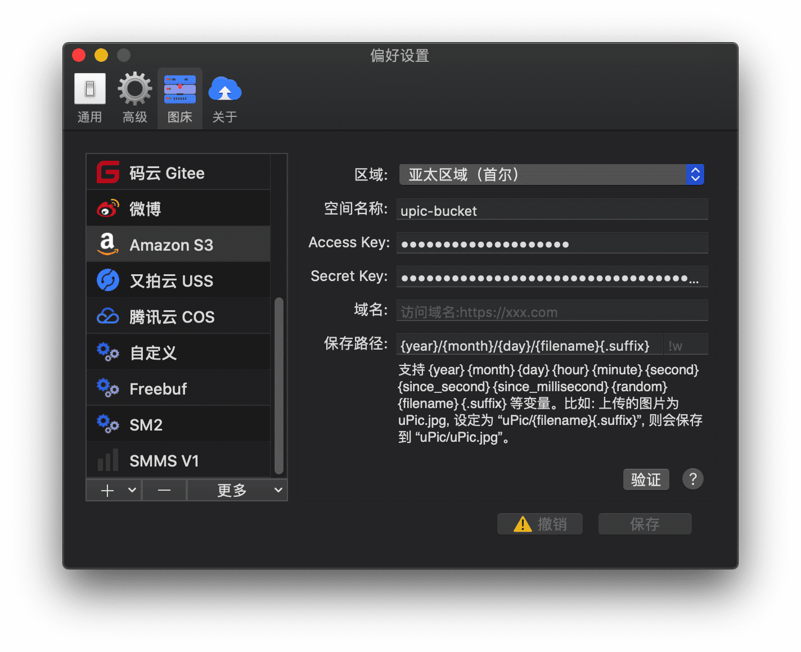

## Steps

### Create a bucket in Amazon S3

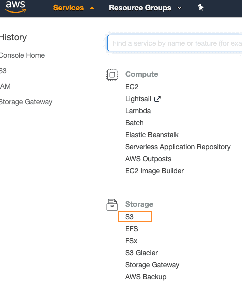
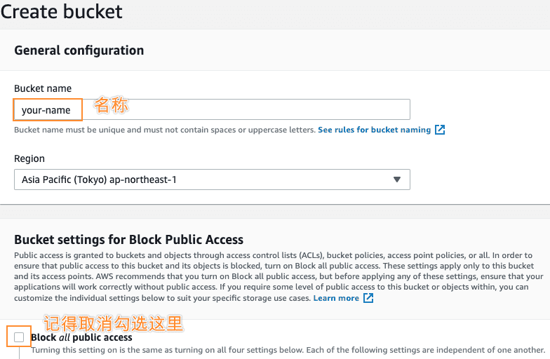

### For security, create an [IAM account](https://console.aws.amazon.com/iam/home#/users) specifically for connecting to S3 storage

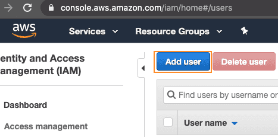
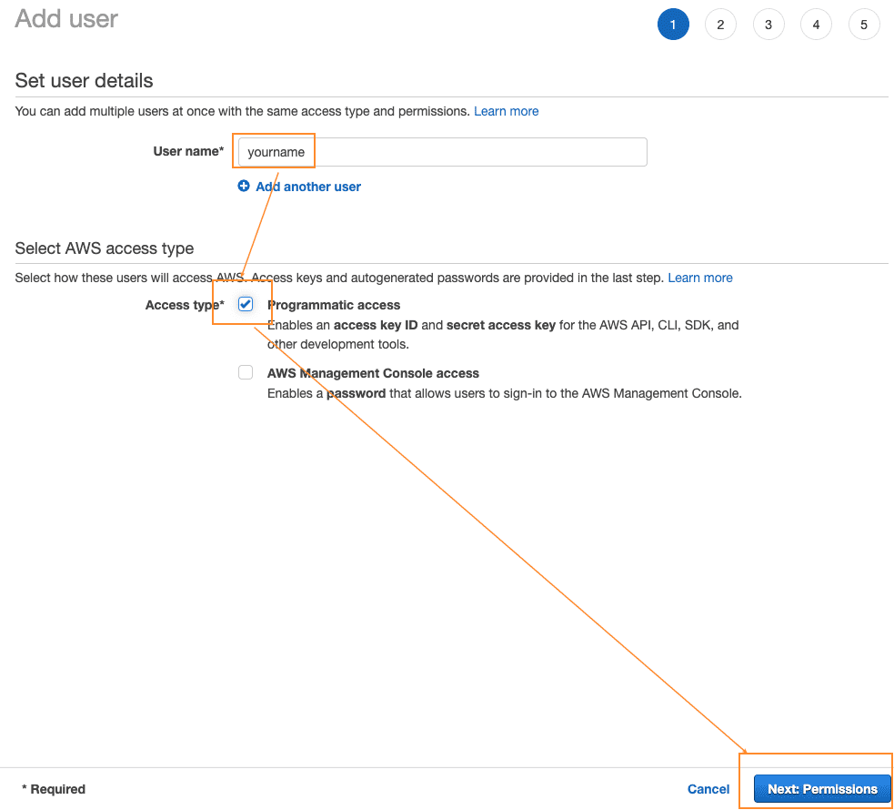

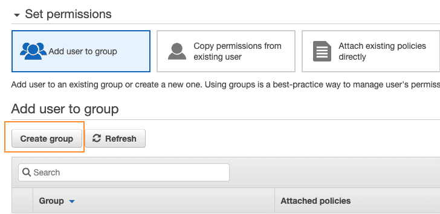

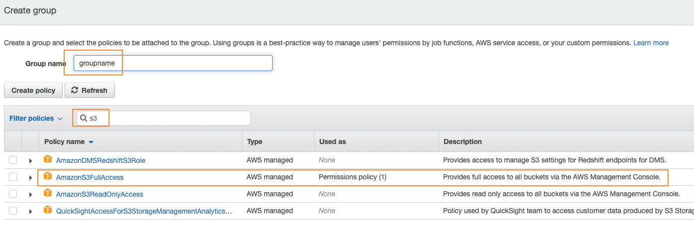

At this point the group has been created. Then, when creating the user, select this group in step 2:

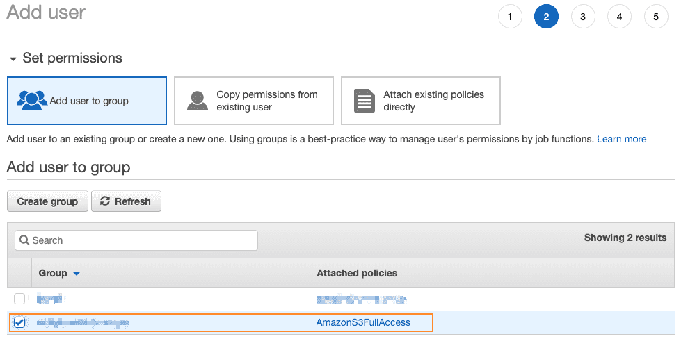

Keep clicking Next. Once the user is created, write down the Access Key ID and **Secret access key**. Remember, the Secret access key only appears here once and won't be shown again, so be sure to write it down.

### Install Homebrew (skip if already installed):

`$ /bin/bash -c "$(curl -fsSL https://raw.githubusercontent.com/Homebrew/install/master/install.sh)"`

### Download and install uPic

`$ brew cask install upic`

### Configure uPic

After installation, find uPic in Applications and open its Preferences:

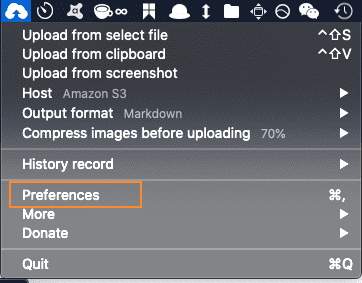

Add an Amazon S3 image host here:

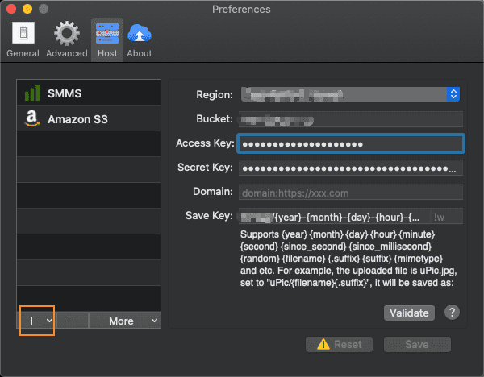

There are 6 input fields here. You don't need to fill in the Domain field yourself; Amazon will assign one to you. The other 5 are:

Region and Bucket: you can find these in the Buckets list in Amazon S3.

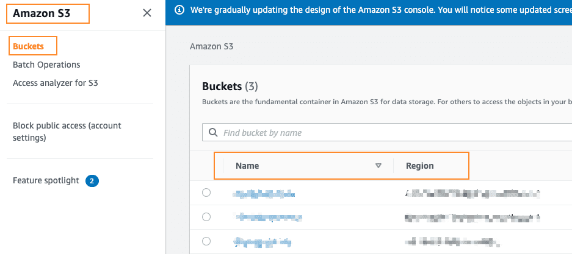

Access Key and SecretKey: you already noted them down when creating the user.

Save path: this is mainly for customizing the path and filename used when storing files. Set it according to your needs.

Detailed instructions: [https://blog.svend.cc/upic/tutorials/amazon_s3/](https://blog.svend.cc/upic/tutorials/amazon_s3/)

Finally, click validate, and a sample image will be uploaded to your Amazon S3 storage, with the link also copied to the clipboard. If you need the link in Markdown syntax, check markdown here:

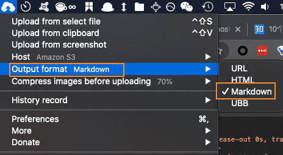

### Custom shortcuts

Set up the shortcuts you want to suit your needs:

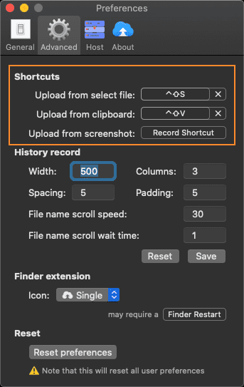

## In practice

For example, I'm writing, and suddenly I want to pick a nice image from my local files. Then I select the image and press "control + option + s" (the shortcut I set up myself). The image is automatically uploaded to S3. When I go back to the Markdown editor and press "command + v", the image is right there. Much faster, isn't it?

## About uPic

[https://blog.svend.cc/2020/01/05/upic/](https://blog.svend.cc/2020/01/05/upic/)
