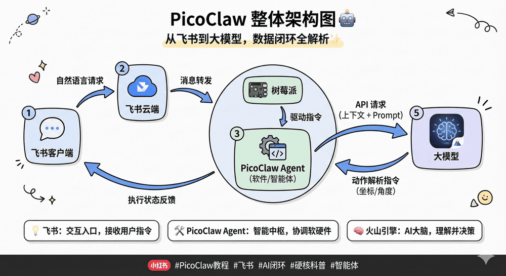
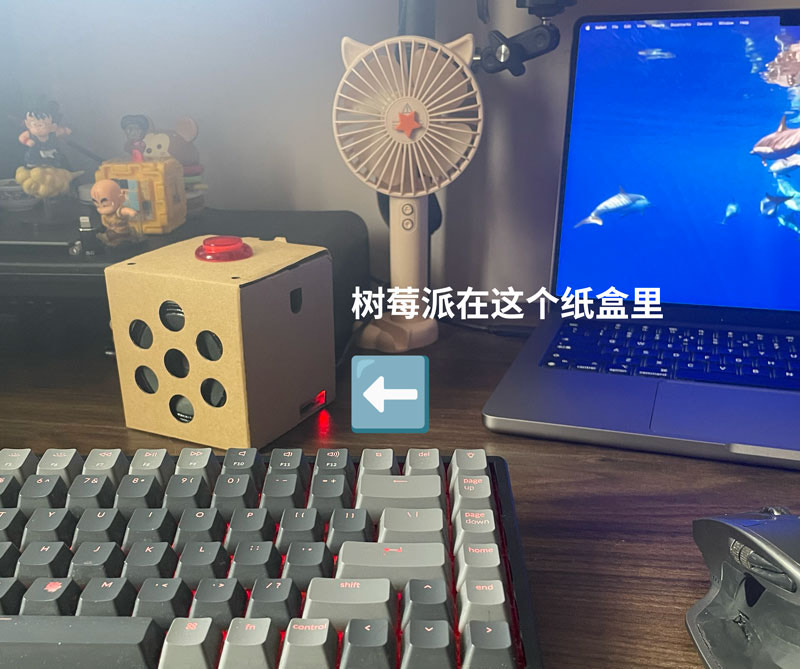
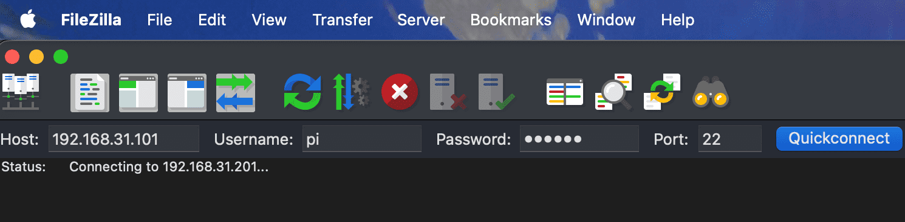
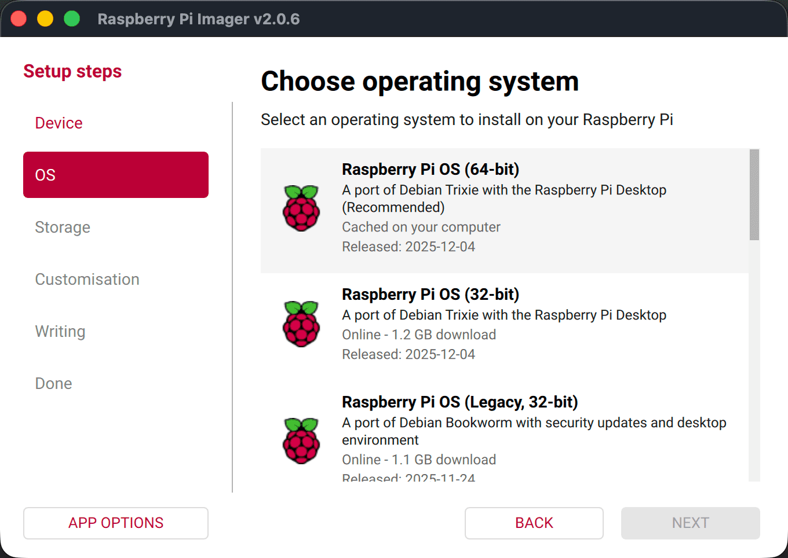
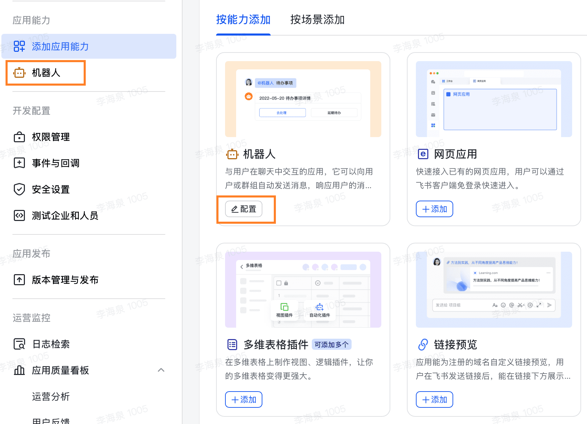
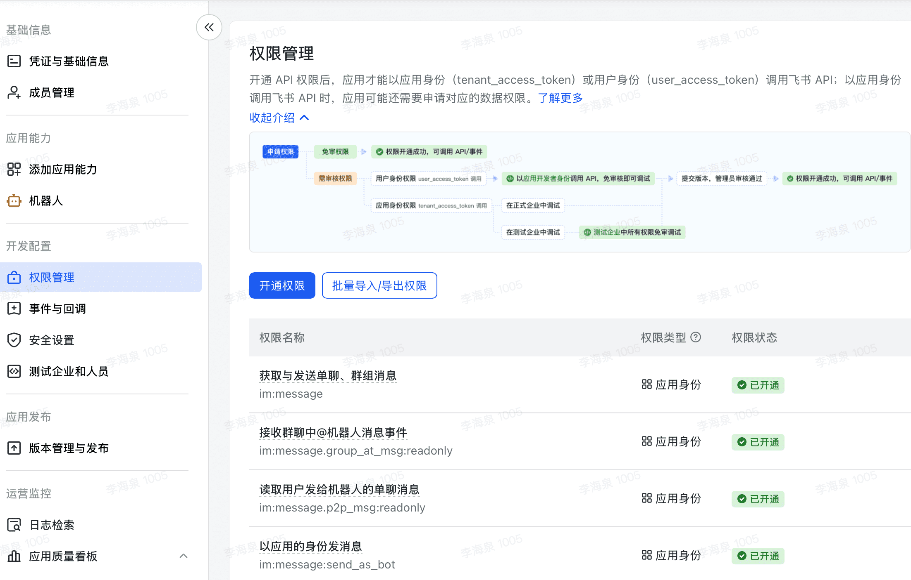
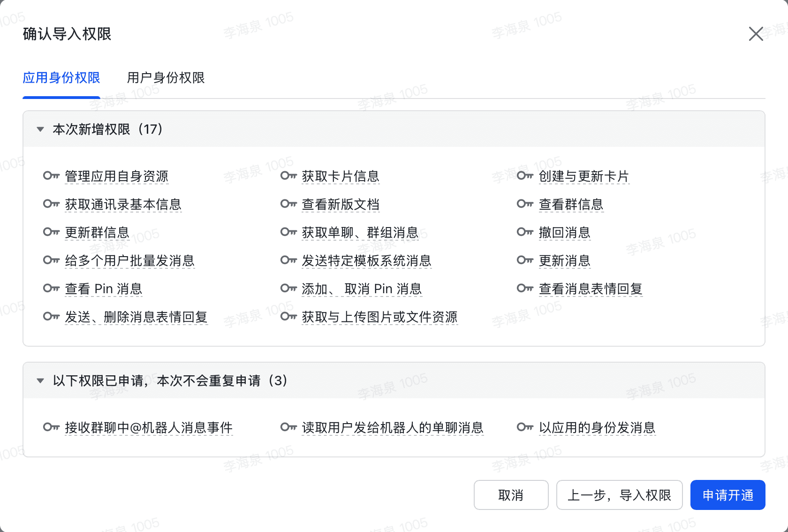

In this tutorial, we'll use a Raspberry Pi as a local server, deploy the **PicoClaw** gateway, and seamlessly connect Feishu to powerful cloud LLMs (such as Volcengine) to build a dedicated, enterprise-grade AI assistant that responds to your commands anytime, anywhere.



---

## 1. Hardware Preparation

Choosing the right hardware is the first step toward success, and it saves you from 90% of low-level errors.

- **Raspberry Pi host**: I strongly recommend a **Raspberry Pi 3B / 3B+ / 4B / 5** or **Zero 2 W**.
    
    > ❌ **Watch out**: **Absolutely do not use** the first-generation Raspberry Pi Zero W (v1.1) or Pi 1/2! Modern high-performance gateways (including Feishu's long-connection SDK) require a **64-bit (ARMv8 / aarch64)** architecture. The old Zero W's chip is 32-bit, so forcing it to run just throws an architecture-not-supported error.
    
- **Other peripherals**: A 16GB or larger MicroSD card and a stable power supply (5V 2.5A or above).
    
- **How to operate**: Although this tutorial can be done headless over SSH, **if you can, I strongly recommend plugging in a monitor and keyboard directly**, so you can actually see the boot screen and the IP address — troubleshooting is much easier that way.
    



---

## 2. Software and Environment Choices

- **Operating system**: We're using the **Raspberry Pi OS (64-bit)** desktop version, flashed with Raspberry Pi Imager v2.0.6 (A port of Debian Trixie with the Raspberry Pi Desktop), released 2025-12-04. The desktop version has more features and is friendlier to beginners. **Make sure it's the 64-bit one**.
    
- **File manager (FileZilla)**: I strongly recommend downloading and installing **FileZilla** on your computer. It's a free FTP tool that lets you connect directly to the Raspberry Pi over SFTP. With it you can double-click to open, edit and sync config files — far nicer than typing tedious commands into the terminal.
    



---

## 3. Core Deployment Process

### 3.1 Flashing the System and Booting

After flashing the system with Raspberry Pi Imager, insert the SD card into the Raspberry Pi and boot it. Connect to your home Wi-Fi and note down the Raspberry Pi's IP address (e.g. `192.168.31.101`).



### 3.2 Final Architecture Check

Run this command in the Raspberry Pi terminal (or over SSH from your computer). If the output is **`aarch64`**, congratulations — your hardware is ready to go!

Bash

```sh
uname -m
```

### 3.3 Downloading, Installing and Initializing PicoClaw

Since we're on a 64-bit system, just download the `aarch64` version of the `.deb` package and run the following in order:

Bash

```sh
# 1. Download the package (check Github's latest release for the version number)
wget https://github.com/sipeed/picoclaw/releases/download/v0.2.1/picoclaw_aarch64.deb

# 2. Install the package
sudo dpkg -i picoclaw_aarch64.deb

# 3. Initialize the working directory (generates default config)
picoclaw onboard
```

Once the init command finishes, the terminal prints the cute lobster icon and the guidance below, telling you the config folder has been created:

Plaintext

```sh
pi@raspberrypi:~ $ picoclaw onboard
🦞 picoclaw is ready!

Next steps:
  1. Add your API key to /home/pi/.picoclaw/config.json

Recommended:
  - OpenRouter: https://openrouter.ai/keys (access 100+ models)
  - Ollama:     https://ollama.com (local, free)

  See README.md for 17+ supported providers.

  2. Chat: picoclaw agent -m "Hello!"
```

---

## 4. The Ultimate Config File Walkthrough (Copy-Paste Zone)

After initialization, open **FileZilla**, connect to the Raspberry Pi, find `/home/pi/.picoclaw/config.json`, and right-click to edit it.

You can copy the configuration below — which I've verified runs perfectly — straight in and overwrite the original contents (**remember to replace the places with `XXXX`**).

_(Note: standard JSON doesn't support `//` comments, but I kept them to make things easier to understand. If you get an error when running it, delete the comments manually)_:

JSON

```json
{
  "session": {
    "dm_scope": "per-channel-peer"
  },
  "agents": {
    "defaults": {
      "workspace": "~/.picoclaw/workspace",
      "restrict_to_workspace": true,
      "provider": "openai",
      "model": "volcengine",
      "max_tokens": 32768,
      "max_tool_iterations": 50
    }
  },
  "channels": {
    "feishu": {
      "enabled": true,
      "app_id": "cli_XXXXXXXXXXXXXXXXX", // Feishu app_id
      "app_secret": "XXXXXXXXXXXXXXXXX", // Feishu app_secret
      "encrypt_key": "picoclaw",
      "verification_token": "uEWQaEyh48hQdKXXXXXXXXXXXXXXXX", // Feishu verification_token
      "allow_from": [],
      "group_trigger": {},
      "reasoning_channel_id": ""
    },
    "maixcam": { "enabled": false, "host": "0.0.0.0", "port": 18790 },
    "qq": { "enabled": false },
    "dingtalk": { "enabled": false },
    "wecom": { "enabled": false },
    "wecom_app": { "enabled": false },
    "pico": { "enabled": false }
  },
  "model_list": [
    {
      "model_name": "volcengine",
      "model": "openai/kimi-k2.5", // Pick a model name from your LLM model list
      "api_base": "https://ark.cn-beijing.volces.com/api/coding/v3", // This is Volcengine's API address
      "api_key": "11XXXX72-XXXX-XXXX-XXXX-XXXXXXXXX" // This is Volcengine's API key
    }
  ],
  "gateway": {
    "host": "127.0.0.1",
    "port": 18790
  },
  "tools": {
    "web": {
      "duckduckgo": { "enabled": true, "max_results": 5 }
    },
    "cron": { "exec_timeout_minutes": 5 },
    "exec": { "enable_deny_patterns": true },
    "skills": {
      "registries": {
        "clawhub": { "enabled": true, "base_url": "https://clawhub.ai" }
      },
      "max_concurrent_searches": 2
    },
    "media_cleanup": {
      "enabled": true,
      "max_age_minutes": 30,
      "interval_minutes": 5
    }
  },
  "heartbeat": {
    "enabled": true,
    "interval": 30
  }
}
```

### 🔑 Where to Find the Keys

1. **Feishu credentials (`app_id`, `app_secret`, `verification_token`)**: Go to the [Feishu Developer Console](https://open.feishu.cn/app/) -> your app -> the **"Credentials & Basic Info"** and **"Events & Callbacks"** pages in the left menu.
    
2. **LLM credentials (`api_key`)**: Go to the [Volcengine AI Console](https://console.volcengine.com/ark/) -> **"API Key Management"**.
    

---

## 5. Feishu developer console permissions and event configuration (⚠️ very easy to get wrong)

This is the key step that determines whether your bot can "speak". Countless people get stuck here and end up with "read but no reply". Be sure to follow these steps in order:

### Step 1: Give the "bot" a soul (extremely easy to miss!)

After creating the app, the first thing you need to do is tell Feishu that it's a bot.

In the left menu of the developer console, find **"Add app capabilities"**, then find the **"Bot"** card, and click **Add**. If you skip this step, all the permission setup that follows is wasted effort.



### Step 2: Get the Raspberry Pi "running" first

Feishu's long-connection mechanism requires: **you must start the gateway locally first; only then can the Feishu backend successfully detect your long connection!**

Run this in the Raspberry Pi terminal and leave it running:

Bash

```sh
picoclaw gateway
```

### Step 3: Enable the "long connection" subscription mode

In the Feishu developer console, go to **"Events and callbacks"** in the left menu -> find **"Subscription method"**, and click the small edit icon next to it.

Select **"Receive events via long connection (recommended)"**, then save.

### Step 4: Configure exactly 4 core permissions (no admin review needed)

In the left menu, go to **"Permission management"**. To get basic direct-message and group @-mention replies working, while trying to avoid triggering the complicated enterprise admin approval process, search for and enable only these 4 permissions (all under "app identity"):

1. **`im:message`** (get and send direct and group messages)
    
2. **`im:message.group_at_msg:readonly`** (receive @bot message events in group chats)
    
3. **`im:message.p2p_msg:readonly`** (read direct messages users send to the bot)
    
4. **`im:message:send_as_bot`** (send messages as the app)
    
    
    For convenience, you can also copy the JSON below and import the permissions in bulk, which saves you from repeatedly applying for and enabling them:
    
```JSON
{
  "scopes": {
    "tenant": [
      "contact:contact.base:readonly",
      "docx:document:readonly",
      "im:chat:read",
      "im:chat:update",
      "im:message.group_at_msg:readonly",
      "im:message.p2p_msg:readonly",
      "im:message.pins:read",
      "im:message.pins:write_only",
      "im:message.reactions:read",
      "im:message.reactions:write_only",
      "im:message:readonly",
      "im:message:recall",
      "im:message:send_as_bot",
      "im:message:send_multi_users",
      "im:message:send_sys_msg",
      "im:message:update",
      "im:resource",
      "application:application:self_manage",
      "cardkit:card:write",
      "cardkit:card:read"
    ],
    "user": [
      "contact:user.employee_id:readonly",
      "offline_access","base:app:copy",
      "base:field:create",
      "base:field:delete",
      "base:field:read",
      "base:field:update",
      "base:record:create",
      "base:record:delete",
      "base:record:retrieve",
      "base:record:update",
      "base:table:create",
      "base:table:delete",
      "base:table:read",
      "base:table:update",
      "base:view:read",
      "base:view:write_only",
      "base:app:create",
      "base:app:update",
      "base:app:read",
      "board:whiteboard:node:create",
      "board:whiteboard:node:read",
      "calendar:calendar:read",
      "calendar:calendar.event:create",
      "calendar:calendar.event:delete",
      "calendar:calendar.event:read",
      "calendar:calendar.event:reply",
      "calendar:calendar.event:update",
      "calendar:calendar.free_busy:read",
      "contact:contact.base:readonly",
      "contact:user.base:readonly",
      "contact:user:search",
      "docs:document.comment:create",
      "docs:document.comment:read",
      "docs:document.comment:update",
      "docs:document.media:download",
      "docs:document:copy",
      "docx:document:create",
      "docx:document:readonly",
      "docx:document:write_only",
      "drive:drive.metadata:readonly",
      "drive:file:download",
      "drive:file:upload",
      "im:chat.members:read",
      "im:chat:read",
      "im:message",
      "im:message.group_msg:get_as_user",
      "im:message.p2p_msg:get_as_user",
      "im:message:readonly",
      "search:docs:read",
      "search:message",
      "space:document:delete",
      "space:document:move",
      "space:document:retrieve",
      "task:comment:read",
      "task:comment:write",
      "task:task:read",
      "task:task:write",
      "task:task:writeonly",
      "task:tasklist:read",
      "task:tasklist:write",
      "wiki:node:copy",
      "wiki:node:create",
      "wiki:node:move",
      "wiki:node:read",
      "wiki:node:retrieve",
      "wiki:space:read",
      "wiki:space:retrieve",
      "wiki:space:write_only"
    ]
  }
}
```



### Step 5: Subscribe to message events (so the bot can "hear")

Go back to the **"Events and callbacks"** page and click the **"Add event"** button on the right.

Search for and select **`Receive messages`** (`im.message.receive_v1`).

### Step 6: Publish a version (the crucial final step!)

**Feishu's strict rule: any permission or event you change will not take effect until you publish it!**

In the left menu, go to **"Version management and release"** -> click **"Create version"** -> enter any version number (e.g. 1.0.0) -> save, then click **"Request release"**.

---

## 6. Running as a daemon (so it never goes offline)

The gateway you're running in the terminal now will disconnect as soon as you close the terminal window. We need to turn it into a background "guardian" on the Raspberry Pi.

First press `Ctrl + C` in the Raspberry Pi terminal running `picoclaw gateway` to stop it. Then copy the whole block below in one go and press Enter to create a system service:

Bash

```
sudo tee /etc/systemd/system/picoclaw.service << 'EOF'
[Unit]
Description=PicoClaw Gateway Service
After=network-online.target
Wants=network-online.target

[Service]
Type=simple
User=pi
WorkingDirectory=/home/pi
ExecStart=/usr/bin/picoclaw gateway
Restart=always
RestartSec=10

[Install]
WantedBy=multi-user.target
EOF
```

**Activate and start the service (run these in order):**

Bash

```
sudo systemctl daemon-reload
sudo systemctl enable picoclaw
sudo systemctl start picoclaw
```

From now on, if you want to see the AI's runtime logs, just run:

Bash

```
journalctl -u picoclaw -f
```

---

## 7. Troubleshooting common problems (FAQ)

**Q: When I log in via SSH, I get `Host key verification failed` and a screenful of uppercase warnings?**

- **Cause**: You may have assigned the Raspberry Pi an IP address that was previously used by another device, and your computer's security mechanism thinks it has encountered an impersonator.

- **Fix**: In your **computer's terminal (note: not on the Raspberry Pi)**, run `ssh-keygen -R <the Raspberry Pi's IP address>` to remove the old entry.

**Q: When I start the gateway, I get `feishu channel is not supported on 32-bit`?**

- **Cause**: The Raspberry Pi system was installed incorrectly (as a 32-bit system), or your Raspberry Pi board is too old (such as an old Zero W) and doesn't support 64-bit at all.

- **Fix**: Switch to a 3B or newer board and re-flash a 64-bit system with Imager.

**Q: The terminal shows `HEARTBEAT_OK`, but messages sent in Feishu get no response, and the terminal shows no `receive` logs either?**

- **Cause**: The LLM API connection works, but the Feishu server isn't pushing messages to you.

- **Fix**: Go back to **Section 5** of the tutorial and focus on checking whether you added the "receive message" event, and **be sure to publish a new version**.

---

_(End of article)_
