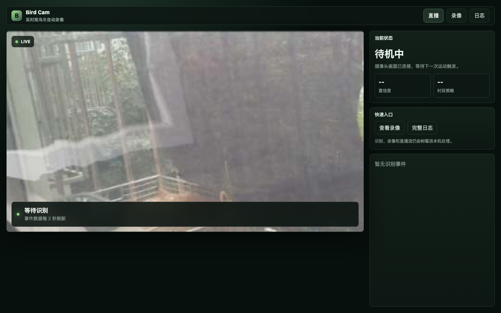
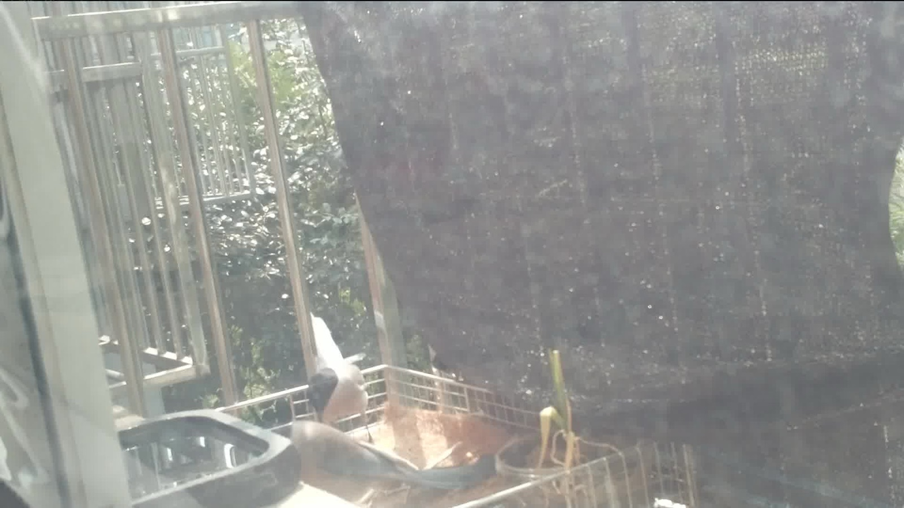
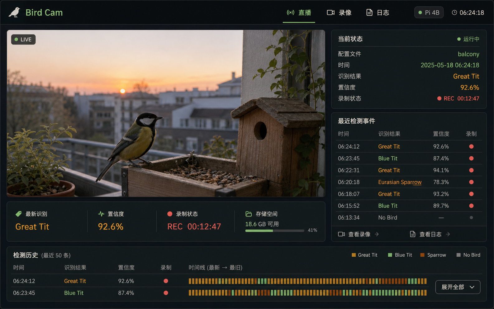
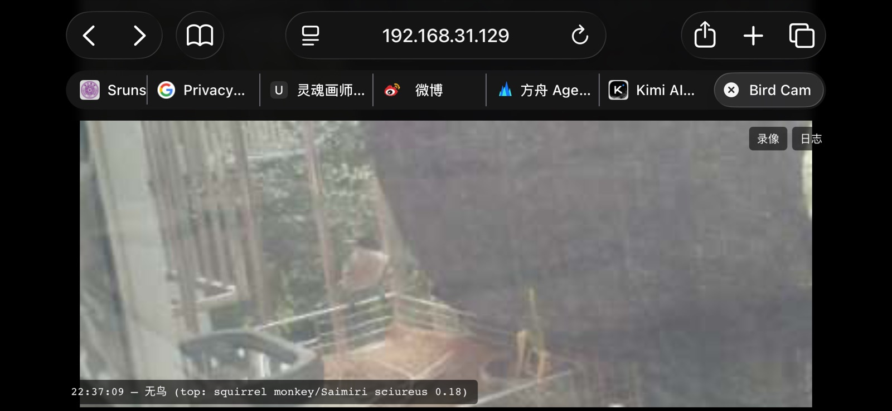
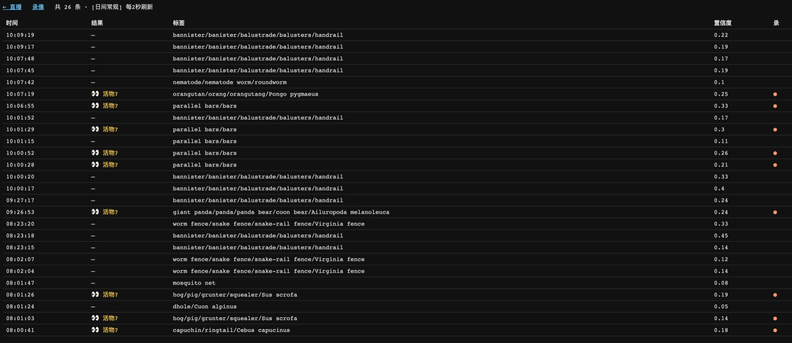
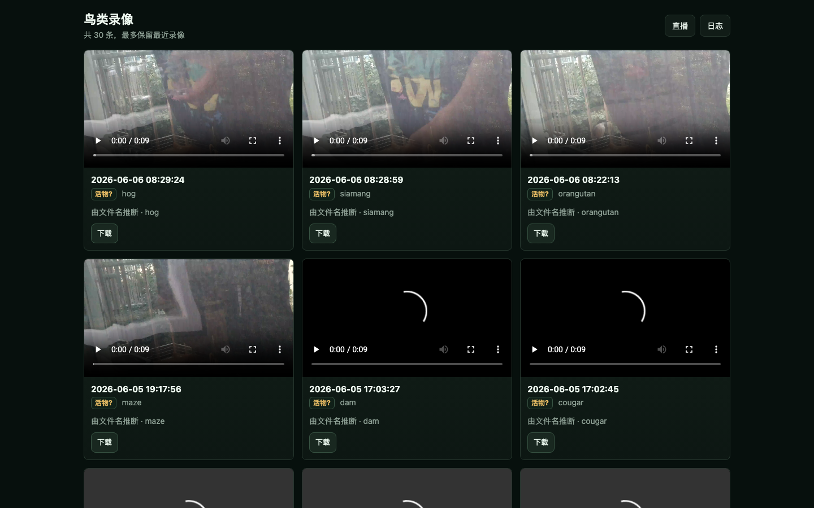

I live on the 4th floor, and birds often come and perch outside the window. Sometimes they stay just a few seconds, sometimes they hop back and forth along the railing. I've loved watching animal documentaries since I was a kid, and now my kid has inherited that gene too. We both want to know when these birds come and how many times they show up.

So I dug out a [Google AIY Vision Kit](https://aiyprojects.withgoogle.com/vision/) that had been gathering dust for a long time: a Raspberry Pi Zero, a Vision Bonnet, and a Raspberry Pi camera. It's the vision version of that 2017 wave of "cardboard-box AI kits," with a vision processing chip on the board that can run image classification locally.

The goal was simple: sit quietly watching the window at low power, and when something lands in the designated area, automatically record a 10-second video; when I open the browser, I can see the live feed, recent recognition results, and the list of recordings.

Here's what it looks like now:



Here's what it can do now:

* When a living thing lands in the windowsill area, automatically record a 10-second 1080p video;
* Keep only the most recent 30 recordings, deleting old ones automatically;
* The web page shows the live feed, current recognition status, recent events, and the recording list;
* The recognition log keeps the most recent 1000 entries, and they survive a restart;
* You can preview recordings right on the page, or download them;
* All inference runs locally, without depending on any cloud service.

The azure-winged magpie below is one it caught itself.



## The hardware isn't new, but it's just enough

This hardware is very old:

* A Raspberry Pi Zero, which is very slow;
* A Google AIY Vision Bonnet that runs the vision model;
* A Raspberry Pi camera, pressed up against the window glass, looking outside;
* The OS is still an old image from around 2017.

Back then, Google made several kinds of models for the Vision Kit. The official introduction mentioned demos such as MobileNets object recognition, expression recognition, and person/cat/dog detection; the [AIY models page](https://aiyprojects.withgoogle.com/models/) also lists the model types the Vision Kit supports. In my image, the one that actually runs reliably is a general ImageNet 1000-class classification model based on [MobileNet](https://arxiv.org/abs/1704.04861).

I originally wanted to use a model related to the [iNaturalist dataset](https://openaccess.thecvf.com/content_cvpr_2018/html/Van_Horn_The_INaturalist_Species_CVPR_2018_paper.html), since it's better suited to nature observation — it's aimed at real-world photos of plants and animals. Unfortunately, the toolchain for this old image and old Bonnet is too old, and after all the fiddling I ended up back with the general classification model.

That also determined the story that follows: the old model isn't very good at recognizing birds — but that same trait is what makes the results more fun later.

## First, make the camera take it easy

A single Pi Zero doing live streaming, recording, and AI inference at the same time will easily bring itself to its knees. My approach is to split the tasks:

```text
When idle:
  Run only one 640x360 low-bitrate H.264 stream, using motion vectors to judge whether the ROI has movement

When there's movement:
  Capture one 1080p original frame
  Crop out the windowsill/landing area
  Throw it to the Vision Bonnet for classification

When it's judged that recording is needed:
  Exclusively occupy the camera to record 10 seconds of 1080p
  Package it into mp4 with ffmpeg
  Return to idle detection

When someone opens the web page:
  Temporarily open one 384x216 MJPEG preview
  Close it when nobody's watching
```

Detection and preview are two separate paths. The live feed on the web page is very blurry, but what's actually fed to the model is a crop of the 1080p original frame. That matters, because at first I also assumed the problem was the poor quality of the live feed.

The core detection logic is roughly like this:

```python
camera.capture(buf, format='jpeg', use_video_port=True, splitter_port=0)
crop = Image.open(buf).crop(ROI)
classes = image_classification.get_classes(inf.run(crop), max_num_objects=5)
```

The web page is just a viewing window; it isn't part of the decision. The decision is made on the cropped landing area.

## It really did mistake a bird for a sloth

Now for the most interesting part.

At first I used a very intuitive rule: if a bird word appears in the model output, like `junco`, `sparrow`, `magpie`, and the confidence exceeds the threshold, then record.

In practice it worked badly. Later I went through the logs and found that the labels were very consistent, both for empty scenes and for scenes with a bird:

| Scene | Common top judgments from the model |
|---|---|
| Empty railing | `handrail`, `bannister`, `worm fence` |
| Glass / window screen / reflection | `mosquito net`, `window screen` |
| Bird landed | `capuchin`, `langur`, `squirrel monkey`, `hog`, `orangutan` |

In other words, it often mistakes birds for monkeys, pigs, and orangutans — if these animals really appeared outside my 4th-floor window in Beijing, I'd definitely be dreaming, haha.

But if I changed the question to "is this still an empty railing?", it turned out to be very stable.

So I changed the logic to this:

```python
STRUCTURE_WORDS = {
    'bannister', 'handrail', 'fence', 'window', 'screen',
    'mosquito', 'net', 'grille', 'picket', 'pole'
}

def is_structure(label):
    return bool(tokens(label) & STRUCTURE_WORDS)

occupied = top_score >= floor and not is_structure(top_label)

if bird_word_hit or occupied:
    record_clip()
```

This is the real turning point of the whole system. It doesn't need to recognize "this is an azure-winged magpie." It only needs to notice "this area no longer looks like the usual empty railing," and I record it.

It sounds a bit off, but it works well in practice. Missing a clip is a permanent loss; a false trigger at most means I skip one clip when I'm going through them. For a birding camera, I'd rather err on the side of recording too much.

## Put the AI's judgment on the web page

Tuning used to be painful because all I had was the logs. Once I hooked the live status and the history onto the web page, tuning got a lot easier.

This is a concept image I had AI generate first, to set the direction for the dashboard: dark theme, image first, status concentrated on the right side.



The final page didn't copy the fake data and decorations from the concept image; it kept only the information structure: the live feed on the left, and on the right the current status, confidence, time-of-day profile, quick links, and recent events.


The live status falls into three categories:

* Green "bird": the model actually listed a bird name among its candidates;
* Yellow "living thing?": the model didn't report a bird, but the top label doesn't look like an empty railing;
* Gray "no bird": still an empty scene, like a railing, a window screen, or a reflection.

The old version of the page was plainer, but you could already see this idea:



The log page is another key piece of the puzzle. It refreshes every 2 seconds and lists recent recognition events. Later I also changed the log from an in-memory ring buffer to a JSONL file on disk, keeping at most 1000 entries. That way the tuning context is still there after the service restarts.



## The recordings page: first you can watch, then you can download

At first the recordings page was just a list of file names. Later I turned it into a card-style clip library: each video can be previewed directly, with the time, recognition summary, and a download button shown below.



Only the most recent 30 recordings are kept. Each time a new recording is written, the program deletes older files by modification time; it also cleans up once when the service starts. So a restart doesn't affect this limit.

## Adjusting sensitivity by time of day

Birds don't show up evenly through the day. They're more active at dawn and dusk, and at night it's basically noise. So I gave it a simple time-of-day profile:

```python
PROFILES = {
    'dawn':  (0.08, 5,  'high activity at dawn'),
    'dusk':  (0.08, 5,  'high activity at dusk'),
    'day':   (0.12, 8,  'normal daytime'),
    'night': (0.22, 15, 'conservative at night'),
}
```

At dawn and dusk the threshold is a bit lower and the cooldown a bit shorter; at night the threshold is higher, so wind moving the curtain or glass reflections don't set off recordings. This strategy is pretty crude, but it fits how I actually use it.

## If you want to build one too

This approach doesn't have to use the AIY Vision Kit. Any "Raspberry Pi + camera + a model that can run classification or detection" can replicate it. The only difference is whether inference runs locally or is thrown to another device or the cloud.

I think the key isn't how powerful the model is, but these few things:

1. First determine a fixed ROI. Don't look for targets across the whole frame; just watch a small area like a feeder, railing, or nest entrance.
2. Use cheap motion detection when idle; don't run the model all the time.
3. When there's movement, capture a high-definition frame, crop the ROI, and run classification.
4. Don't rush to ask "is it a bird." First collect what empty scenes get recognized as, then change the rule to "does it still look like an empty scene."
5. Display the model output. Web page, logs, JSON, anything — don't tune blind.
6. Separate recording and live streaming. The preview can be blurry; the recording needs to be clear.
7. Set a limit on storage. Mine is 30 recordings and 1000 log entries.

Right now this program is just one Python file plus a long-running service, with no database, no cloud account, and no complicated frontend. It isn't smart, but every morning it can tell me whether anything came to the window last night.

It still calls birds sloths. My kid's English is better than mine, and she caught on right away; I had to ask her to translate it for me before I got it~

But anyway, detecting something alive is usually good news.

Youke Lili, adding a little sunshine to your life~
