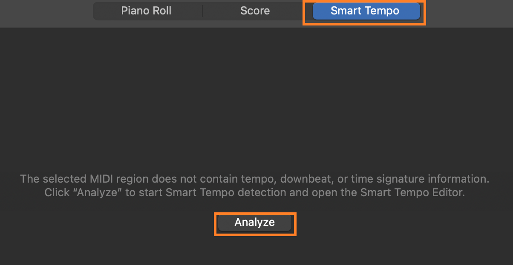
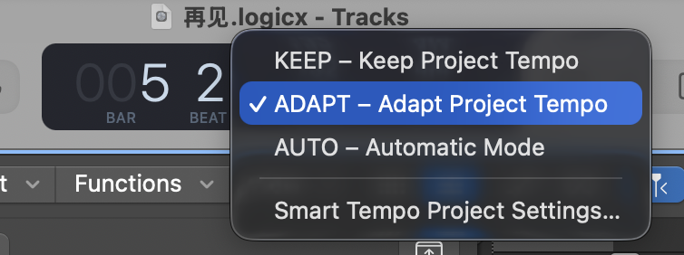
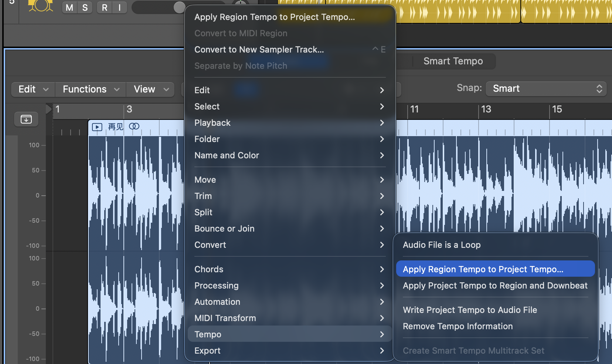

In Logic Pro, to make the software's grid and beats follow exactly a song you recorded with a non-standard tempo (free tempo / recorded without a metronome), the core idea is to let the software adapt to your audio (let the grid follow the audio) rather than forcing your audio straight.

The quickest and smartest solution is to use Logic Pro's Smart Tempo feature, which can analyze the downbeats in the audio and automatically generate a fluctuating tempo track to match your recording. If you need more precise manual fine-tuning, use Beat Mapping. Here are the steps:

1. Import the audio: Drag the audio file you recorded onto an empty audio track in Logic Pro.

2. Trim the start: Cut off the extra empty space at the front of the audio and align the audio's start point with the start of the grid (for example, beat 1 of bar 1).

3. Set the follow mode: Double-click the audio region to open the editor, click the Smart Tempo tab, then click Analyze.

4. Switch to Adapt: In the tempo display area at the top of the LCD (or in the Smart Tempo project settings), change the Project Tempo Mode from "Keep" to Adapt.

5. Apply to the project: Right-click the audio region and choose Tempo -> Apply Region Tempo to Project Tempo. Logic will automatically analyze your recording and build a dedicated tempo track for it (the Tempo Map).

6. Turn on the metronome and have a listen. The metronome will now speed up and slow down along with your recording, matching it perfectly.
