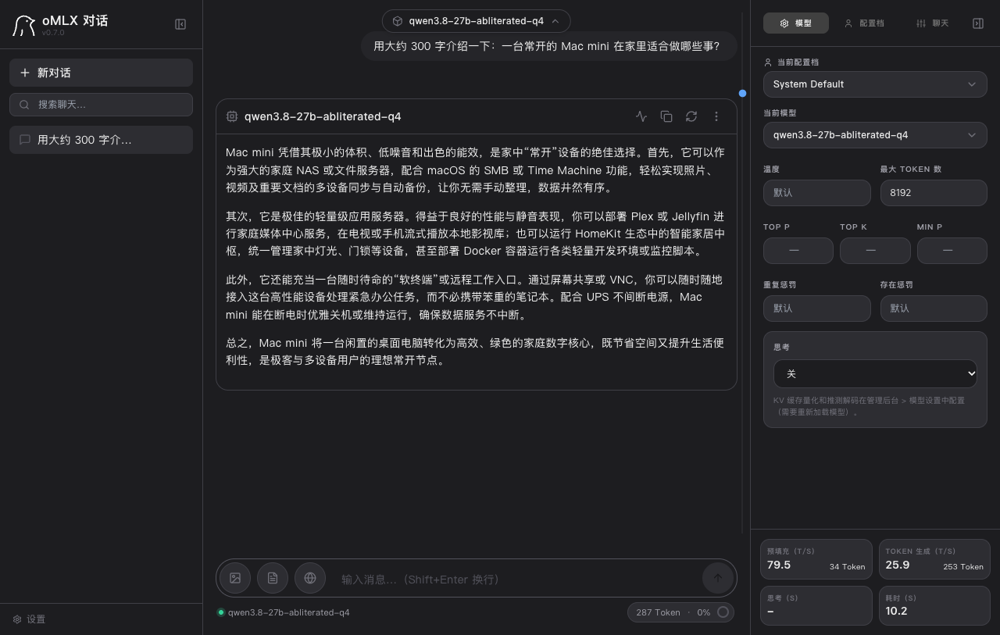
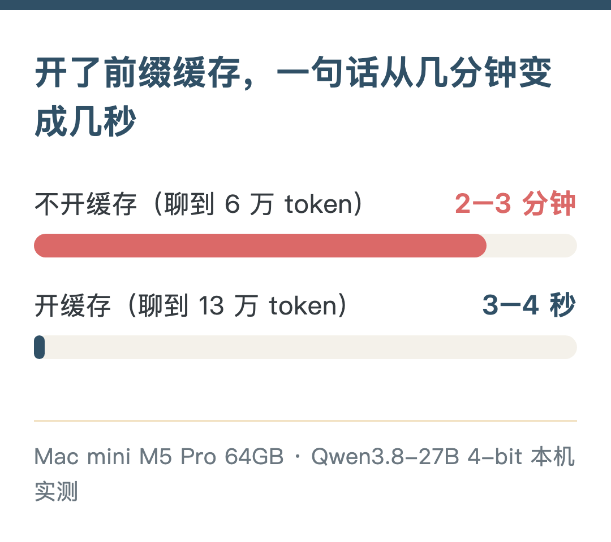
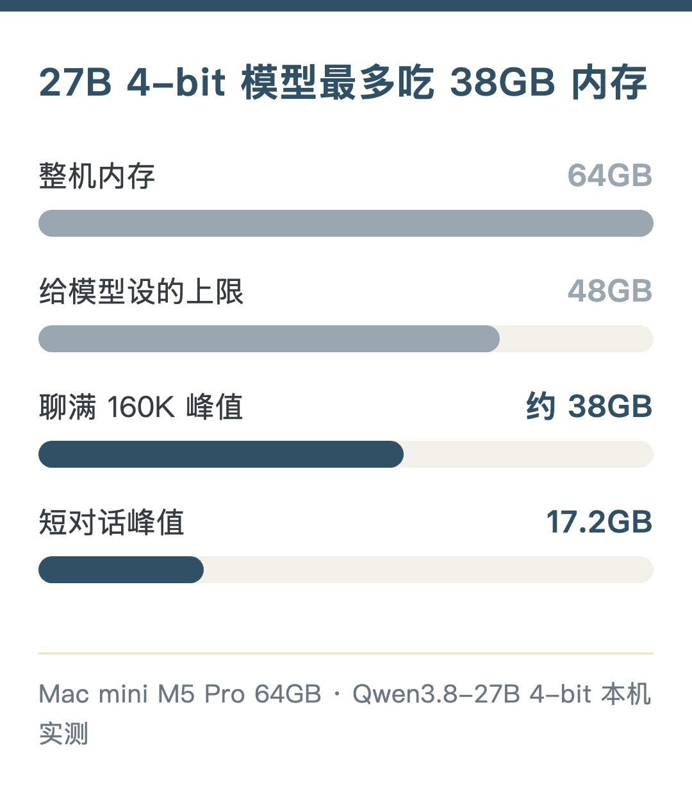

After using cloud AI for a while, one thing has kept distracting me: quota. There's a cap every 5 hours, and another every week. Halfway through a task, it says I'm out of quota and I just have to wait. Pretty annoying. It also gets stuck when the network is bad. And there are some questions I'd rather not send to the cloud, but I had no other way.

So this time I seriously tried running a local large model on my Mac mini at home. I was after two things: token freedom — use as much as I want — and no censorship, fewer refusals.

I spent three days testing it. It works, and it can run 24/7. Once a conversation reaches 130k tokens, a reply still comes in 3–4 seconds. When the cloud quota runs out, it takes over automatically.

Below: how to configure it, how the settings differ, and if you're thinking of buying one, how to choose memory.

## My machine and how I use it

Mac mini, M5 Pro, 20-core GPU, 64GB memory, 2TB disk. It's normally the home server and also runs an AI assistant, a media library and video generation, so the model can't take up all the memory. So I set a 48GB cap on the model process; if it goes over, it stops.

The model is Qwen3.8-27B, a 27-billion-parameter model. I tried two engines, oMLX and MTPLX, and kept oMLX.

## How fast it actually runs

Here's what daily use feels like:

| Scenario | How long you wait |
| --- | --- |
| Already 130k tokens into a chat, ask one more thing | 3–4 seconds to start answering |
| Chat at 210k tokens | 4–7 seconds |
| Feeding in 10k+ characters of new material at once | Tens of seconds to over a minute |
| Output speed | 20–27 tokens per second, short answers up to 35.8 |

While writing this, I opened oMLX's built-in web chat and tested again. A one-line "hello" reply came at 35.8 tokens per second, the fastest I've seen; asking it to write a ~300-character intro gave 25.9 tokens per second, 10.2 seconds total from sending to finishing.

Peak memory for the whole process was about 38GB, and it didn't use swap. After a service restart, the previous conversation cache was still there, so I could keep chatting without re-reading.

This speed is usable for everyday work. It depends on one setting: prefix caching.

## The most important setting: prefix caching

With caching off, every question makes the model read the entire history from the beginning. Once the chat reaches 60k tokens, each question takes 2–3 minutes. In my first round of testing, I measured "how long it takes to read in 260k tokens at once." The first token took 18 minutes — I almost concluded that long local conversations were unusable.

With caching on, it only reads the new part. That's where the 3–4 seconds come from.

Caching matters more than changing quantization or turning on acceleration. That was my biggest takeaway this time. I put the cache on the SSD, capped at 100GB, which holds about four or five long conversations at full length.

## How the settings differ

### 4-bit is enough

The model can be compressed to different precisions; the fewer bits, the less memory it uses. I compared 4-bit (Q4) and 8-bit (Q8) on 63 questions:

| | Structured questions | Code | Peak memory (short chat) |
| --- | --- | --- | --- |
| Q8 | 30/42 | 8/8 | 29.0GB |
| Q4 | 34/42 | 7/8 | 17.2GB |

Q4 is no worse than Q8. It got one fewer code question right; tool calling is 3/3 for both. Reading in 260k tokens at once, Q4 reads 237 tokens per second with a 36.1GB peak; Q8 reads 160 per second with a 45.4GB peak. oMLX has dedicated acceleration for 4-bit, so Q4 is both faster and uses less memory. I also let Q4 run continuously for two hours: 13 questions all correct, memory steady at 36GB.

### Uncensored version: same capability, benefit not measured

I compressed both the uncensored and official versions to Q4. On the same set of questions, scores were almost identical, and speed was about the same too (16.61 and 16.70 tokens per second).

But on the few sensitive questions I prepared, both versions answered normally, so I couldn't measure how much the uncensored version actually helps this time. According to the model author's notes, it "reduces refusals" rather than "never refuses"; with thinking mode on, about 8.7% still get refused.

### MoE model: fast, but memory-hungry

I also tried a 35B MoE model. It only uses 3B parameters at a time, so it's fast: 56 tokens per second output on short chats, 3–4 times the config above. But the 8-bit version's weights alone take about 35GB, peak hit 47GB, and long conversations were unstable. On a 64GB machine, I ruled it out.

## The config to copy

Engine: oMLX 0.7.0; model: Qwen3.8-27B uncensored 4-bit. Below, each row gives the setting and how to write it in oMLX:

| Item | Setting | In oMLX |
| --- | --- | --- |
| Prefix cache | On, on SSD, 100GB cap | Startup args `--paged-ssd-cache-dir`, `--paged-ssd-cache-max-size 100GB` |
| MTP acceleration | On | Model setting `mtp_enabled: true` |
| Thinking mode | Off | `enable_thinking: false` |
| Context window | 160K | `max_context_window: 163840` |
| Memory cap | 48GB | Startup arg `--memory-guard-gb 48` |
| Concurrency | 1 request | Startup arg `--max-concurrent-requests 1` |
| Idle unload | 30 minutes | `ttl_seconds: 1800`, reloads in about 4 seconds next time |

Two things to watch:

**MTP has to be imported first.** This 4-bit model's MTP weights are in a separate file, and oMLX can't read them by default; you need oMLX's built-in import function (`import_mtplx_sidecar`) to sort it out. It modifies the model directory directly, so copy it first with `cp -cR`. Worth the trouble: at 130k tokens, output went from 10.6 to 26 tokens per second.

**4-bit has dedicated read-in acceleration (oQ A8)**, about 1.4× faster, and I have it on. Q6 and Q8 can't use it.

I tried these and don't recommend turning them on:

- **KV cache quantization**: both read-in and output became 2–3 times slower.
- **ANE prefill**: 30% slower instead, uses 16GB more memory, and disables the oQ A8 above.
- **In-memory hot cache**: immediately blows up memory usage.
- **256K window**: it can finish, but it sits right at the 48GB cap with no headroom.

I also hooked it into the AI assistant Hermes as a backup model: when the cloud is rate-limited, out of quota or offline, it switches to local automatically. The cost is that every new conversation's first message waits about 20 extra seconds, because the assistant always carries a big chunk of instructions, about 14k tokens. After that it's fast.

## Where I use it from

I use the same model from four places. oMLX provides both OpenAI- and Anthropic-format APIs, so common tools can connect. The speed difference isn't in the model; it's in how much fixed content each request has to read first:

| Entry point | First message of a new chat | Good for |
| --- | --- | --- |
| oMLX's built-in web chat | About 1.4 seconds | Pure chat, writing, questions I don't want going to the cloud |
| Hermes (used in WeChat and Feishu) | About 20 seconds | Daily assistant; switches over automatically when the cloud is unavailable |
| Claude Code | About 35 seconds | Simple coding, when I don't want code leaving the machine |
| Codex | About 54 seconds | Same as above |

As the same conversation continues, every entry point hits the cache and the gap shrinks. But honestly, the 27B 4-bit model is clearly worse than cloud models at multi-file coding; I only use it for simple work.

It's also convenient on a laptop. I use Tailscale to access it from my own devices; only my devices can connect, and it works when I'm out.

## Can it stay on all the time

Yes. But a few things to know.

**Power**: inference draws 50–60W more than idle, peaking around 80W. When the model is idle it draws almost nothing extra, and after 30 minutes of no use it unloads automatically. I spend most of my time typing, and at one or two hours of cumulative inference a day, that's a few dozen kWh more per year.

**Temperature**: the chip rises to 75–77°C in 1–2 minutes and stays there; no thermal warnings, no throttling.

**Disk**: writes come mainly from the cache, about 140MB per 1000 tokens of new content. With very heavy use, that's about 28GB a day, around 10TB a year. Mainstream 2TB SSDs are rated for several hundred TB of writes or more, so ten years is no problem.

**Can't run alongside other big tasks**: this machine also runs video generation, peaking around 22GB; add the model's 38GB and it goes over, so I can only run them at different times.

## If you want to buy, how to choose memory

I only tested the 64GB machine. Below, everything except 64GB is extrapolated from measured memory peaks, for reference only; before buying, better to check real-world tests of the same config.

| Memory | My judgment |
| --- | --- |
| 64GB | Measured: 27B 4-bit and 160K long conversations both work, and other services can run alongside; it just can't run at the same time as big tasks like video generation |
| 48GB | Extrapolated: 27B 4-bit runs, and short chats peak at only 17GB; but when long conversations reach 160K, the model peaks around 38GB, and leaving headroom for the system gets tight, so the context may need to be shortened |
| 32GB | Extrapolated: with 27B 4-bit, short chats are worth a try, but there isn't much room for long conversations and it's hard to run other services alongside; a smaller model is more realistic |
| 24GB and below | Extrapolated: the 27B tier isn't realistic, go straight to a small model |

About the new M6 Mac mini: Apple's published configurations top out at 32GB of memory, so based on the estimates above, it can only fall in the 32GB tier. There are no real tests yet of how much faster the new chip is or whether the engine is optimized for it, so I won't draw conclusions.

My take: for local large models, memory matters more than chip tier. The chip decides speed; memory decides whether it runs and how long you can chat. Don't skimp on the disk either; cache and models both take space.

If you mainly use the cloud and occasionally want an unlimited backup that never leaves the machine, a Mac mini with a lot of memory can already do that. I hope these numbers help with your config choice.
