What's the key to choosing a Mac mini? The CPU already crushes everything in its class, and you can add storage yourself later; but **the memory is soldered to the motherboard**, and how much memory you get is closely tied to what you use it for as a server.

Buy too little and the models you want to run later won't fit, so you have to replace the machine. Buy too much and you're using a sledgehammer to crack a nut. And the gap between configurations can be over ¥10,000. If you're thinking of buying one too: how much memory should you get, which chip, and roughly how much will it cost?

Below, first, the recommended configurations for different uses; the full configuration and price tables are at the end of the article.

## Recommendations first

1. Just a home server, **no large models: 16GB**. the M6 16GB+512GB is ¥8,499, or a used M4 for ¥3,000–4,000.
2. **Want to try local models: M6 32GB**, from ¥9,999. 27B runs but very slowly; MoE models are fast and good enough for writing articles, but overall quality is not as good as dense models.
3. Want to use 27B daily, **long conversations: M5 Pro 48GB**, ¥19,749.
4. Also want to run other services alongside, or want to try **larger models** later: **M5 Pro 64GB**, from ¥20,499.
5. Around ¥20,000 and you care more about speed: **base Mac Studio at ¥19,999**, cheaper than the mini 64GB but with only 36GB of memory. With a budget of ¥27,000, the Studio 64GB is better value than the mini 64GB.

Once the use is settled, **512GB of storage is enough**; 256GB is really too small. You don't have to go for the bigger capacity all at once — spend what you save on an external drive later, or have a professional service mod the internal drive.

For local models I'll use the hottest model right now, Qwen3.8-27B, as the example; the engine is oMLX. My machine is an M5 Pro 64GB, which has the most headroom, so I can measure how much memory the model actually uses under different settings. For the other tiers I don't have the actual machine, so I calculated from the memory peaks I measured; for M6 speed I used publicly available measured results.

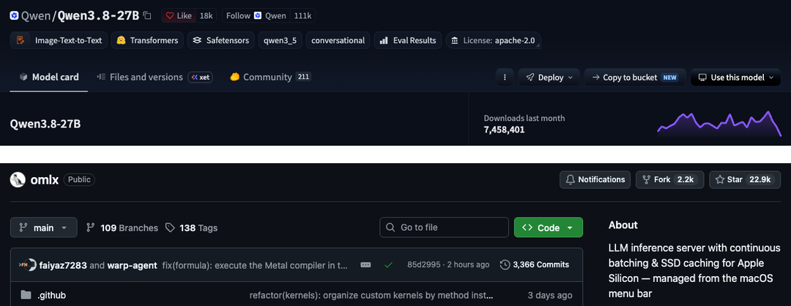

## Local model memory usage reference

- 27B 4-bit (Q4) short conversation: peak 17.2GB
- 27B Q4 up to 160K context: peak about 38GB
- 27B 8-bit (Q8) short conversation: peak 29.0GB

That's just the model process itself. macOS itself, the browser and background services also use memory. So **subtract the model peak from total memory** and see whether the remainder is enough for other programs' daily use.

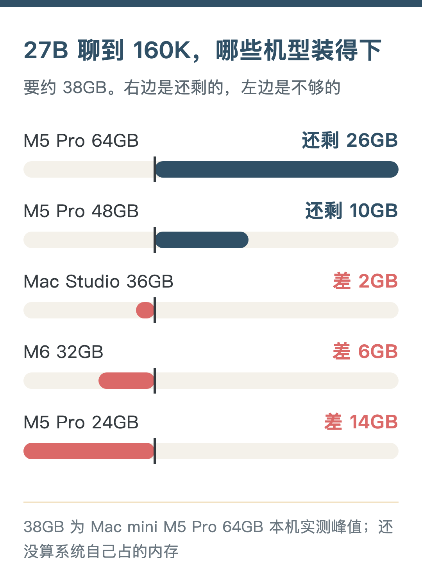

When memory runs short, the Mac moves some content to disk (swap), and programs don't crash right away. It looks like it runs. But I don't count that as "usable". **Frequent swapping makes the server unstable**.

## Best option for a personal local server: 16GB

Don't consider local large models on a 16GB machine. **Its role is clear: a local server**.

My machine keeps Hermes (an AI assistant; on a 16GB machine it only uses cloud models), Jellyfin (my home media library) and Syncthing (syncing files between several devices) running all the time. 16GB handles these without strain.

Other services that are good to keep running long-term:

1. Time Machine: other Macs at home back up automatically to this machine. It's built into the system — just set a folder as the backup destination in Sharing settings. Backups eat disk space, so you'd usually attach an external drive with plenty of capacity.
2. AdGuard Home: blocks ad and tracking domains at the DNS layer; point your router at it and every device at home is covered. It only blocks by domain, so not all ads get removed.
3. FreshRSS: your own RSS reader, with read status shared between phone and computer.
4. Paperless-ngx: scan contracts, invoices and manuals into it, it OCRs them automatically, and later you can find the original just by searching the text. When you import a big batch of old files at once, OCR has a spike.

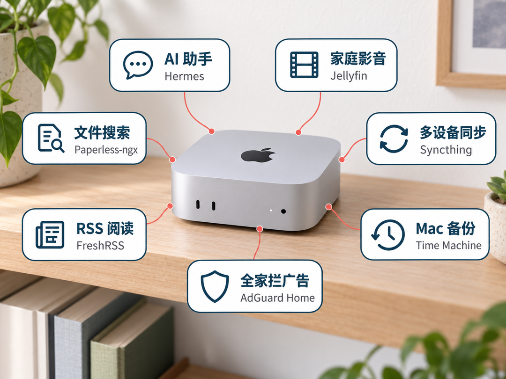

FreshRSS and Paperless-ngx usually run in Docker, which means spinning up an extra Linux virtual machine. Docker Desktop's default memory limit for it is half the host, so 8GB on a 16GB machine. So **add things one at a time**, and stagger tasks with spikes like OCR and video transcoding.

The chip doesn't matter at this tier. The M6 16GB has 153GB/s of bandwidth, a bit lower than the 170GB/s of the 24GB and 32GB models, but as a server you won't need that difference. A used M4 is fine too.

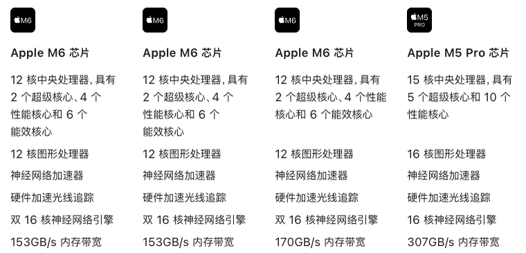

Since you're giving up local large models, this tier suits clear-headed people who've committed to cloud models. You get top-tier cloud models plus a personal server that responds 24/7, and save a lot of money.

Worth noting: although the base M6 is ¥2,500 more than the M4's ¥4,499 back then, this 2nm chip is genuinely impressive.

## Local models: M6 32GB

Memory first. 27B Q4 short conversation peaks at 17.2GB, leaving 14.8GB out of 32GB. It fits. At 160K it needs about 38GB, already more than total memory, so context has to be kept short (estimated).

Now speed. For every token the model outputs, it roughly has to read the weights from memory once, so **output speed is heavily tied to memory bandwidth**. The M6 is 170GB/s and the M5 Pro 307GB/s, a 1.8x difference.

I don't have an M6, so I looked up other people's measurements, all on 32GB models running Qwen3.8-27B 4-bit:

- A German user's public test on GitHub (LM Studio, GGUF format): 11–12 tokens per second writing English and German paragraphs, 17.5 writing code
- A video review (using MLX directly): 8–9 per second

Mine writes 300 characters at 25.9 per second. The engines and formats differ, so it's not a strict comparison, but the gap is over 2x, larger than the bandwidth difference. The M6 has only a 12-core GPU versus 20 cores on mine, which may also matter (my guess).

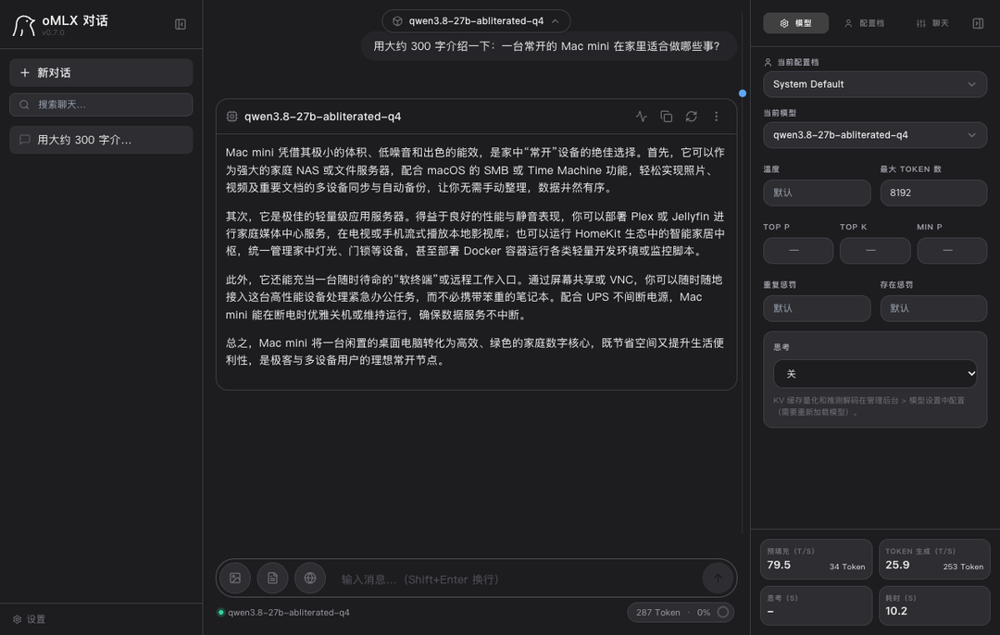

At around 10 per second, asking a few questions occasionally is fine, but as a daily driver it's on the slow side. So 27B on the M6 32GB is limited to just being able to run. **For daily use it's basically a no-go**.

If you want speed on the M6, switch to an MoE model. An MoE model has a large total parameter count, but each output token uses only a small part of it, so fewer weights are read and the bandwidth requirement is much lower.

Take the 4-bit version of Qwen3.6-35B-A3B. There are two other people's measurements on the M6 32GB; I also ran the same model's 4-bit version on my machine with oMLX, using the same prompt types and parameters as the GitHub test:

- Short inputs (German, English, code, JSON): M6 63–69 tokens per second, mine about 110, **1.6–1.7x the M6**
- After reading in about 20,000 tokens of material: M6 outputs 58.5 per second, mine 80.4; reading speed M6 1,215 per second, mine 2,176

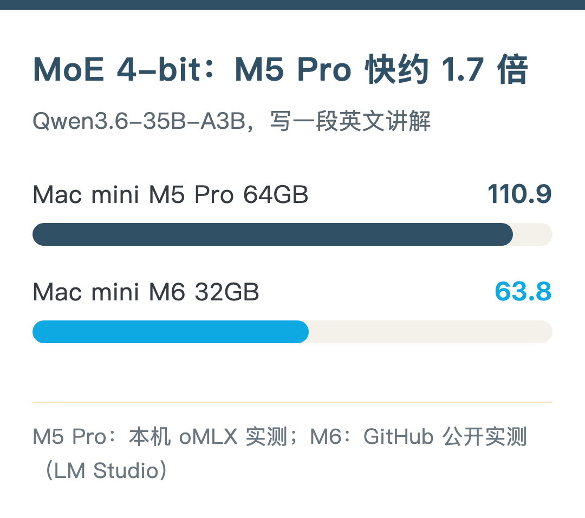

Bandwidth differs by 1.8x, and the short-input speed difference is close to that.

Memory measurements on my machine:

- Short input: peak about 21.5GB
- Reading 20,000 tokens: about 23.7GB
- Reading 65,000 tokens: about 24.7GB
- Reading 130,000 tokens: about 27.0GB

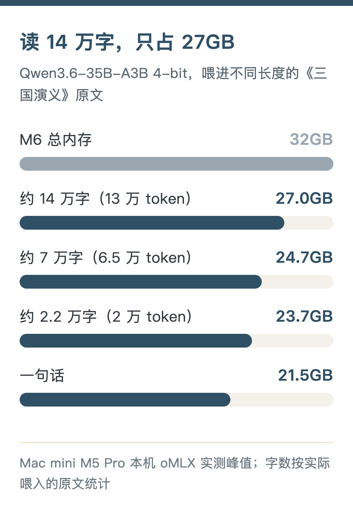

No swap was used at any point. MoE memory grows very slowly when reading long material. Subtracting from 32GB (estimated): about 10GB left for short input, about 8GB at 20,000 tokens, only 5GB at 130,000 tokens. The user in Japan reported 19.7GB, lower than what I measured, possibly because of a different counting method.

So an M6 32GB running MoE 4-bit **can read long material too, leaving 8–10GB for the system** — enough for a browser and everyday office work. But you can only run this one model; running Docker, a media library and similar services at the same time probably means staggering them.

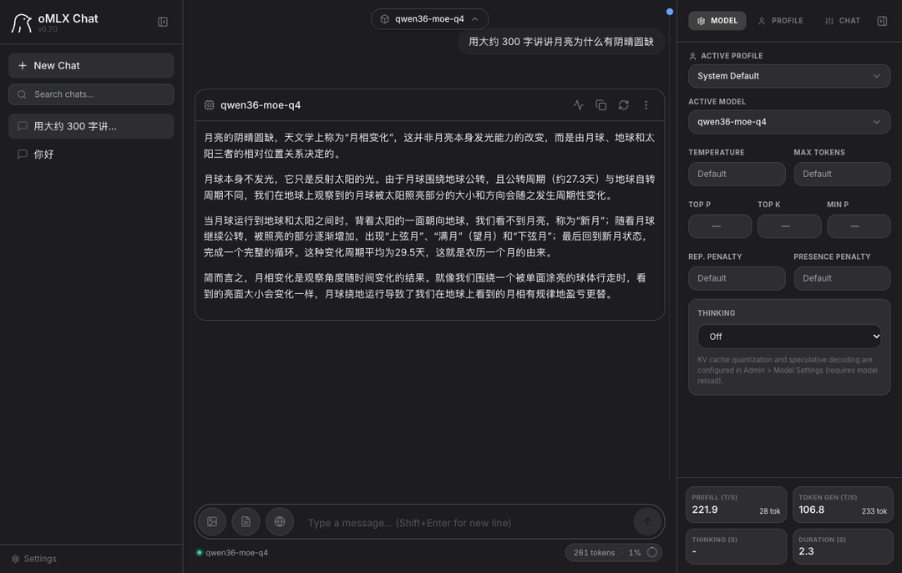

Of course MoE has a cost. On my mini it does about 110 tokens per second, 3–4x the 27B; but 35B-A3B activates only about 3B parameters per token, so **quality is a bit worse than the 27B**. My worry is that it keeps putting out low-quality content, and cleaning up after it is harder work. So I still use 27B day to day. If speed matters more to you, MoE is still the first choice on a Mac.

Another option is the M5 Pro 24GB at ¥12,999. The chip is faster, but it has 8GB less memory than the M6 32GB; 27B Q4 short conversation leaves 6.8GB, which gets tight once you open a few programs. Looking only at local models, **this tier is a bit awkward**.

## Using 27B every day: M5 Pro 48GB and up

If you use local large models every day, you'll inevitably have long conversations and feed in long documents. Then **memory has to be sized for 160K**:

- 48GB: at 160K about 10GB left for the system and other programs — it runs, but it's not roomy
- 64GB: about 26GB left (measured peak on my machine)

All M5 Pro tiers have 307GB/s of bandwidth, so the 48GB model's output speed should be close to mine: 35.8 tokens per second answering "hello", 25.9 per second writing 300 characters (the 48GB figure is estimated).

Running MoE 4-bit is roomy too: reading 130,000 tokens peaks at about 27GB, leaving 21GB of 48GB.

## Running other services at the same time: 64GB

This is my configuration: M5 Pro, 18-core CPU / 20-core GPU, 64GB of memory. It keeps Hermes, Jellyfin and local video generation with MiniMax H3 running at the same time.

I set a 48GB cap on the model process, leaving 16GB for the system and other services. Even so, **the model and H3 can't run at the same time**. The model is about 38GB and H3 about 22GB, roughly 60GB together, leaving too little headroom for the system. I've tested it; they have to be staggered.

So 64GB doesn't mean everything can run at once either. Run them staggered and everything fits.

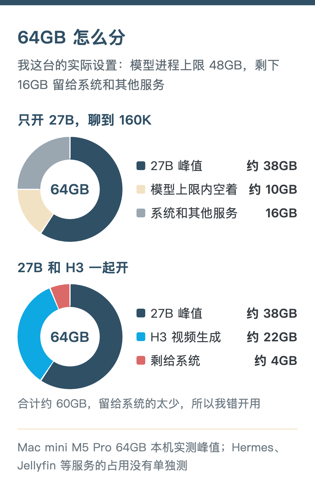

Why did I buy 64GB? When I buy a machine I plan to use it for a long time, and **memory can't be changed**.

Apple's ecosystem is moving fast on AI, and many local models — text, image, video, voice generation — are all heading toward compressing size as much as possible while keeping quality. The more memory, the better your ticket in. It also has to run everyday tasks, and I don't want memory maxing out and swapping often, because then the server becomes unstable and can't be called a server anymore.

## Around ¥20,000: Mac mini or Mac Studio

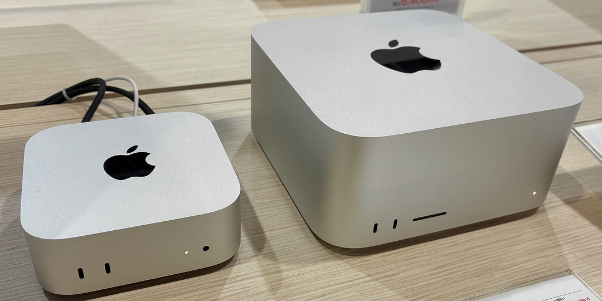

At the ¥20,000 price point, the Mac Studio and the Mac mini cost the same:

- Mac mini M5 Pro 48GB+1TB: ¥19,749, bandwidth 307GB/s
- Mac Studio M5 Max 36GB+512GB: ¥19,999, bandwidth 460GB/s
- Mac mini M5 Pro 64GB+512GB: ¥20,499, bandwidth 307GB/s

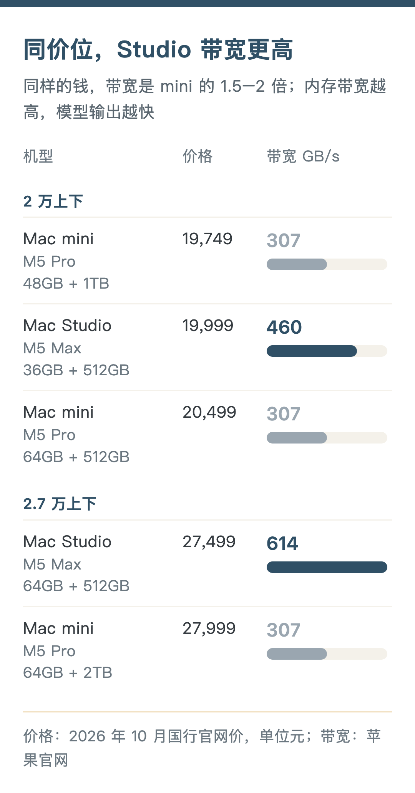

The base Studio is ¥500 cheaper than the 64GB mini. It trades away part of the memory for a Max chip: 1.5x the bandwidth, but only 36GB of memory. Running a 27B Q4 model for short conversations leaves 18.8GB free, and it should be faster than mine, but a 160K chat needs about 38GB, which won't fit. So **if you have long conversations every day, the 48GB or 64GB mini is still the right choice**; if it's mostly short questions and answers and you want it a bit faster, the base Studio is the better deal.

Move up in budget and the difference becomes clearer:

- Mac mini M5 Pro 64GB+1TB: ¥22,749, bandwidth 307GB/s
- Mac mini M5 Pro 64GB+2TB: ¥27,999, bandwidth 307GB/s
- Mac Studio M5 Max 64GB+512GB: ¥27,499, 40-core GPU, bandwidth 614GB/s
- Mac Studio M5 Max 128GB+512GB: ¥39,499, bandwidth 614GB/s

For the same 64GB+512GB configuration, the Studio costs ¥7,000 more than the mini, in exchange for 2x the bandwidth and better cooling. Compared with the 64GB+2TB mini, it's ¥500 cheaper with 2x the bandwidth, except that the drive is 1.5TB smaller. **You can add storage externally, but you can't add bandwidth**. If your budget reaches ¥27,000 and it's mainly for local models, the 64GB Studio is the better value.

Thinking about it now, if size weren't a concern, maybe the 128GB Studio would also be the better choice, with better cooling and more headroom. Apple's own chips keep moving forward too, and I'd guess that if you're willing to wait, later chips will most likely be better suited to local models. But all of that is the cost of waiting. Life is a hundred years at most; rather than waiting and waiting, it's better to buy early and start enjoying it sooner.

Of course, my situation isn't just about using local large models — cloud models are always more tempting. Unless you're clear that local models are fully up to your local work, it's best **not to kid yourself that buying a Mac mini means you can leave cloud models behind for good**.

## Storage: just enough, add external later

**Storage, unlike memory, can be added later**. Once your use is settled, just pick enough built-in storage.

Running local models needs spare space. If it's only a server, 512GB is enough; put video, audio and backups on an external drive. 256GB is really too small — the system alone eats a big chunk. If you buy 256GB, I'd suggest just modding the internal drive; internal drives are more stable than external ones. Modding means going to a specialist shop and may affect the official warranty. I think going straight to 512GB is safer.

Upgrading storage on the official site isn't cheap: on the M6 32GB, going from 256GB to 1TB costs ¥3,750 more; on the M5 Pro 64GB, going from 1TB to 2TB costs ¥5,250 more. You can save that money for now and buy an external drive later as needed. I chose 2TB because I have to back up a lot of video in my daily work. For just running models and being a server, you don't really need 2TB.

## Configuration and price tables

Prices are official China prices from October 2026, not counting Double 11 promotions. The M4 is no longer sold on the official site, so the price listed is a used price from Xianyu (China's second-hand marketplace).

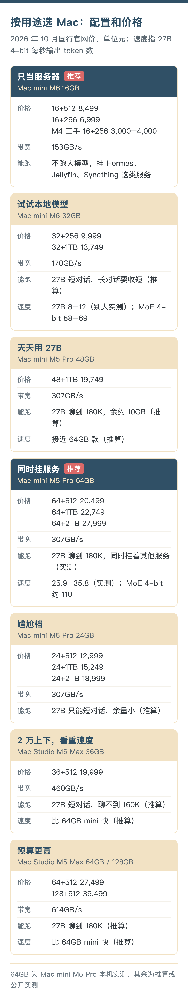

Earlier tests on this Mac mini:

- [“Mac mini pocket rocket runs 27B, up to 35 token/s”](https://mp.weixin.qq.com/s/thx2mUELkcduNu7ifyb5fw): how to set up local large models and how fast they run
- [“Mac mini runs AI video: how much memory it uses and how long generation takes”](https://mp.weixin.qq.com/s/iHqF5izRKrq8wT1bJgvGUg): running MiniMax H3 locally to generate video
- [“Keeping files in sync between two computers, without using my iCloud space”](https://mp.weixin.qq.com/s/s3sMxi6Q_7Ujax9Ce6AU4Q): the Syncthing mentioned in the 16GB tier

If you have an M6 32GB, an M5 Pro 48GB or a Mac Studio, feel free to leave your measured speeds in the comments. If there's anything else you'd like me to test on this mini, leave a comment too. Hope this helps.

Sources:

- Data for my machine: measured on my Mac mini M5 Pro 64GB, oMLX running Qwen3.8-27B, see the previous post “Mac mini pocket rocket runs 27B, up to 35 token/s”
- Mac mini and Mac Studio bandwidth and configurations: apple.com.cn/mac-mini/specs, apple.com.cn/mac-studio/specs
- M6 32GB running 27B (LM Studio, GGUF): github.com/HDZucht/Mac-Mini-M6-LLM-benchmarks
- M6 32GB running 27B (MLX, video review): youtube.com/watch?v=7ugFOo8e8H4
- M6 32GB running MoE: github.com/HDZucht/Mac-Mini-M6-LLM-benchmarks, note.com/corestudio/n/n583c1b00f8ef
- M5 Pro running MoE 4-bit: measured on my machine with oMLX 0.7.0, model mlx-community/Qwen3.6-35B-A3B-4bit (October 20, 2026)
- M6 2nm, from ¥6,999: reports from the August 25, 2026 launch event (ITHome, Sina Tech); M4 Mac mini, from ¥4,499 in China: 2024 launch price (ITHome)
- Services on the 16GB server: official documentation for Docker, AdGuard Home, FreshRSS and Paperless-ngx

---

*This is a translation of my Chinese post, made with the help of AI.*
