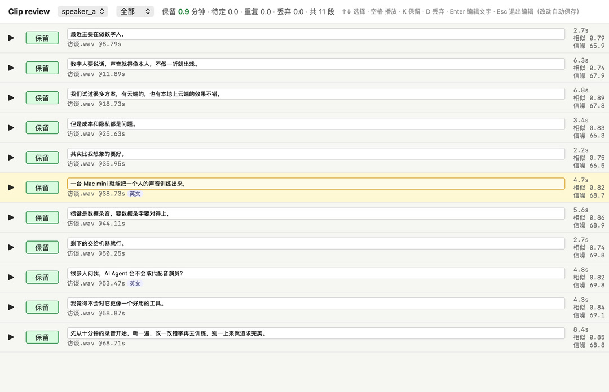
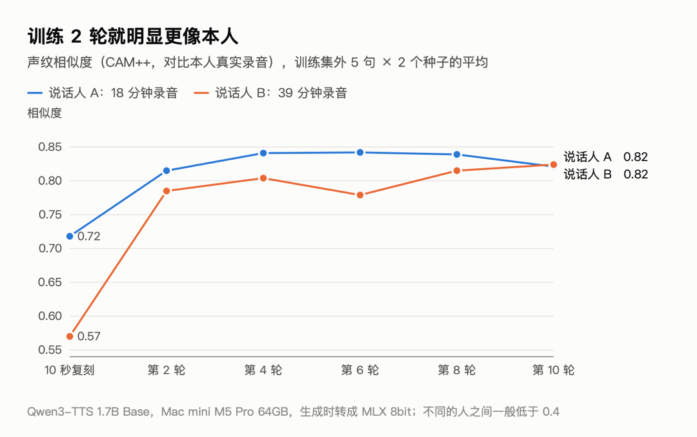
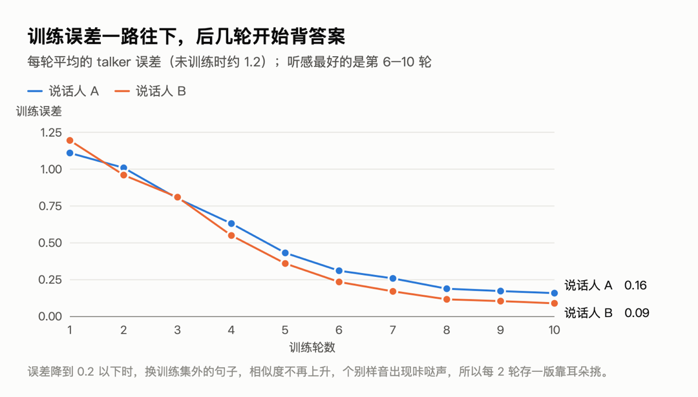
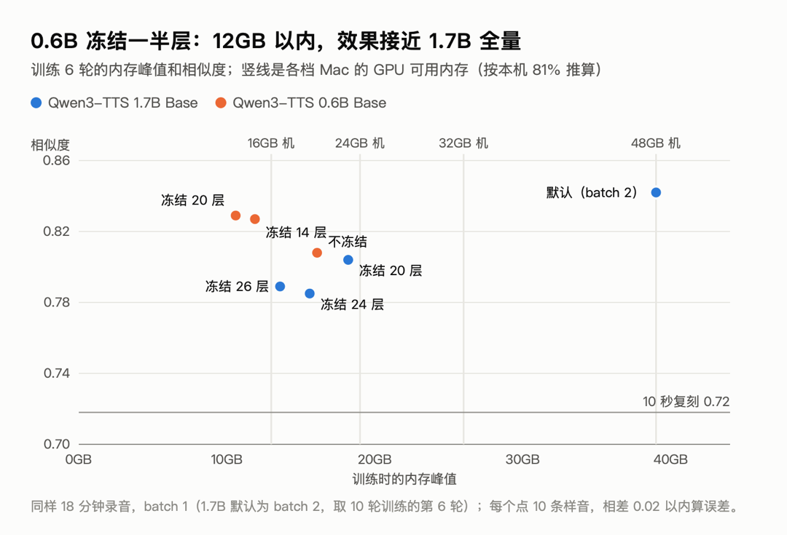
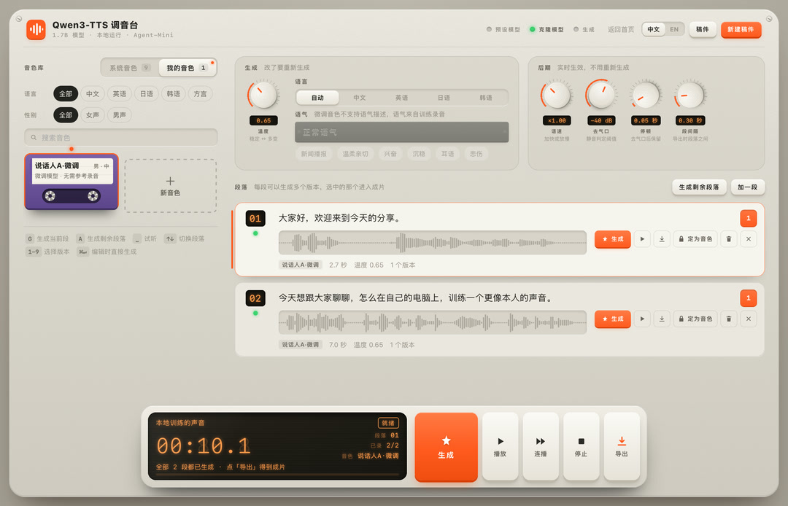

> This is a complete record for my own reference: next time I train a new voice, or pick this up again in a new conversation, read this first. All the code is in [qwen3-tts-console](https://github.com/shisaq/qwen3-tts-console) (the web page is in the root directory, the training pipeline is in `finetune/`). In this post the two people being trained are called speaker A and B.

## Summary at a glance

| Item | Value |
| --- | --- |
| Machine | Mac mini, M5 Pro, 64GB; GPU can use up to 51.8GB (81%) |
| Reason | Zero-shot cloning from a 10-second reference clip didn't match the person's timbre and accent |
| Source material | A: 6 videos (about 24 minutes) + 1 conversation of 23 minutes; B: 13 videos (about 42 minutes) + the same conversation |
| Automatic processing | About 90 minutes of material, cut, transcribed and speaker-filtered in a dozen or so minutes |
| After manual review | A 165 segments / 18.0 minutes; B 361 segments / 38.9 minutes (review took about 1.5 hours) |
| Training (1.7B, 10 epochs) | A 17 minutes, B 37 minutes, peak memory about 39–41GB |
| Voiceprint similarity | A: 0.72 → 0.84; B: 0.57 → 0.82 (zero-shot → best epoch) |
| Character error rate | Below 1% for all versions |
| Deployment | A uses epoch 8, B uses epoch 10; generating 5 seconds of speech takes about 2 seconds, loading takes 0.5 seconds, and each model is about 3GB |
| Low memory | 0.6B with 20 layers frozen: peak 10.6GB, similarity 0.83, so a 16GB machine should be able to run it |

## Overall structure

```
Video ─(extract audio yourself first)─▶ wav
  ─ prep_data.py   FunASR transcription + cut into 2–10 seconds + CAM++ speaker filtering      (.venv: torch + funasr)
  ─ review.py      web review: listen, fix text, keep/discard              (same as above)
  ─ build_train.py Qwen3-TTS-Tokenizer-12Hz encodes into speech tokens  (.venv-train: qwen-tts + torch)
  ─ sft.py         fine-tune on the Base model, save as custom_voice checkpoint (same as above, MPS)
  ─ gen_samples.py convert each epoch to MLX 8bit, generate sample audio together with zero-shot   (the web page's venv: mlx-audio)
  ─ score_samples.py similarity, character error rate, speaking rate; pick by ear on the comparison page       (.venv)
  ─ ttsd's tuned_voices config ─▶ appears in "My Voices" on the web page
```

The 3 Python environments are deliberately separated: FunASR, qwen-tts and mlx-audio each pin different dependency versions, and mixing them tends to cause conflicts. Tested versions: funasr 1.4.16, modelscope 1.40.2, qwen-tts 0.1.1, torch 2.14.1; mlx-audio uses the commit pinned in the web page's `requirements.txt`.

The web UI itself (ttsd) is a single-file Python service, kept running by launchd and reverse-proxied by Caddy. Models run as 8bit quantized versions through mlx-audio and are unloaded automatically after 10 minutes idle.

## Data preparation

### Transcription: FunASR, not Whisper

`AutoModel(model="paraformer-zh", vad_model="fsmn-vad", punc_model="ct-punc", spk_model="cam++")`:

- **Paraformer-zh**: accurate for Chinese, and gives a timestamp for each character. 1.8 minutes of audio transcribes in 12 seconds. English words are often misspelled (Gartner → garten), so segments that are mostly English are discarded outright (more letters than Chinese characters).
- **fsmn-vad / ct-punc**: sentence segmentation and punctuation.
- **CAM++**: voiceprints. Measured: segments from the same person score 0.72–0.75, different people 0.08–0.36, and the two people's reference recordings score 0.31 against each other. Threshold: ≥ 0.55 keep, 0.45–0.55 tentative, below that discard. The host, interruptions and the other party in the conversation all get filtered out this way.

**A FunASR 1.4.16 bug**: `sentence_info` puts each punctuation mark one character late ("开发者。大家好，很高兴" becomes "开发者大。家好很，高兴"), so cutting segments with it breaks words in the middle. The full text `text` and per-character timestamps `timestamp` are correct, so I re-cut it myself: tokenize by `[A-Za-z']+|punctuation|single Chinese character`, the token count and timestamp count match one-to-one (measured to match exactly), break sentences at punctuation, and take the speaker label from the `sentence_info` segment with the most temporal overlap.

### Cutting rules

- Sentences from the same speaker with a gap ≤ 0.5 seconds are merged into 2–10-second segments; once a segment reaches 4 seconds and hits a period, cut it off early.
- Leave 0.08 / 0.15 seconds at the start and end, but don't cross the midpoint of the neighbouring sentence.
- Normalize the loudness of the voiced parts to -20 dBFS, with peaks no higher than -1 dBFS.
- The noise floor is the 10th percentile of 50ms frame energy over the whole audio, with a lower bound of -90 dB (synthesized or denoised audio can contain digital silence; without a lower bound the SNR comes out as 150-something).
- Two edited versions of the same event will have duplicate sentences: if text similarity > 0.8 and they come from different files, keep the one with the higher SNR.
- Automatic flags: English, filler words (呃嗯额, "uh/um"), repetitions/slips of the tongue, runs of Chinese numerals — look at these first when reviewing.
- Normalize the casing of English terms (ai → AI, gpt → GPT); misrecognized product names go into the configured `terms`.

### Manual review



Changes are written to `edits.json` (by segment id), so re-running data preparation doesn't lose them. Of A's 198 segments I changed the text of 55 (29 typos, 19 with English words, 7 punctuation only) and dropped 33. Of B's 469 segments I changed 109 and dropped 108, which took about 1.5 hours. My impression is that the automatic recognition is already quite accurate, and only a few sentence breaks were wrong.

## Training script: 4 problems in the official sft_12hz.py

First, compute the loss on real clips with the **untrained** Base model: with the right settings, the loss should be very low, since a pretrained model can already predict real speech. The first smoke test gave a loss of 7.5, close to random guessing (vocabulary 3072; a uniform distribution would give about 8.0), so I compared it against the inference code to track it down:

| Setting | talker initial loss | sub-model initial loss |
| --- | --- | --- |
| Official script | 11.9 | 9.1 |
| Labels shifted only once | 7.9 | – |
| Plus `text_projection` | **1.2** | – |
| Sub-model uses the previous frame's hidden state; loss is no longer shifted | – | **5.4** |

1. **Labels shifted twice** ([QwenLM/Qwen3-TTS#179](https://github.com/QwenLM/Qwen3-TTS/issues/179)): the talker's HF loss shifts internally once, and the script also does `[:, 1:]` by hand. The model learns to predict the token one frame away, and the symptom is that speech gets faster the longer you train. Fix: don't slice the input or labels; let the loss function do the shifting itself.
2. **Missing `text_projection`**: at inference, all text vectors (role markers, tts_pad/bos/eos, body text) first go through `talker.text_projection`, but the training script used the output of `text_embedding` directly. Both are 2048-dimensional, so no error is raised, and the model kept learning from inputs it never sees at inference.
3. **Sub-model also shifted twice**: the logits returned by `forward_sub_talker_finetune` are already aligned with `codec_ids[:, 1:]`, and the built-in loss shifts them one more position; at inference, the code predictor gets the hidden state of "the position that predicted this frame" (t−1). Fix: `hidden[:, :-1][codec_mask[:, 1:]]` paired with `codec_ids[:, 1:][codec_mask[:, 1:]]`, computing the cross-entropy myself without the shift.
4. **Weights stored in bf16**: at a learning rate of 2e-6, AdamW's per-step update is smaller than what bf16 can represent, so most of it gets rounded away. Changed to fp32 weight storage with bf16 autocast for compute.

Other settings: learning rate 2e-6, 5% warmup + cosine decay, batch 2 × gradient accumulation 4, gradient clipping 1.0; the speaker vector is the average voiceprint of 64 training clips (more stable than a single reference recording), written into row 3000 of `codec_embedding`; checkpoints are saved as bf16, `tts_model_type` changed to `custom_voice`, `spk_id` is just this one person.

The training data uses the prefix with no language tag (nothink), so **generation must use auto as the language**; specifying chinese switches to a prefix the model has never seen. The Base model never learned instructions, so the fine-tuned voice **does not support tone descriptions**.

### Memory: the first run hit swap

Full training of 1.6B parameters (the text embedding layer is trained too) used 44GB. At epoch 2, saving a checkpoint copied the weights once more, so the system started swapping and each step went from 1.2 seconds to 15 seconds. Changed 3 things:

- **Freeze the text embedding layer**: 311 million parameters, 150k tokens, but 18 minutes of audio only uses a few hundred of them. Saves about 4GB, and reduces overfitting a little too (details in the next section).
- **When saving a checkpoint, move each tensor to the CPU first, then convert to bf16**, and call `torch.mps.empty_cache()` after saving.
- **Store frozen parameters in bf16** (not updated, so fp32 isn't needed).

After that, 1.7B full training held steady at 37–41GB and 1.2 seconds per step.

### Is freezing the text embedding layer risky?

Freezing doesn't remove the layer: it still takes part in computation; it just isn't updated during training and keeps the Base model's original values.

**What it handles.** `talker.model.text_embedding` is a 151936 × 2048 lookup table, one row per token, and it only answers "which character is this". Everything after it that decides "how this person reads it" is trained:

| Part | Shape / size | During training |
| --- | --- | --- |
| `text_embedding` (recognizing characters) | 151936 × 2048, 311 million parameters | **frozen** |
| `text_projection` (translates text vectors for the speech model) | two layers 2048 × 2048 | trained |
| talker 28 layers (how to read, intonation, rhythm) | about 1.4 billion parameters | trained |
| `codec_embedding` (speech codes, where the speaker vector lives) | 3072 × 2048 | trained |
| code predictor (15 layers of speech codes after each frame) | about 170 million parameters | trained |
| speaker encoder (only used to compute the speaker vector) | – | frozen |

**Why freezing is actually more stable with little data.** Without freezing, at each step only the few hundred rows that appear in the training text get gradients in the embedding layer (AdamW barely moves rows with zero gradient), and after training, "characters it has seen" and "characters it hasn't" slowly become inconsistent in the model's eyes: in a new sentence, some characters may sound like him and some may not. With freezing, the 150k tokens stay as they are and remain consistent with each other.

**No loss of precision.** The Base model's released weights are already bf16 (`text_embedding` and `text_projection` both), so storing the frozen part in bf16 is bit-for-bit identical to the original weights; checkpoints are saved as bf16 anyway.

**The real limitation.** A frozen embedding layer can't give a word a "new identity". If his pronunciation of a word is very particular (a fixed pronunciation for a product name, the reading of a character in a dialect), only the 28 layers behind it can learn that from context; that's enough most of the time, but if after training a word **still comes out wrong every time**:

1. First change how it's written in the script: a homophone, split it apart, or add a space—that's the easiest way;
2. Once you have more data (an hour or two), add `--train_text_embedding` when training again, it uses about 4GB more. New languages and new dialects fall under this too.

**The limits of the evidence.** What supports "character recognition isn't damaged": after fine-tuning, all versions had a character error rate below 1% on sentences outside the training set, including ones with English words like AI Agent and RPA, and similarity also improved as expected. What I haven't done: a strict frozen vs. non-frozen comparison. Both voices that went live were trained with freezing, and the non-frozen version only ran for 1 epoch (memory blew up), so there's no direct data showing that "the two perform the same". To confirm: same data, batch 1 with text embedding training enabled, train for 6 epochs, compare similarity and character error rate, and listen specifically to a few proper nouns.

## How to judge whether it sounds alike

- **Qwen's built-in voiceprint encoder can't be used for evaluation**: zero-shot cloning's similarity to the reference recording was 0.991, but another male voice also scored 0.974. The 8bit and bf16 clones both scored 0.991 (I couldn't hear a difference either, so 8bit is what I use live).
- **Use CAM++ and compare against the average voiceprint from 40 real clips of the person**, not a single reference recording.
- 5 sentences outside the training set × 2 random seeds, 10 samples per version; also check the transcription character error rate and speaking rate (a real person is about 5 characters/second; a noticeably faster rate means the label-shift problem).
- The score is compared against the training recordings, and the recording environment (microphone, room) can also be learned, so **the final pick is by ear**. The comparison page puts all versions of the same sentence side by side.

## Results





- 2 epochs of training gave most of the improvement; after that it was basically flat.
- Training loss dropped to 0.1–0.2 by epoch 10, and it started memorizing: A's epoch 10 score fell back, and a few samples had a click. So I save a version every 2 epochs.
- For A's epochs 8 and 10, I also tested 8 more sentences × 3 seeds each: 0.815 vs 0.827, a tie. In the end I picked both by ear from the seed 11 group: A uses epoch 8, B uses epoch 10, and the other epoch is kept as a backup.

## Low-memory options



Training for 6 epochs is enough. Using the same 18 minutes of A's recordings, batch 1 × accumulation 8, measured on a 64GB machine:

| Model · setting | Peak | Time | Similarity |
| --- | --- | --- | --- |
| 1.7B default (batch 2, epoch 6 of a 10-epoch run) | about 39GB | about 10 minutes | 0.842 |
| 1.7B freeze 20 layers | 18.2GB | 7 minutes | 0.804 |
| 1.7B freeze 24 layers | 15.6GB | 6 minutes | 0.785 |
| 1.7B freeze 26 layers | 13.6GB | 5.5 minutes | 0.789 |
| 0.6B no freezing | 16.1GB | 7 minutes | 0.808 |
| 0.6B freeze 14 layers | 11.9GB | 5 minutes | 0.827 |
| 0.6B freeze 20 layers | 10.6GB | 5 minutes | 0.829 |

Just changing to batch 1 barely saves anything (35.6 → 33.3GB); most of the memory goes to the weights, gradients and Adam states of the trainable parameters (fp32, 16 bytes per parameter).

macOS doesn't give all of the memory to the GPU: on this machine `torch.mps.recommended_max_memory()` is 51.8GB (81%). Extrapolating at the same ratio (on the optimistic side; smaller machines may have a lower ratio and slower chips; none of this was measured):

| Machine | Roughly available to GPU | Recommendation | Left over |
| --- | --- | --- | --- |
| 64GB | 52GB | 1.7B default | about 13GB |
| 48GB | 39GB | 1.7B freeze 20 layers (default is right at the limit) | about 21GB |
| 32GB | 26GB | 1.7B freeze 20 layers | about 8GB |
| 24GB | 19GB | 0.6B freeze 14 layers | about 7GB |
| 16GB | 13GB | 0.6B freeze 20 layers | about 2GB |

Freezing some layers of 0.6B actually scores a bit higher than the full 0.6B model; each group has only 10 samples, so a difference within ±0.02 is within error, and I haven't compared 0.6B by ear either.

## Deployment

```bash
# Convert the chosen epoch to MLX 8bit and put it in the models directory
python -m mlx_audio.convert --hf-path <ckpt>/epoch-8 --mlx-path ~/Models/qwen3-tts/tuned/<id>-e8-8bit -q --q-bits 8
```

`~/.config/ttsd/config.json`:

```json
"tuned_voices": {
  "<id>": {"name": "Display name·fine-tuned", "model": "tuned/<id>-e8-8bit", "speaker": "<id>", "gender": "m", "lang": "zh"}
}
```

`speaker` must match the `--speaker_name` used during training. After the change, restart with `launchctl kickstart -k gui/$(id -u)/<label>`, then use the API to create a temporary script, generate one sentence to verify, and delete the script.

Changes to ttsd: the voice id is `tuned:<id>`, each fine-tuned voice gets its own model slot; at generation time the language is fixed to auto and no tone is passed; in the web UI it's under "My Voices", and the tone box greys out when it's selected.



## Pitfalls

- **Safari: no sound when I hit play, downloads work fine**: the page uses Web Audio for playback. The server and code were both fine; restarting Safari fixed it. There's currently no error message when playback fails; I could add one later.
- **ttsd's `safe_id` only accepts hex**: fine-tuned voice IDs (e.g. English names) are rejected as invalid, and the voice doesn't appear. I changed it to "must be a key already in the config"; a newly added unit test caught it.
- **Speaker keys must be in English**: the key becomes the speaker ID in the model and the directory name. The open-source version enforces ASCII.
- **HF download gets stuck at the last step**: the file is already downloaded (the size matches) but gets stuck at the checksum and rename step. The temp filename is the sha256 itself; compute it yourself, check that it matches, then `mv` it into place.
- **`pkill -f` killed the wrong process**: the match string used to kill the download process also appeared in another background command waiting for the download, so that one got killed too. Killing by PID is safer.
- **zsh doesn't split variables on spaces**: `set -- $var` doesn't split in zsh; write out the loop arguments or use an array.
- **mlx-audio reads `sys.argv`**: my script passed the model path on the command line, and mlx-audio took it as the model name. I moved it into the script.
- **Speaker encoder dtype on MPS**: when the model is bf16, cast the mel input to the same dtype.
- **Redacting screenshots**: before screenshotting, I renamed things and deleted content showing real people on the page using JS; I re-ran the review page with demo data synthesized from system voices before capturing. When Playwright renders charts, the double quotes in `font-family` truncate the HTML `style="…"`, so the font reverts to the default serif.

## How to reproduce

The shortest path (`run.sh` / `deploy.py` added on 2026-10-29; video files can go straight into the assets folder, and non-wav files are decoded with ffmpeg):

```bash
cd finetune && cp voiceprep.example.json voiceprep.json   # after filling it in
./run.sh prep                 # slice + transcribe + pick speakers; open the review page when done
./run.sh train alice          # encode → train → sample audio → score; on low memory add --epochs 6 --batch_size 1 --grad_accum 8 --freeze_layers 20
./run.sh review               # /compare/alice to pick a round
./run.sh deploy alice 8 --name "display name" --gender m --restart <ttsd's launchd label>
```

`deploy` copies the model into the console's `models_dir/tuned/`, backs it up and then edits `tuned_voices` (the speaker ID is read from the checkpoint), and optionally restarts it. To run it manually, step by step:

```bash
cd finetune
cp voiceprep.example.json voiceprep.json      # speaker, reference recording and transcript, material directory
.venv/bin/python prep_data.py
.venv/bin/python review.py                    # 127.0.0.1:18410, no login, only open on the local machine; use ssh -L remotely
.venv-train/bin/python build_train.py alice
.venv-train/bin/python sft.py --train_jsonl <work>/alice/train_with_codes.jsonl --speaker_name alice \
    --output_dir <work>/alice/ckpt --epochs 10 --save_epochs 2,4,6,8,10
#   low memory: --batch_size 1 --grad_accum 8 --freeze_layers 20 [--init_model_path Qwen/Qwen3-TTS-12Hz-0.6B-Base]
../.venv/bin/python gen_samples.py alice
.venv/bin/python score_samples.py alice       # then open /compare/alice and listen
```

## Not verified yet

- Actual memory usage and speed on 16GB / 24GB / 32GB machines (all extrapolated from the 64GB peak and 81%).
- What the 0.6B fine-tuned version sounds like; the web page currently loads the 1.7B preset/clone models by default. The 0.6B fine-tuned version can convert and generate, but it isn't live yet.
- Whether a few more hours of data would improve it further; how the proportion of clips under 10 seconds affects the accent.
