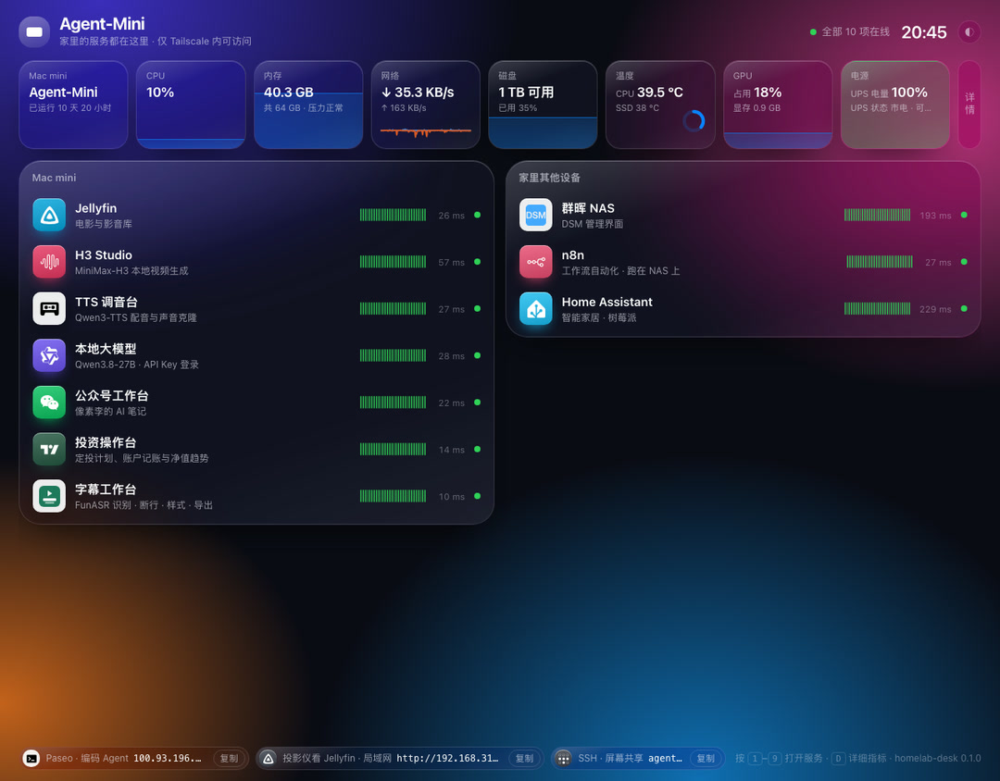
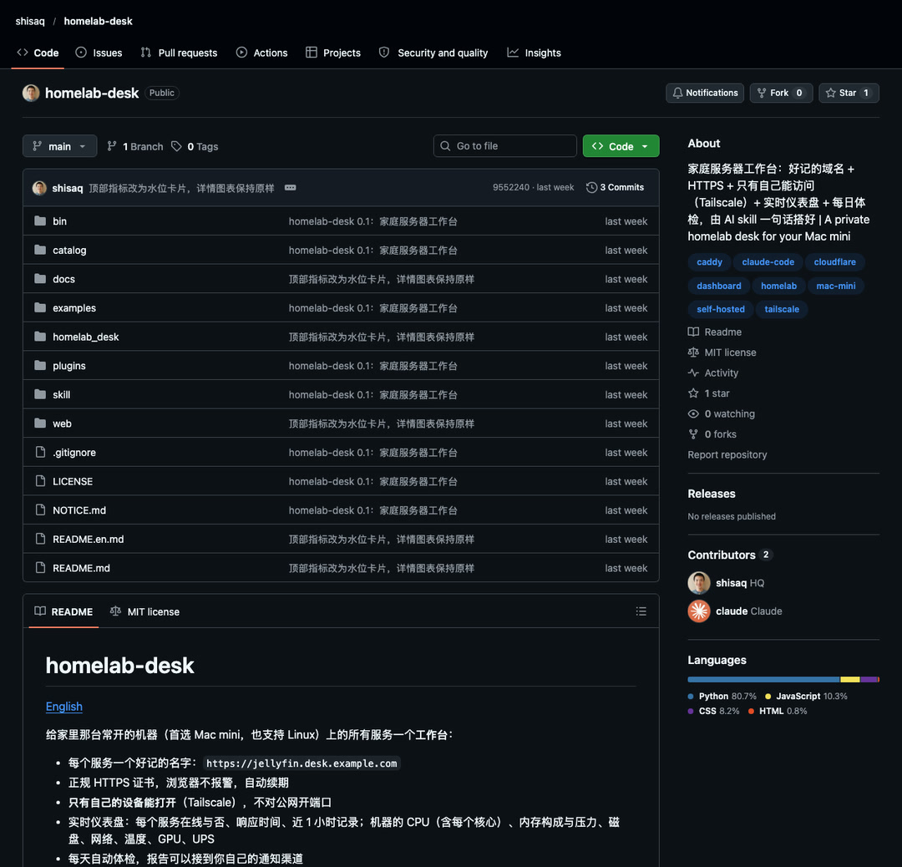
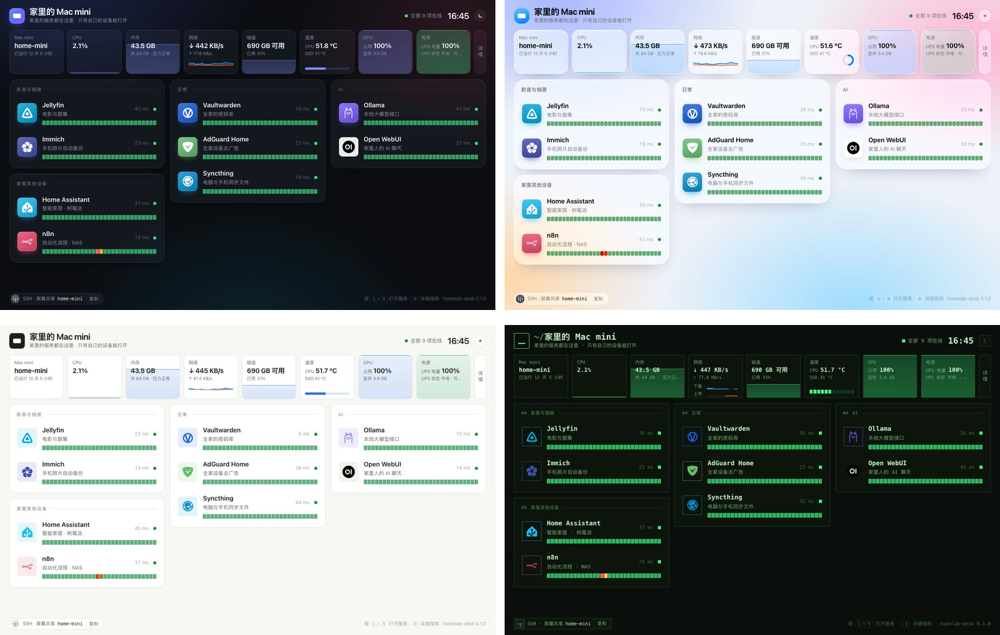

> A home server sounds very geeky, like a toy that only programmers have. But in the era of large models, it's actually something for every household. Because the code work of deployment, management and maintenance is **exactly one of the things today's large models are best at**. I turned the pitfalls I ran into into an open-source project, **so that AI can set up** a workbench **in one sentence**.

The one at my home is a Mac mini. I actually thought about it for a long time before buying the Mac mini — I already had an mbp — with one more computer, would I even use it enough? But after buying it, I found that the more I use it, the more I like it. The core of a home server is **running 24/7 without interruption**. That means whatever service you want to use, whenever you want it, it's there to respond. And over time, the automated services naturally get richer — this is a device that keeps growing along with you, **it's an asset**. This is what it looks like right now:

There are 10 services in total. 7 on the Mac mini: movie library, local video generation, voiceover, local large model, the workbench I use to write this WeChat account, investment bookkeeping, and subtitles. The other 3 are on the NAS and Raspberry Pi next to it: Synology admin, n8n and Home Assistant.

## What a home server is

Put simply, it's **a computer at home that's on 24 hours a day**, running your own always-on services.

Things a home server can do include but are not limited to:

| Purpose | Common services | What it does for you |
| --- | --- | --- |
| Media | Jellyfin | Downloaded movies automatically get posters, and you can watch them on your TV, projector or phone |
| Photos | Immich | Phone photos are backed up automatically and searchable by face, location, or similar image |
| Passwords | Vaultwarden | The family password vault; any Bitwarden client can connect |
| Ad blocking | AdGuard Home | Ad blocking across all home devices |
| Automation | n8n, Home Assistant | Scrape news on a schedule and send it to your phone; the desk rises by itself after you sit too long |
| AI | Ollama etc. | Run large models locally; chat and generation never leave this machine |

There are also some services that don't need a backend but are actually very well suited to running on one. For example, what I use most right now is **Paseo**. It's a console for coding Agents like Claude Code and Codex: the Agent runs permanently on the Mac mini, and I can connect from anywhere to check progress and give the next instruction. **A session started on the computer can be continued on the phone**, and vice versa — the multi-device session sync problem is gone entirely. That's what lets AI now work steadily across multiple devices over the long term. I'll go into its benefits in detail next time.

What machine is good for a home server? My take:

1. **Mac mini is the best fit**. Low power, quiet, fine to leave on long-term, and Apple chips can run local AI.
2. NAS is good for storing data. Install too many services and it struggles.
3. Raspberry Pi is good for running one or two lightweight ones, like Home Assistant.
4. An idle Linux computer also works, but it's a second choice.

## Once you have a lot of services, trouble starts

The 4 troubles I ran into:

1. **Can't remember the addresses**. Each service has a port, `8096` is movies, `8190` is video generation, `8123` is smart home… 10 of them, impossible to remember, I have to dig through notes every time.
2. **The browser says "not secure"**. Home services default to http, and some features (like recording, copying) don't work on insecure pages.
3. **Want to use it from outside, but afraid of exposure**. Opening a port on the router is the simplest, but it's like leaving your front door open on the public internet, and port-scanning bots are looking for doors like that all day long.
4. **Don't know when something is down**. You usually only find out a service stopped when you need to use it.

## The workbench: one entry point to manage all services

My solution is to build a workbench for these always-on services. It does just 4 things:

1. **A name for each service**: `jellyfin.yourdomain.com`, `ha.yourdomain.com`, no more remembering ports.
2. **Proper certificates**: the browser shows a padlock, auto-renewed.
3. **Only you can open it**: even if others know the address, they can't connect.
4. **One dashboard**: whether each service is online, and the machine's CPU, memory, disk and temperature, all at a glance; plus an automatic checkup once a day.

Maintenance is simple too. All services are written in one list, **adding a service is adding a line**, and the domain, certificate, card and checkup all update automatically.

## Several ways to access from outside

"Only you can open it" is a given on the LAN; the key is how to connect back home from outside. The common ones:

| Method | How it connects | Who can access | Things to note |
| --- | --- | --- | --- |
| Public IP + port forwarding | Open a port on the router; DDNS follows IP changes | The whole world | Many home broadband connections have no public IP; exposed to the public internet, security rests entirely on the service itself |
| Tunneling (frp, Oray etc.) | Borrow a relay server | The whole world by default | Speed depends on the relay; mostly paid |
| Cloudflare Tunnel | Your home connects out to Cloudflare | The whole world, login can be added | Unstable access from within China; not suitable for streaming video |
| Tailscale / ZeroTier | Your devices form a virtual LAN | Only your logged-in devices | An App must be installed on each device |

If the services are only for yourself and your family, **I recommend the last one**. I use Tailscale, and the personal free plan currently allows **6 users, with unlimited devices**. At home it automatically connects directly over the LAN, and when you're out and about you can still connect back. Remote desktop works through it too.

## My recommendation: a private URL only you can open

Adding your own domain on top of Tailscale gives you a very comfortable setup:

| Step | What to use | Cost |
| --- | --- | --- |
| Domain | A domain bought from any registrar, with DNS managed by Cloudflare | Non-`.com` domains are super cheap |
| Resolution | One wildcard record pointing to the server's Tailscale address | Free |
| Certificate | Let's Encrypt, DNS validation | Free |
| Entry | Caddy, routes requests to each service by domain | Free |
| Connection | Tailscale | Free for personal use |

The result: I open `mini.uulili.com` and it's the workbench, and clicking into each service gives it its own address and SSL padlock. This domain resolves publicly, but it resolves to an address inside Tailscale, so devices not on my Tailscale network **can't connect even if they try**.

## homelab-desk: let AI set it up in one sentence

The workbench project is called homelab-desk, and it's already **open source** on GitHub under the MIT license:

> **GitHub project address**
>
> <https://github.com/shisaq/homelab-desk>

It does these things:

1. **Deployment overview**: reads your service list, generates the Caddy config, requests certificates, allows only Tailscale, and installs itself as a background service that starts on boot. It can be run repeatedly — just run it again after changing the list.
2. **Real-time dashboard**: whether each service is online, how fast it responds, and the last 1 hour of records; the machine's CPU (every core), memory composition and pressure, disk and network, and with plugins also temperature, GPU and UPS.
3. **Pick a style**: 4 themes, each with light and dark versions; see the next section for how they look.
4. **Recommended services**: a built-in catalog covering media, photos, passwords, ad blocking, automation, AI, downloads, reading and more, 30 items in total. Each item says who it's for, how to install it, and what to watch out for behind a reverse proxy.
5. **Daily checkup**: checks each service and how many days the certificate has left, and can be hooked up to your own notification channel.

The pitfalls I ran into above, **the project handles them all**. For example, for the restriction on listening on 443, it switches to allowing only Tailscale by source; the online check is done on the server, avoiding the browser's cross-origin false positives; services like Home Assistant that need extra configuration are spelled out directly in the catalog.

## I also made a few different styles along the way

The workbench has **4 themes** in total: Glass, Apple's Liquid Glass, Minimal and Terminal, each with light and dark versions, switchable from the top right corner of the page.

## How to use it

Clone the project, link the skill inside it to Claude Code or Codex, then say one sentence to it:

> **Say to Claude Code or Codex**
>
> Help me set up a home server workbench with homelab-desk

It will check the prerequisites, walk you through creating a Token and DNS records in Cloudflare, deploy everything, and finally verify it. **Adding a service later is also one sentence**:

> **Adding a service later**
>
> Add Immich

If you don't want to use AI, you can also manually run the 4 commands `init`, `doctor`, `dns`, `deploy`.

Why not make it Docker? Docker on Mac runs in a virtual machine, so it can't get the Tailscale address, and it can't read the host's temperature or GPU. The project itself is just Caddy, a small Python service and a static page, so running it natively is simpler. Your services can run anywhere, including in Docker; the project only cares about "address:port".

Homepage, Homarr and Dashy handle navigation pages, and Uptime Kuma handles monitoring. homelab-desk manages **the whole chain from zero to usable**. If you're already using them, you can add them as services too.

## Who it's for

1. You already have an always-on Mac running a few services: use it directly.
2. You're on Linux: the adaptation code is already written, but hasn't been verified on real hardware yet, so testing and feedback are welcome.
3. You don't have a server yet: pick one or two services you want from the table above, and a single Mac mini can run them.
4. You want to expose services to friends and have them open in a browser directly, without Tailscale: **this project doesn't handle that**. That needs a public server and user management, and the security issues alone are enough to give you a headache.

The prerequisites are 3 things: a domain hosted on Cloudflare, Tailscale installed and logged in, and Claude Code or Codex (not needed for manual deployment).

To sum up: the value of a home server is in those services, and **the workbench lets you keep them manageable**. Project address once more, and I'd love a star:

> **GitHub project address**
>
> <https://github.com/shisaq/homelab-desk>

If you run into problems while using it, feel free to leave a comment or open an issue on GitHub. I sincerely hope you have few liabilities and many assets.

## Blog edition extras

For a few of the services on the workbench, the blog has separate hands-on posts:

- Local large model: [Mac mini running 27B, up to 35 token/s](/2026/10/17/小钢炮-Mac-mini-跑-27B-最快-35-token-s/)
- Local video generation (H3 Studio): [Running AI video on a Mac mini: how much memory, how long to generate?](/2026/10/09/Mac-mini-跑-AI-视频-内存占多少-生成要多久/)
- Voiceover (TTS mixing desk): [Tech notes: locally fine-tuning Qwen3-TTS voices on a Mac mini](/2026/10/29/技术笔记-Mac-mini-本地微调-Qwen3-TTS-声音/)
