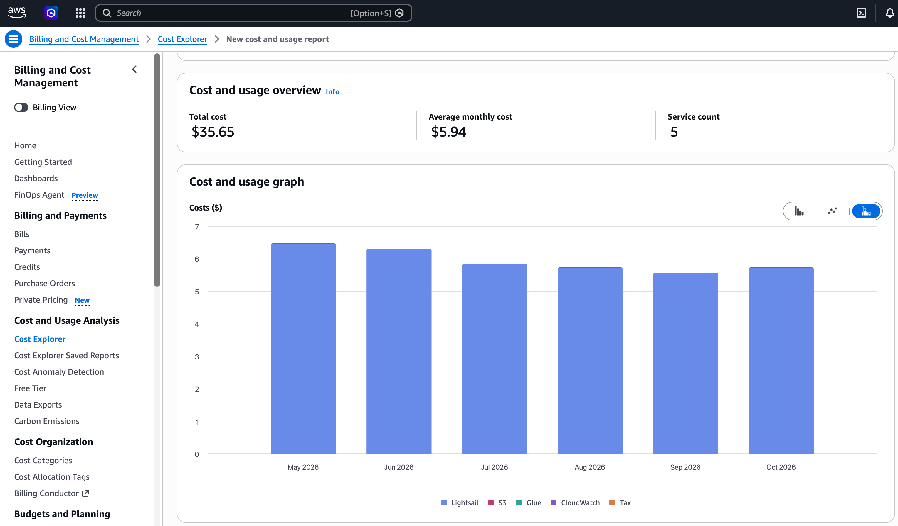
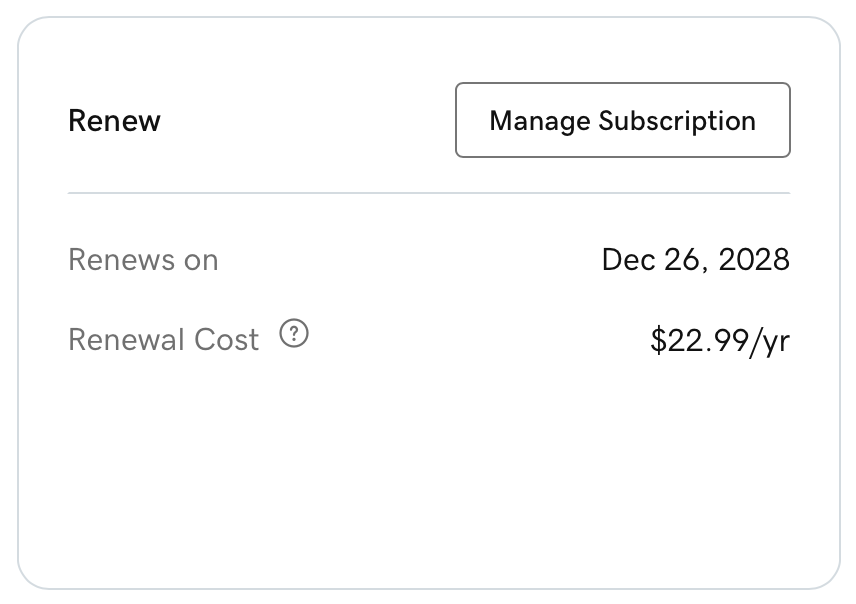
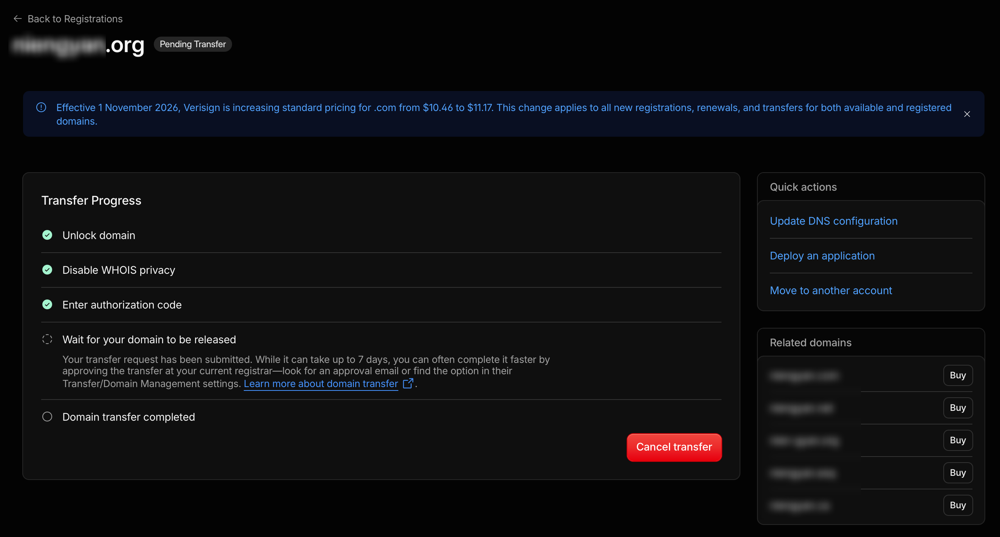

> This is a complete record for myself: the next time I change this site, or move another old site the same way, read this first. The site was built for a lab many years ago; below I just call it "this site" and leave out its name and domain. The one doing the work was Claude Code on a Mac mini; I made the decisions and clicked confirm.

## Summary at a glance

| Item | Before | After |
| --- | --- | --- |
| Hosting | One AWS Lightsail server, running only this site | Cloudflare Workers static assets, free |
| Cost | $35.65 for six months, averaging $5.94 a month, about $71 a year | **Server cost 0**; only the domain registration fee is left |
| Stack | Python 2.7 + Flask 0.12 + Apache, Ubuntu 16.04 (unsupported since 2021) | Python 3.12 + Flask 3 exporting static files; the admin runs only locally |
| Update frequency | Changed about twice a year | Unchanged; after editing, `make publish` goes live in half a minute |
| Large files | S3: research page videos + PyMOL downloads, 26 files, 362MB | Videos go into the site; 17 download files go on R2 (free tier 10GB) |
| Time | 2 months of development back then; then deployment, data updates, and for 2.0 adding the admin and writing tutorials, so there was always maintenance work | **Static conversion done in one day** |
| Trade-off | — | Direct connections from mainland China got slower (see the measurements below); I accepted it |



To keep it stable, I never ran any other service on this server. **I changed the content twice a year and still paid $6 every month.** That's money I should have saved long ago.

## Why it can be made static

First I listed the "dynamic" parts clearly, so I could tell whether they could be moved:

| Part | How it used to work | After static conversion |
| --- | --- | --- |
| 6 pages | Jinja templates + SQLite queries | Exported as HTML |
| 10 research subpages | `/research/<name>` renders the matching template | Exported one by one |
| 3 JSON endpoints | `?selectedItem=…`, `?selectedTag=…`, `?tag=…` query strings | Changed to path parameters, each address exported as a `.json` file |
| Admin | Flask-Admin, Basic Auth, edited directly on the live site | Kept as is, runs only locally |
| Page cache | Flask-Cache, cleared after admin submissions | Removed |

On the visitor side there are no forms, logins or search — **it's all read-only**. That's enough. The data is small too: 221 papers, 105 structures, 55 members, a 164KB database, 39MB of images.

## Export

I didn't use Frozen-Flask; I wrote an 88-line `freeze.py` that requests each URL through Flask's `test_client` and writes the file. Reasons:

- I wanted `/people` written as `people.html`, so the hosting platform maps `/people` to it automatically; Frozen-Flask by default writes extensionless files.
- **Endpoints with query strings can't be exported**, so the routes had to change first.

How I changed the endpoints:

```text
/current_structure?selectedItem=5GMK  →  /data/structure/5GMK.json
/orientation_tag?selectedTag=…        →  /data/orientation/0.json   (numbered in page order)
/current_event?tag=Fun Time           →  /data/event/fun-time.json
```

Orientation names contain spaces and `&beta;`, which don't work well as filenames, so I used numbers. I changed one or two request URLs in each of the two front-end JS files.

While I was at it, I also wrote two files the hosting platform understands:

```text
_redirects   /index → /, and one old section address redirecting to the new section
_headers     /static/* cached 1 day; /data/* cached 10 minutes
```

`_headers` was added after going live: Workers static assets default to **`max-age=0, must-revalidate`**, so the browser has to check back with the server for every image; a structure page with dozens of thumbnails means dozens of round trips. The old server cached for 12 hours.

## Python 2 → 3

The code base isn't big (about 700 lines excluding data), but **a few places fail silently**:

| Problem | Symptom | Fix |
| --- | --- | --- |
| `zip()` returns an iterator in Python 3 | The template loop is drained after one pass; `json.dumps` serialization fails | Wrap in `list()` |
| `r.encode('utf-8')` | Orientation names become `b'…'` written into the page | Removed |
| `flask.json.dumps(…, cls=…)` | Since Flask 2.3 `cls` is ignored, the custom encoder doesn't take effect, raising `Category is not JSON serializable` | Switched to the standard library `json` |
| SQLAlchemy 2 single-column queries return `Row` | Not a tuple, so the encoder doesn't accept it | `[list(r) for r in rows]` |
| Custom encoder scans fields with `dir(obj)` | SQLAlchemy 2 adds attributes like `registry` | Changed to take only `mapper.column_attrs` |
| `__unicode__` references `self.name`, but the model has no `name` | Never called under Python 2; Flask-Admin calls `__str__` under Python 3 | Changed to the real field |
| Flask-Admin 2 only ships Bootstrap 4 | `label label-info` and `well` in 24 custom admin templates stopped working | Replaced with `badge` and `card` |
| One global session, the local dev server is multi-threaded | Occasional mix-ups | `scoped_session` + `remove()` in `teardown_appcontext` |
| Database path hardcoded to `/home/<user>/…` | Not found on another machine | Changed to a path relative to the project directory |

I also turned up an old bug that I planted myself back then. The 4th tab name on the structure page contains a Greek letter; the tab text goes through HTML decoding (`&beta;` → `β`), but the name list passed to the endpoint wasn't decoded, so the two sides didn't match. It used to show up only because the server had a hardcoded fallback. **After static conversion the fallback was gone, and the problem surfaced.** Fixed by decoding before comparing.

## Verification: line-by-line comparison with the live site

Before changing anything, I saved a snapshot of the live site: 7 pages, 12 research subpages, 112 JSON endpoints (one per structure). After export I compared them one by one:

- The 19 pages are **line-by-line identical** after stripping whitespace;
- **The 112 JSON files match** (ignoring the related fields with `null` values that the old encoder emitted extra);
- I clicked through it in a headless browser: the 4 tabs on the structure page add up to 23+36+18+28=105 structures, matching the database count; detail pages have images and text; the 3 lab activity tabs work;
- Screenshots at 375 (phone), 768 (tablet) and 1400 (desktop) widths: list pages are **pixel-identical** to the live site.

I tested the admin on a temporary copy, without touching the real data: **create, edit and delete in 15 sections**; after uploading a structure image, the main image gets cropped to 500×500 and a 100×100 thumbnail is generated automatically; deleting a record deletes the file along with the thumbnail; uploading and deleting media files; then clicked through the new-paper form in a real browser (the year is a select2 dropdown), saved it, and it showed up on the paper page.

## Deployment: Workers static assets

I originally planned to use Cloudflare Pages. The new wrangler (4.157) runs `pages project create` by redirecting to creating a Worker, and fails if no static directory is given. **Pages has been merged into Workers**; what's recommended now is Workers static assets, with the same free tier, and it supports `_redirects`, `_headers` and 404 pages.

```jsonc
{
  "name": "<worker name>",
  "compatibility_date": "2026-11-01",
  "routes": [{ "pattern": "<domain>", "custom_domain": true }],
  "workers_dev": false,
  "preview_urls": false,
  "assets": {
    "directory": "./build",
    "html_handling": "auto-trailing-slash",
    "not_found_handling": "404-page"
  }
}
```

The permissions the API token needs (the first dropdown is Zone or Account; pick the wrong one and the later items won't show up):

| Scope | Permission | Purpose |
| --- | --- | --- |
| Account | Workers Scripts · Edit | Deploy |
| Account | Workers R2 Storage · Edit | Create buckets, upload files, bind the domain |
| Zone (only these domains selected) | DNS · Edit | Change records (note: not DNS Settings) |
| Zone | Workers Routes · Edit | Bind custom domain |
| Zone | Dynamic URL Redirects · Edit | Redirect rules |

If the Token only has Pages permissions, wrangler can't read the account ID, and `CLOUDFLARE_ACCOUNT_ID` has to be set manually.

For day-to-day use I wrapped it in a Makefile:

```bash
make admin     # open the admin locally to edit content
make publish   # export → deploy → commit and push the database and images to GitHub
```

The auto-commit in `publish` is there because the content (database, images) is also in the repo. It used to be a manual step, and **if I forgot, the "backup" on GitHub was actually stale**. I will definitely forget.

## Moving S3 to R2

The videos and download files on S3 have hotlink protection: only requests whose Referer is the https version of this site get through. So a plain curl gets a 403, but with the Referer it downloads fine, **no AWS keys needed**:

```bash
curl -H "Referer: https://<domain>/" -o file "https://s3.<region>.amazonaws.com/<bucket>/<path>"
```

- **9 videos** (1.5–4.7MB) went straight into the site. The `+` in filenames was changed to `_` to avoid ambiguity in URLs.
- **17 PyMOL files** (largest 47MB, over the 25MB per-file limit for Workers static assets) went on R2, bound to the subdomain `files.<domain>`. Uploaded with `wrangler r2 object put --remote`; after uploading, each was downloaded and its SHA-256 compared, matching the S3 originals.

After binding the custom domain, a few files returned 403 for the first minute; once the edge nodes synced, they were fine.

## Domain

### Changing nameservers

In Cloudflare, go to Add a site → Connect a domain, and the DNS records are imported automatically. After importing, **first change the records pointing at the old server to a grey cloud (DNS only)**: the old server does its own http→https redirect, and some Cloudflare SSL modes send requests to the origin over HTTP, so the two together can cause an infinite redirect loop. Once they're grey, the site is still served by the old server until the switch.

Gotcha: **different domains aren't necessarily assigned the same pair of nameservers**. I filled in the same pair for two domains in bulk at GoDaddy, and one of them stayed pending; I checked the API and found it had been assigned a different pair.

### Switching

Delete the A record for the main domain, then immediately bind the Worker custom domain via the API (the certificate is issued automatically). Visitors who still have the old record cached keep going to the old server, which is still running, so there was no downtime.

For the domain used only for redirects: point the root record at the placeholder address `192.0.2.1` with the proxy on, then add a 301 rule so requests are redirected at the Cloudflare edge without hitting the origin. The target address in the rule:

```text
Keep the path: target_url.expression = concat("https://<main domain>", http.request.uri.path)
Fixed address: target_url.value = "https://…"     ← writing this as an expression gives a Filter parsing error
```

### Registrar





For the same .com, GoDaddy renews at $22.99/year, Cloudflare at cost, $11.17/year (it just went up from $10.46 on November 1), **a difference of $11.82 a year, roughly half the price**. To transfer, first make the domain active on Cloudflare, then unlock it at GoDaddy and get the authorization code; you pay for 1 year at transfer time, and it's added after the existing expiry date, so nothing is wasted. Don't change the registrant info before the transfer completes, or the domain gets locked for 60 days.

## Access from mainland China

**This is the only thing that got worse.** On the afternoon of 2026-11-05, over the same home broadband connection, I connected directly and requested one 2KB logo each time:

| | Success | Average time |
| --- | --- | --- |
| Cloudflare free plan | 17/20, 3 timeouts | 4–8 seconds |
| Old server (AWS Ohio, US) | 10/10 | 0.9 seconds |

Breaking it down, establishing the TCP connection takes 0.27 seconds, about the same as with AWS; the slowness comes from the occasional 3–5 second stall afterwards, as if from packet loss and retransmission. Access from overseas is faster, by contrast. After looking at the data, I decided to accept it. No rollback. To get fast access in mainland China, the only option is ICP filing and a domestic CDN.

Also, **`*.workers.dev` is blocked entirely in mainland China**: DNS resolves to the wrong address, and even a connection to the real IP gets reset during the TLS handshake. The test address could only be viewed through a proxy; once I bind my own domain, it isn't affected. I later shut down that test address too (`workers_dev: false`).

## While I was at it: moving the blog's image host back into the repo

In 2020 I wrote a post about [setting up an image host with Amazon S3 + uPic](/成长日记/2020/04/30/amazon-s3-with-upic-picture-bed/). That bucket had 44 images, 39 of which were referenced by the blog, 3.3MB in total. I'd long forgotten the key and secret from back then. Fortunately **the images were public anyway, so I could just download them**, no key needed. They went into the repo under `img/markdown-img/`, and the links in 10 posts and the about page were changed to paths within the site. Later posts already put images straight into `/img/`.

To see all the files in a bucket when you don't have a key, use CloudShell in the top-right corner of the AWS console, which uses your current logged-in identity:

```bash
aws s3 ls s3://<bucket> --recursive --summarize | tail -3
```

## How much to let the AI do

Claude Code's safety checks stopped me twice: once when deleting the DNS records for the production domain, and once when making an R2 bucket public on a subdomain. It was right to stop me, **both steps affect the outside world and are hard to undo**. After I'd read the list of changes and the rollback plan it laid out, I replied "confirm", and only then did it go ahead. Another time it wanted to borrow another Token to look up the account ID, and that was blocked too: that Token is for renewing certificates for another service and shouldn't be repurposed.

## Pitfalls

1. In zsh, a URL containing `?` without quotes is treated as a glob, and the command fails with `no matches found`.
2. zsh doesn't split variables on spaces, so `set -- $r` doesn't give you multiple arguments, and my validation script flagged everything as "abnormal" because of it.
3. Going through a proxy from my machine, each request to Cloudflare takes 1–2 seconds; after a headless browser views a few pages with video, the next page hangs and times out. Interactive tests need a separate page.
4. Workers static assets have a per-file limit of 25MB.
5. The Google Analytics the pages referenced was the old UA code that had stopped collecting data back in 2023, and it was also slowing down page loads, so I removed it.

## Not done yet

- After monitoring it for a week or two, delete the S3 bucket and shut down the old server; then remove the test subdomain record pointing at the old server and the `deploy/` directory in the repo.
- I haven't tested the speed in mainland China during peak hours; I assume it's only worse.
- The other 10 defensively registered .com domains are still at GoDaddy; I'll decide before they expire whether to transfer them.
