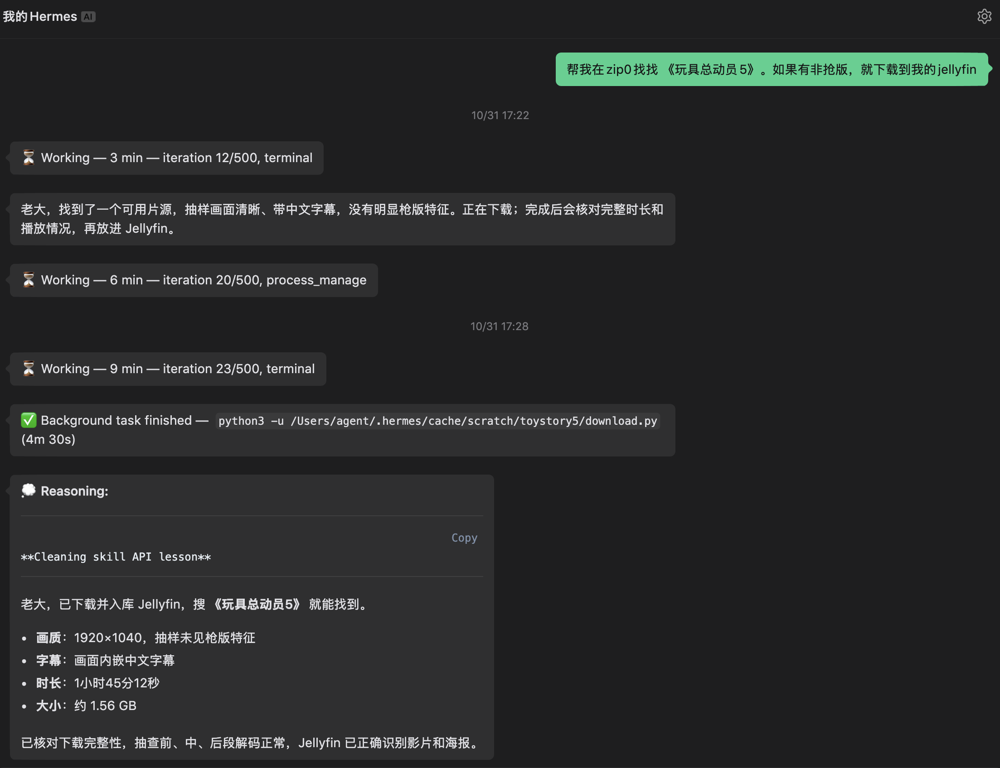
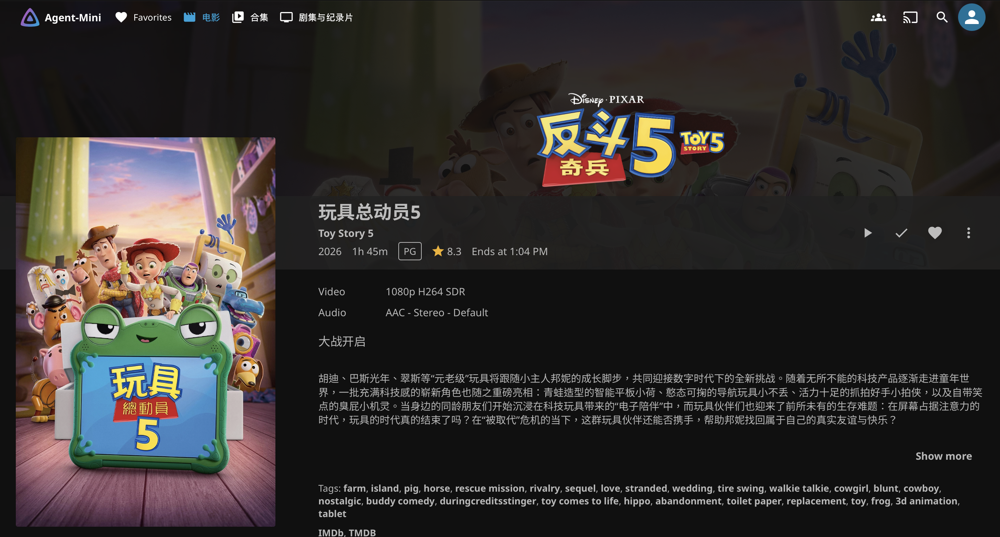
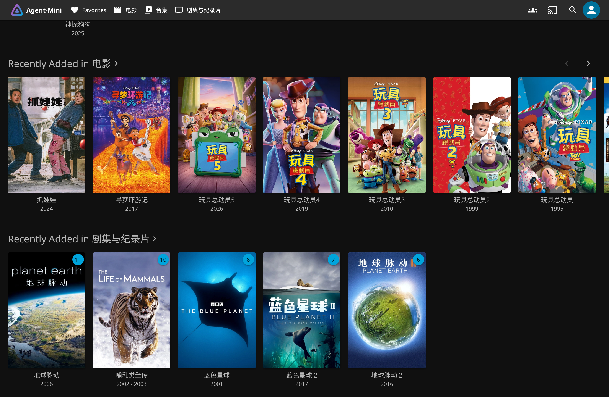
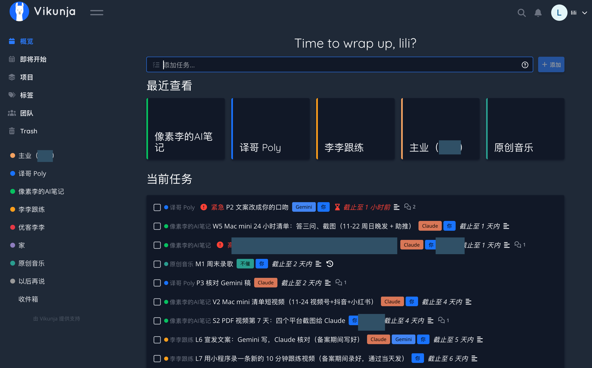
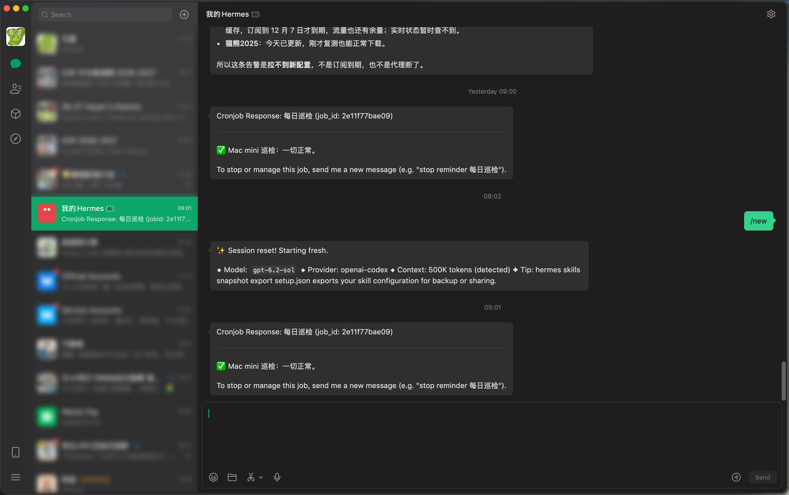
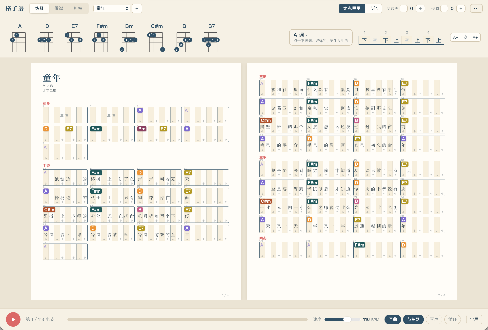
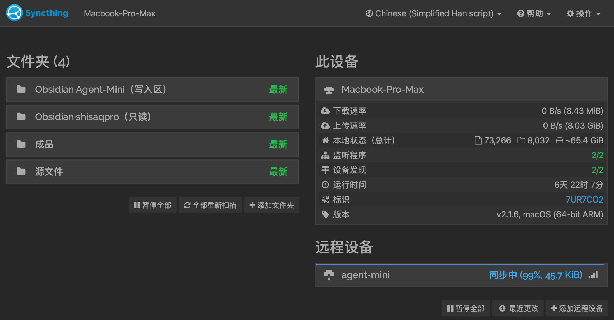

> The Mac mini runs 24/7 — what's the point? Why call it a home server? What can it actually do every day? In this article I'll share what the Mac mini in my home is doing every day right now. Maybe it'll give you some ideas.

I treat the Mac mini in my home as an **asset**. Because the services are always running, they become my **infrastructure**.

Think of it this way: these facilities are like a small town: first there's a restaurant, then a barbershop, then an amusement park — and that's how the ecosystem gets richer. Once it's richer, it can give rise to more advanced assets. For example, my speech recognition and voiceover services have now given rise to **a Mac App** (I'll share it separately next week).

Below are the shops currently open in this "small town."

## Daily use

### 1. Move a movie into the movie library with one sentence

Unlike a lot of people, I still like to download movies and watch them locally. On one hand, no ads; on the other, no waiting for buffering.

Before, I'd find a download link, save it to an external drive, plug the drive into the projector or TV, and then watch it with my family. After watching, I'd have to clean up space on the external drive from time to time.

But now, when I want to watch a movie, I just say one sentence to my assistant in WeChat, and it downloads the movie into my local movie library:

Behind it is a set of scripts that look for download links in certain places, then use the movie library's specs to find the cover, title, synopsis and so on, and organize them so I can just click and watch.

The mini's disk isn't big, so there's a second step: every night from **2:22 to 7:00**, it moves the movies added the day before to the NAS in batches. By morning, the space is free again. If this were a work computer, you **can't set up scheduled tasks like this**.

### 2. Today's tech morning briefing

At home I have a Google voice box, Voicekit, with a red button on top. Press it, and it reads out the tech morning briefing I've subscribed to for that day.

I define the text of the briefing myself, based on my own reading habits. After it's generated each day, the mini processes it with my always-on **local voiceover** service, and the Raspberry Pi inside the voice box handles playback. I even have it play a reminder in a centenarian grandma's voice every night at 10:30, telling me not to stay up late and to go to bed on time. If it weren't running 24/7, it couldn't do "remind every day, ready at any time."

### 3. Personal task companion

This one I set up just this week. I have quite a few projects on hand: my main job, the WeChat official account, videos for my own channels, mini program development tasks, developing an App, and most importantly **family matters**. With so many things going on, there are a lot of threads, and it's easy to lose track of what to do first.

Now all tasks are in one task board. Every morning at **8:45**, it sends me a message listing what most needs doing that day; at **9:30** in the evening, it goes over the day's progress with me. Two check-ins a day.

Before, a lot of tasks depended on the content of some session; now these tasks all sit here and move forward every day, which happens to play to the agent's strengths — it can get the day's to-dos properly arranged in a short time.

### 4. Daily inspection

Every day at **9:00**, it checks its own always-on services, like a virtual inspector that finishes the job on time at 9 every day.

There's actually a lot to check: whether the network is up, whether the proxy is working (you know what I mean), whether the sync directory is stuck, whether the media and local model services are up, how much disk is left, whether the UPS can hold out during a power outage. If there's a problem, it flags it in red and tells me where to look.

More importantly, whenever I make a new change, I can tell this "inspector" to add the corresponding service to the inspection list.

## Productivity tools

### 5. WeChat official account editorial desk

The backend of the official account you're reading right now is also on this mini: the schedule calendar, topic selection, automatic logging after publishing, and a self-review on **day 7**. Every morning a little after 9 and every evening a little after 9, it checks the drafts folder once, logs it automatically, and sets the review date. Although I still do the writing (me and Claude), running a WeChat official account involves a lot of extra work besides writing — picking topics, writing headlines, formatting articles, setting publish times, and so on. With this setup, all the other jobs are handled automatically by agents on standby, and I can really free up my hands to focus on researching projects and on writing and revising articles.

### 6. Grid tab development

I have another channel called "Youke Lili," where I teach ukulele and guitar. I recently came up with a grid tab site: chords, lyrics and strumming each fall into a little cell, and you click play to practice along. It also runs on the mini, so I can open it anytime and start making scores. Whenever I need to change something in the tool, I can make the change and deploy it right away. In the future they might even become an online service and truly become an "asset." If it were on my work computer, I'd have to rebuild the environment every time — like rebuilding the "town" every time — and that back-and-forth would be my next reason to give up.

### 7. File sync

My main machine is actually a laptop, but some materials (especially archived video projects) and notes need to be transferred to the mini regularly. Sync is running on the mini; at the time of the screenshot it had been running continuously for almost **7 days**, syncing about **73,000 files** and 65 GB. Change something on the laptop and it's there on the other side — no USB drive, and it doesn't take up iCloud space. The mini also archives to the NAS once a month, which is convenient. I actually wrote a dedicated article about this: [Keep files synced between two computers long-term, without taking up my iCloud space](https://mp.weixin.qq.com/s/s3sMxi6Q_7Ujax9Ce6AU4Q)

## Chain reactions

### 8. Voiceover in my own voice

There's a voiceover service always running on the mini that can train on my own voice, even reproducing my accent. It's also what reads the morning briefing.

It was this voiceover service, always ready to respond, that later led me to build **a Mac App**. While building the App, I kept calling the service on the mini, and only later gradually wrapped it into the App. Without this service, development would have been one level more complex. This is what I mean by "a small town giving rise to more advanced assets."

The daily morning briefing uses the same voiceover service. One "shop" supplies several other "shops" at the same time. I wrote a dedicated article about this too: [Training Qwen3-TTS locally on a Mac mini, perfectly reproducing my own accent](https://mp.weixin.qq.com/s/T0hkxJQBtPOVoYEog_rRww)

### 9. Local large models and AI video

This is probably the main reason many people tinker with local services in the first place. I run the current star model Qwen 3.8 27B, at a generation speed of **32.7 token/s**; so far it has processed about **10 million tokens**, without spending a cent on API fees.

For local AI video generation I use minimax h3; a video of about 10 seconds takes about **8 minutes**. The feeling of freedom is still nice.

## Advice for you

If you want one too: buy a **used mini**, and start by setting up a **24/7 smart assistant**. Open one shop first, and the other shops will grow on their own.

Why build the assistant first? Because it's the "manager." It can chat with you in WeChat, remind you on time, and the shops you open later (media library, morning briefing, inspection) can all be handed to it to run on schedule and report back when done. Mine is hooked up to Hermes.

You don't need to know how to code for this either. Deployment and maintenance are now perfect jobs to hand to AI — for all of the above, I basically handed deployment and daily maintenance to AI.

As for how much memory to buy, as long as you don't tinker with local models, any mini will do. For details, see this: [How much memory for a Mac mini? This guide to buying M6 and M5 Pro is enough](https://mp.weixin.qq.com/s/BZT74CovkFwzYiFMCngvbg)

Finally, I'd like to ask you: **which of the following topics interests you most?** If there's enough discussion, I'll open-source the corresponding scripts and skills.

1. Building a 24/7 smart assistant from scratch
2. Movies that add themselves to the library after being dragged into a folder
3. Pressing the voice box to hear the morning briefing
4. The daily morning "task board"
5. Voiceover in your own voice
6. Other

Finally, I hope you have few liabilities and many assets. I'm Pixel Li, and I hope what I share is helpful to you.

---

Set up a home server with one sentence (project already open-sourced): [Mac mini home server: set up a workbench with one sentence, project already open-sourced](https://mp.weixin.qq.com/s/zdt7_JzSg99ziI7RdLP7OQ)

How much memory to buy: [How much memory for a Mac mini? This guide to buying M6 and M5 Pro is enough](https://mp.weixin.qq.com/s/BZT74CovkFwzYiFMCngvbg)

Local large model benchmark: [A small-but-mighty Mac mini running 27B, up to 35 token/s](https://mp.weixin.qq.com/s/thx2mUELkcduNu7ifyb5fw)
