选购 Mac mini 的关键是什么？CPU 已经同级别碾压了，存储空间后期还可以自己加；但**内存是焊死在主板上的**，而内存的大小跟它作为服务器的用途息息相关。

买小了，以后想跑的模型放不下，只能换机器。买大了，妥妥的杀鸡用牛刀。而不同的配置，差价就有上万元。如果你也想买一台，内存买多大、芯片怎么选、大概要花多少钱？

下面先给不同用途的推荐配置，完整的配置表和价格表放在文末。

## 先看推荐

1. 只当家里的服务器，**不跑大模型：16GB**。M6 16+512 8,499 元，甚至 M4 二手 3,000–4,000 元。
2. **想试试本地模型：M6 32GB**，9,999 元起。27B 能跑但很慢；MoE 模型快，写文章够用，但整体质量不及稠密模型。
3. 想把 27B 当日常用，**聊长对话：M5 Pro 48GB**，19,749 元。
4. 还要同时挂别的服务，或者以后想试**更大的模型：M5 Pro 64GB**，20,499 元起。
5. 2 万上下，更看重速度：**Mac Studio 起步款 19,999 元**，比 mini 64GB 还便宜，但内存只有 36GB。预算到 2.7 万，Studio 64GB 比 mini 64GB 更值。

用途确定后，**硬盘选 512GB 就够**，256GB 实在太小。更大的容量不必一步到位，省下的钱后面自己加外置硬盘，或者找专业机构改造内置硬盘。

本地模型我就拿现在最火的 Qwen3.8-27B 举例了，引擎是 oMLX。我这台是 M5 Pro 64GB，余量最充足，模型在不同设置下实际占多少内存，都能测出来。其他档位我没有真机，是拿实测的内存峰值去算的；M6 的速度用的是公开的实测数据。

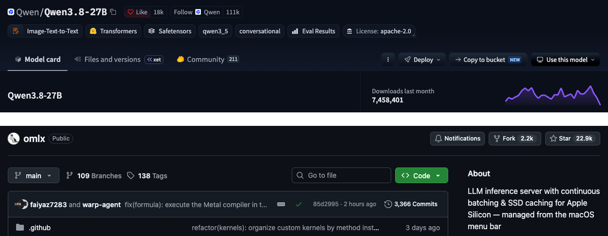

## 本地模型内存占用参考

- 27B 4-bit（Q4）短对话：峰值 17.2GB
- 27B Q4 聊到 160K 上下文：峰值约 38GB
- 27B 8-bit（Q8）短对话：峰值 29.0GB

这只是模型这一个进程。macOS 自己、浏览器、后台服务也要占内存。所以**要拿总内存减掉模型峰值**，看剩下的够不够其他程序日常使用。

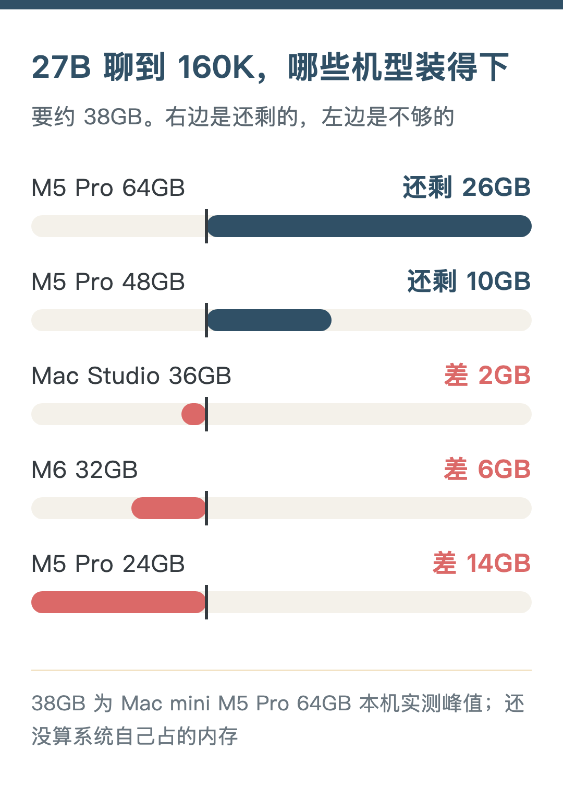

内存不够时，Mac 会把一部分内容挪到硬盘上（swap），程序不会马上崩。看着能跑。但我不把这算“能用”。**频繁 swap，服务器就不稳定了**。

## 个人本地服务器最佳选项：16GB

16GB 内存的机器不要考虑本地大模型。**它的定位很清晰：本地服务器**。

我这台长期挂着 Hermes（AI 助手，16GB 上就只用云端模型）、Jellyfin（家里的影音库）、Syncthing（几台设备之间同步文件），16GB 跑这些没压力。

其他适合长期挂着的还有这些：

1. Time Machine：家里其他 Mac 自动备份到这台。系统自带，在共享设置里把一个文件夹设成备份目的地就行。备份吃硬盘，一般外接一块容量充足的盘。
2. AdGuard Home：在 DNS 这一层拦广告和追踪域名，路由器指过来，全家设备都生效。它只按域名拦，不是所有广告都能去掉。
3. FreshRSS：自己的 RSS 阅读器，手机和电脑共用一份已读状态。
4. Paperless-ngx：合同、发票、说明书扫进去，自动 OCR，以后按字就能搜到原件。一次导入一大堆旧文件时，OCR 会有峰值。

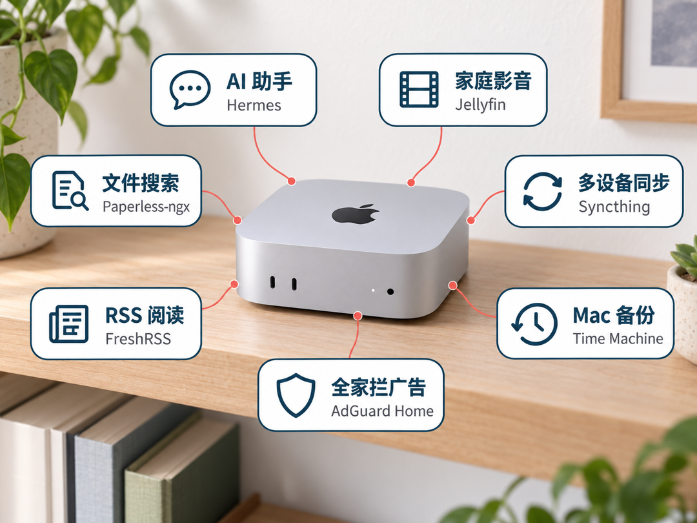

FreshRSS 和 Paperless-ngx 一般用 Docker 跑，要多开一个 Linux 虚拟机。Docker Desktop 默认给它的内存上限是主机的一半，16GB 机器就是 8GB。所以**一项一项加**，OCR、视频转码这种有峰值的活错开时间。

这一档芯片不重要。M6 16GB 的带宽是 153GB/s，比 24GB、32GB 款的 170GB/s 还低一点，但当服务器用不到这个差别。二手 M4 也够。

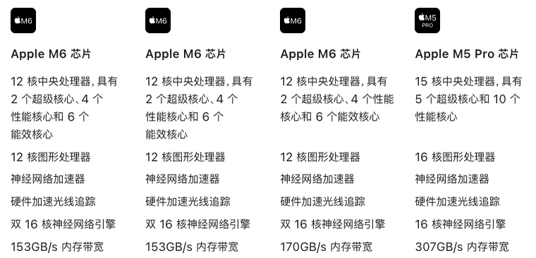

既然舍去了本地大模型，这个档位适合思路清晰，锁定云端大模型的玩家。既有云端顶级大模型加持，又有7x24随时响应的个人服务器，还能省下一大笔钱。

值得一提的是，虽然 M6 起步款比 M4 当年的 4,499 元贵了 2,500 元，但这颗 2 纳米的芯片是实打实的厉害。

## 本地模型：M6 32GB

先算内存。27B Q4 短对话峰值 17.2GB，32GB 还剩 14.8GB。放得下。聊到 160K 要约 38GB，已经超过总内存，上下文只能收短（推算）。

再看速度。模型每输出一个 token，大致都要把权重从内存里读一遍，所以**输出速度跟内存带宽关系很大**。M6 是 170GB/s，M5 Pro 是 307GB/s，差了 1.8 倍。

M6 我没有真机，查了别人的实测，都是 32GB 款跑 Qwen3.8-27B 4-bit：

- 一位德国网友在 GitHub 公开的测试（LM Studio，GGUF 格式）：写英文、德文段落每秒 11–12 个 token，写代码 17.5 个
- 一个视频评测（直接用 MLX）：每秒 8–9 个

我这台写 300 字是每秒 25.9 个。引擎、格式都不一样，不能严格对比，但差距在 2 倍以上，比带宽差得还多。M6 只有 12 核 GPU，我这台是 20 核，可能也有关系（我猜）。

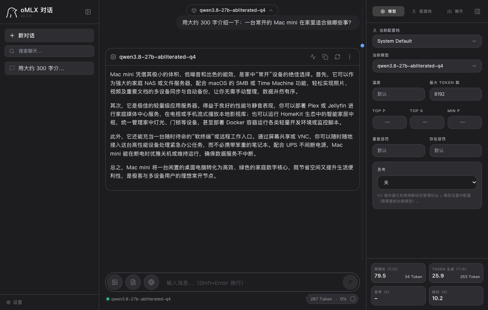

按每秒 10 个左右的速度，偶尔问几句可以，当日常主力偏慢。所以 27B 在 M6 32GB 上仅限于能跑。**日常使用基本劝退**。

想在 M6 上跑得快，可以换 MoE 模型。MoE 总参数大，但每输出一个 token 只用其中一小部分，要读的权重少，对带宽要求就低得多。

拿 Qwen3.6-35B-A3B 的 4-bit 版来说。M6 32GB 上有两份别人的实测；我这台也用 oMLX 跑了同一个模型的 4-bit 版，提示词类型和参数照着 GitHub 那份测试来：

- 短输入（德语、英语、代码、JSON）：M6 每秒 63–69 个 token，我这台约 110 个，**是 M6 的 1.6–1.7 倍**
- 读入约 2 万 token 的资料后：M6 每秒输出 58.5 个，我这台 80.4 个；读入速度 M6 每秒 1,215 个，我这台 2,176 个

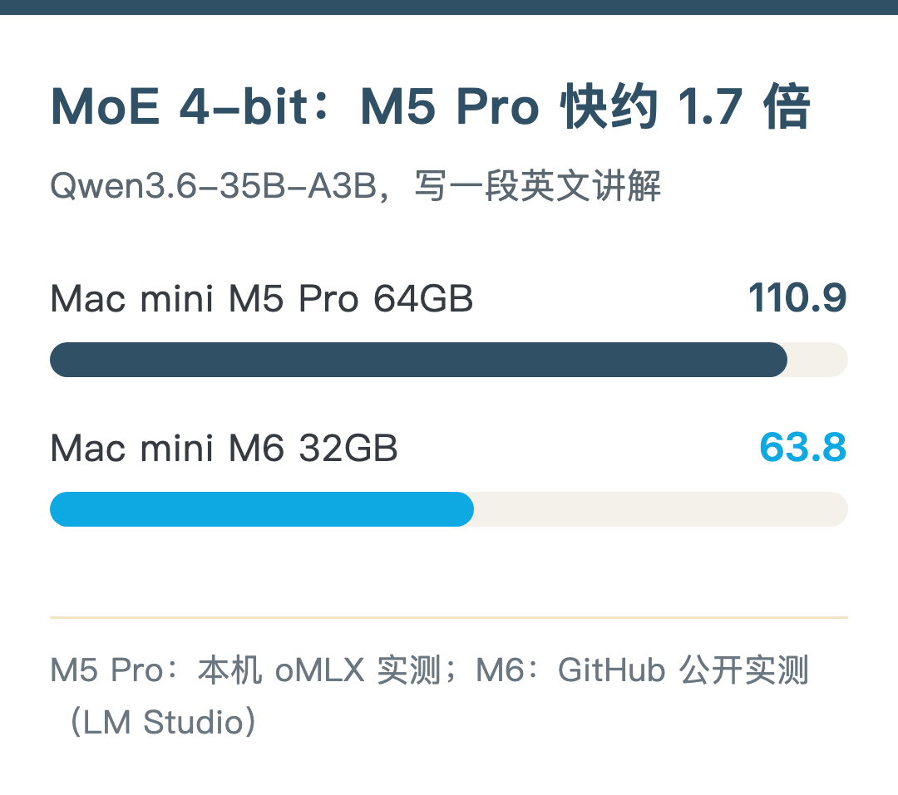

带宽差 1.8 倍，短输入的速度差跟它很接近。

本机内存测试如下：

- 短输入：峰值约 21.5GB
- 读入 2 万 token：约 23.7GB
- 读入 6.5 万 token：约 24.7GB
- 读入 13 万 token：约 27.0GB

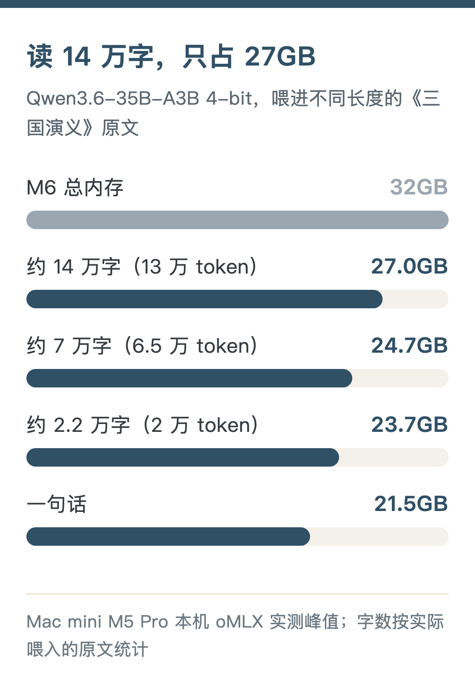

全程没用 swap。MoE 读长资料，内存涨得很慢。拿 32GB 去减（推算）：短输入剩约 10GB，2 万 token 剩约 8GB，13 万 token 只剩 5GB。日本那位用户报的是 19.7GB，比我测的低一些，可能是统计口径不同。

所以 M6 32GB 跑 MoE 4-bit，**长资料也读得进去，剩 8–10GB 给系统**，开开浏览器、日常办公可以。但模型只能开这一个，再挂 Docker、影音库这类服务可能就得错开用了。

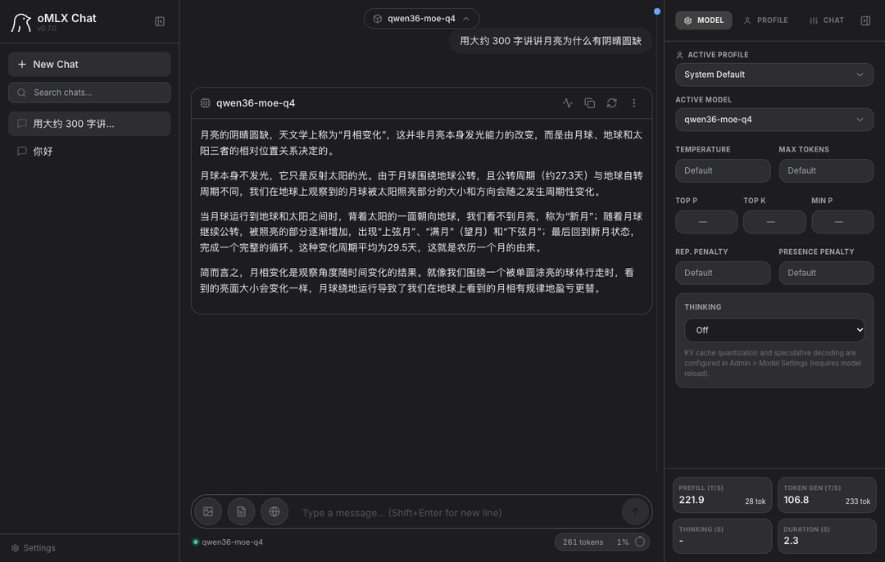

当然 MoE 也有代价。在我这台 mini 上，它每秒约 110 个 token，是 27B 的 3–4 倍；可 35B-A3B 每个 token 只激活约 3B 参数，**质量会比 27B 差一些**。我就怕它一直输出低质量的内容，擦屁股的工作更不好做。所以我日常还是用 27B。如果你更追求速度，Mac 系统还是首选 MoE 吧。

还有一个选项是 M5 Pro 24GB，12,999 元。芯片虽然更快，可内存比 M6 32GB 还少 8GB，27B Q4 短对话剩 6.8GB，再开几个程序就吃紧了。只看本地模型，**这一档有点尴尬**。

## 天天用 27B：M5 Pro 48GB 起

如果天天用本地大模型，免不了聊长对话、丢长资料进去。这时**内存要按 160K 算**：

- 48GB：聊到 160K 剩约 10GB 给系统和其他程序，能跑，不算宽裕
- 64GB：剩约 26GB（本机实测峰值）

M5 Pro 各档带宽都是 307GB/s，48GB 款的输出速度应该接近我这台：回“你好”每秒 35.8 token，写 300 字每秒 25.9 token（48GB 是推算）。

想跑 MoE 4-bit 也宽裕：读入 13 万 token 峰值约 27GB，48GB 还剩 21GB。

## 同时挂别的服务：64GB

这是我这台的配置：M5 Pro，18 核 CPU / 20 核 GPU，64GB 内存。它同时挂着 Hermes、Jellyfin 和本地视频生成 MiniMax H3。

我给模型进程设了 48GB 的上限，剩下 16GB 留给系统和其他服务。就算这样，**模型和 H3 也不能同时跑**。模型约 38GB，H3 约 22GB，合计约 60GB，留给系统的余量太少。我实测过，只能错开用。

所以 64GB 也不是什么都能一起开。错开用，都放得下。

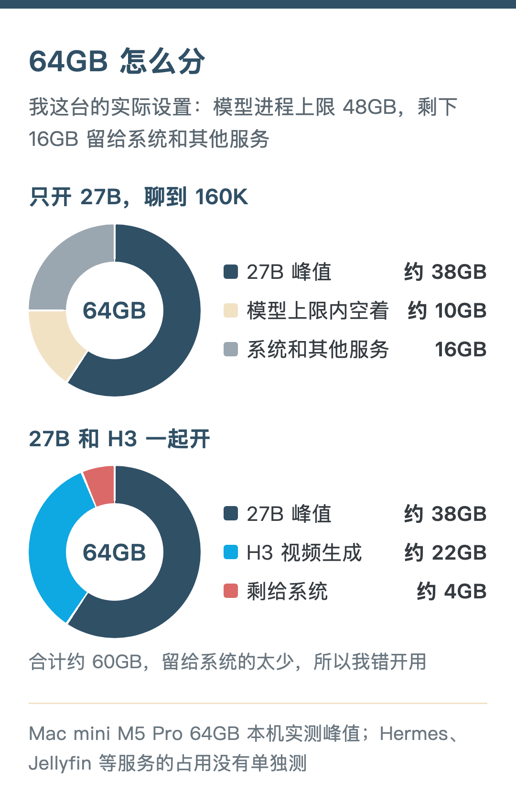

我为什么买 64GB？买一台就打算用很久，而**内存无法改**。

苹果生态在 AI 上发展得很快，很多本地模型，生文字、生图、生视频、生声音，方向都是在保证质量的基础上尽量压缩体积。内存越大，越能有入场券。另外它还要跑日常任务，我不希望频繁出现内存爆满、swap 的情况，否则服务器就不稳定，不能被称作服务器了。

## 2 万上下：Mac mini 还是 Mac Studio

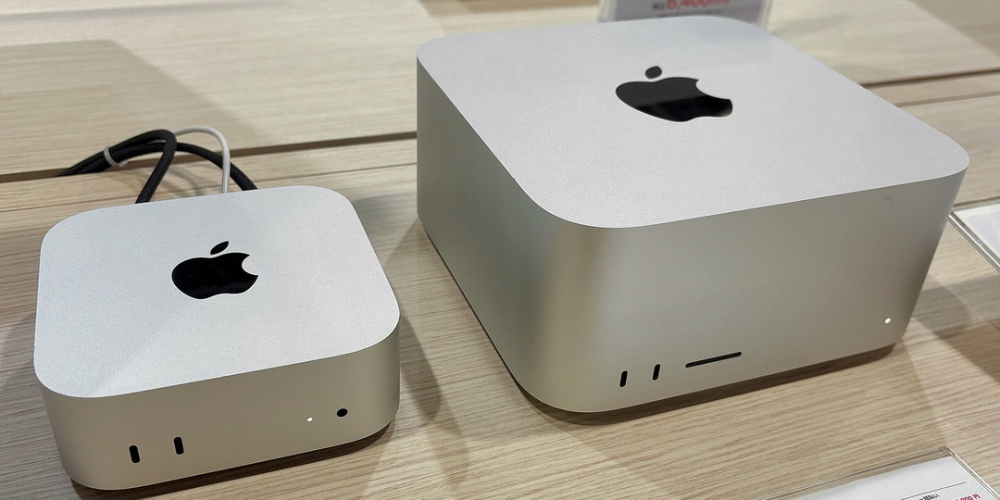

到了 2 万这个价位，Mac Studio 跟 Mac mini 是一个价了：

- Mac mini M5 Pro 48GB+1TB：19,749 元，带宽 307GB/s
- Mac Studio M5 Max 36GB+512GB：19,999 元，带宽 460GB/s
- Mac mini M5 Pro 64GB+512GB：20,499 元，带宽 307GB/s

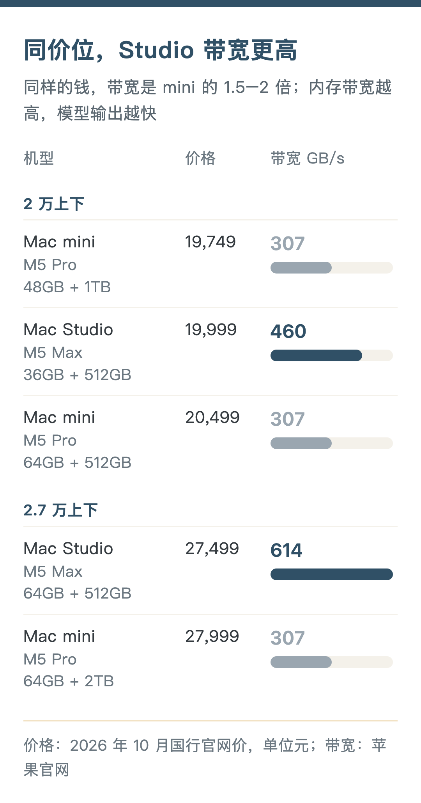

Studio 起步款比 mini 64GB 还便宜 500 元。它是拿 Max 芯片换掉了一部分内存：带宽高 1.5 倍，内存只有 36GB。跑 27B Q4 短对话剩 18.8GB，速度应该会比我这台快；但聊到 160K 要约 38GB，放不下。所以**天天聊长对话，还是 mini 48GB、64GB 合适**；主要是短问短答，又想快一点，Studio 起步款更划算。

预算再往上，差别就更明显了：

- Mac mini M5 Pro 64GB+1TB：22,749 元，带宽 307GB/s
- Mac mini M5 Pro 64GB+2TB：27,999 元，带宽 307GB/s
- Mac Studio M5 Max 64GB+512GB：27,499 元，40 核 GPU，带宽 614GB/s
- Mac Studio M5 Max 128GB+512GB：39,499 元，带宽 614GB/s

同样 64GB+512GB，Studio 比 mini 贵 7,000 元，换来 2 倍带宽和更好的散热。跟 mini 64+2TB 比，便宜 500 元，带宽是 2 倍，只是硬盘小了 1.5TB。**硬盘可以外接，带宽加不了**。预算到了 2.7 万，又主要为了本地模型，Studio 64GB 更值。

现在想想，如果不考虑体积，或许 128GB 的 Studio 也是更好的选择，散热更好，空间更足。苹果自己的芯片也在往前走，我猜愿意再等等的话，后面的芯片大概率更适合本地模型。只是这些都是等待成本。人生百年，等来等去，不如早买早享受。

当然我的现状其实不止是用本地大模型，云端模型总是更香的。除非你清醒地认为本地模型足以胜任你的本地工作，否则最好还是**不要妄想买了 Mac mini 后，从此就能离开云端模型**。

## 硬盘：够用就行，后面外接

**硬盘不像内存，可以后面加**。用途定了，内置盘选够用的就行。

跑本地模型要留空间。只当服务器的话，512GB 就够，影音、备份放外置盘。256GB 实在太小，系统就能吃掉一大块。如果买的是 256GB，我建议直接改造内置硬盘，内置盘比外置盘稳定。改造要找专业机构，可能会影响官方保修。我觉得还是直接 512GB 保险一些。

官网加硬盘的价格不低：M6 32GB 从 256GB 加到 1TB 多 3,750 元，M5 Pro 64GB 从 1TB 加到 2TB 多 5,250 元。这笔钱可以先省下来，后面按需要买外置硬盘。我这台选 2TB，是因为我日常工作上要备份大量视频。只跑模型、当服务器，其实用不着 2TB。

## 配置表和价格表

价格是 2026 年 10 月的国行官网价，没算双十一活动。M4 官网已经不卖，写的是闲鱼二手价。

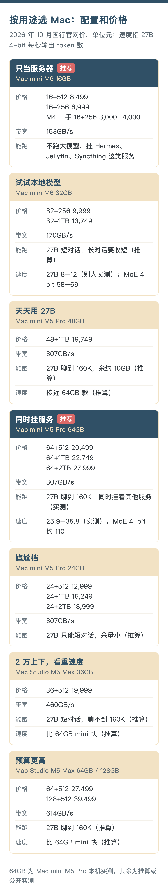

这台 Mac mini 之前的实测：

- [《小钢炮 Mac mini 跑 27B，最快 35 token/s》](https://mp.weixin.qq.com/s/thx2mUELkcduNu7ifyb5fw)：本地大模型怎么配、跑多快
- [《Mac mini 跑 AI 视频：内存占多少，生成要多久？》](https://mp.weixin.qq.com/s/iHqF5izRKrq8wT1bJgvGUg)：本地跑 MiniMax H3 生成视频
- [《两台电脑持久同步文件，不占我的 iCloud 空间》](https://mp.weixin.qq.com/s/s3sMxi6Q_7Ujax9Ce6AU4Q)：16GB 那一档提到的 Syncthing

手上有 M6 32GB、M5 Pro 48GB 或 Mac Studio 的小伙伴，欢迎在评论区留下你的实测速度。还想让我拿这台 mini 测点什么，也欢迎留言。希望对你有帮助。

来源：

- 我这台的数据：Mac mini M5 Pro 64GB 实测，oMLX 跑 Qwen3.8-27B，见上一篇《小钢炮 Mac mini 跑 27B，最快 35 token/s》
- Mac mini、Mac Studio 带宽和配置：apple.com.cn/mac-mini/specs、apple.com.cn/mac-studio/specs
- M6 32GB 跑 27B（LM Studio，GGUF）：github.com/HDZucht/Mac-Mini-M6-LLM-benchmarks
- M6 32GB 跑 27B（MLX，视频评测）：youtube.com/watch?v=7ugFOo8e8H4
- M6 32GB 跑 MoE：github.com/HDZucht/Mac-Mini-M6-LLM-benchmarks、note.com/corestudio/n/n583c1b00f8ef
- M5 Pro 跑 MoE 4-bit：我这台用 oMLX 0.7.0 实测，模型 mlx-community/Qwen3.6-35B-A3B-4bit（2026 年 10 月 20 日）
- M6 2 纳米、6,999 元起：2026 年 8 月 25 日发布会报道（IT之家、新浪科技）；M4 Mac mini 国行 4,499 元起：2024 年发售价（IT之家）
- 16GB 服务器上的服务：Docker、AdGuard Home、FreshRSS、Paperless-ngx 官方文档

---

本文首发于微信公众号「像素李的AI笔记」：[原文链接](https://mp.weixin.qq.com/s/BZT74CovkFwzYiFMCngvbg)。博客版保留了文中的外链，和公众号版不同的地方都标了“博客版”。
