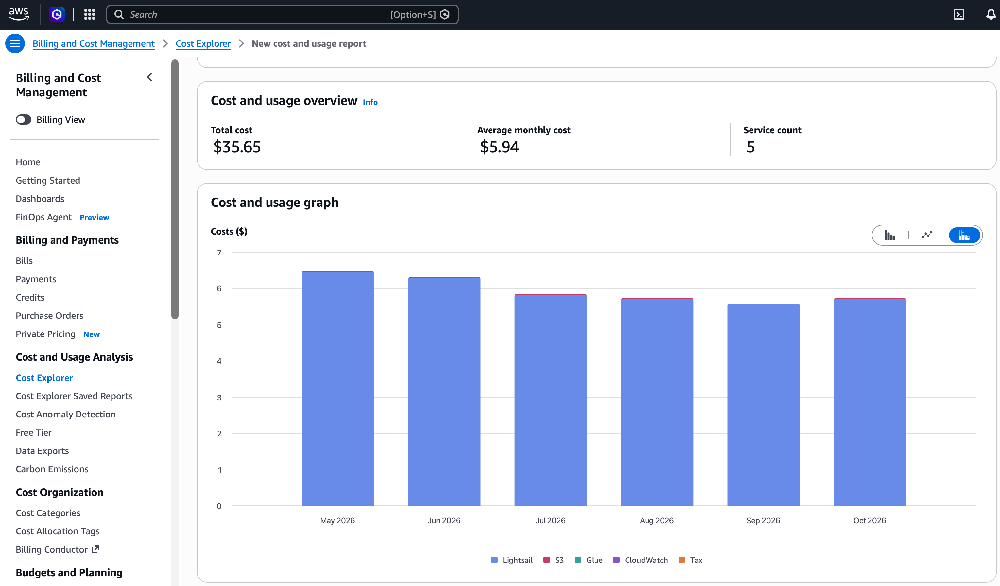
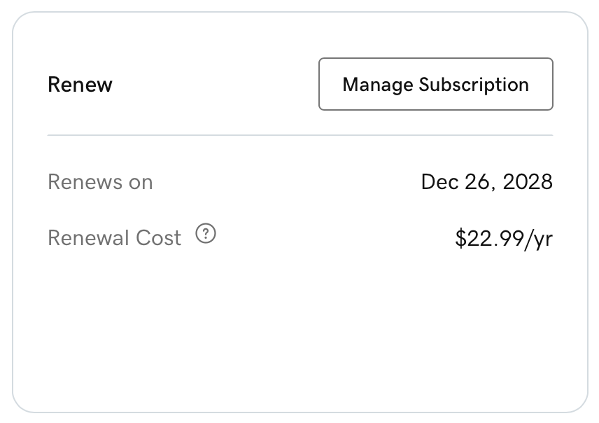
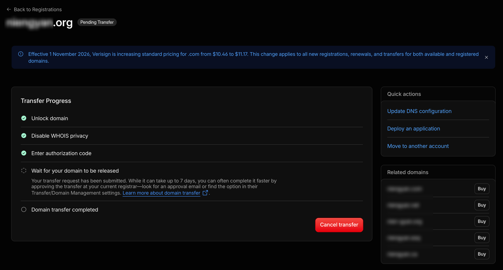

> 这是一份给自己看的完整记录：以后再改这个站、或者把别的老站也这么搬，先读这篇。网站是很多年前帮一个实验室做的，下文只叫“这个站”，不写名字和域名。动手的是 Mac mini 上的 Claude Code，我负责拍板和点确认。

## 结论速览

| 项目 | 之前 | 之后 |
| --- | --- | --- |
| 托管 | AWS Lightsail 一台服务器，只跑这一个站 | Cloudflare Workers 静态资源，免费 |
| 花费 | 半年 $35.65，月均 $5.94，一年约 $71 | **服务器费 0**；只剩域名注册费 |
| 技术栈 | Python 2.7 + Flask 0.12 + Apache，Ubuntu 16.04（2021 年就停止维护） | Python 3.12 + Flask 3 导出静态文件；后台只在本机跑 |
| 更新频率 | 一年改 2 次左右 | 不变，改完 `make publish` 半分钟上线 |
| 大文件 | S3：研究页视频 + PyMOL 下载，26 个文件 362MB | 视频进站点；17 个下载文件放 R2（免费额度 10GB） |
| 时间 | 当年开发 2 个月，之后部署、更新数据、2.0 加后台写教程，一直有维护成本 | **静态化一天做完** |
| 代价 | — | 国内直连变慢（实测见后文），我接受了 |



这台服务器为了稳定，我没让它跑任何别的服务。**一年改两次内容，每个月照交 6 美元。**这笔钱早该省。

## 为什么能静态化

先把“动态”的部分列清楚，才知道能不能搬：

| 部分 | 原来怎么做 | 静态化后 |
| --- | --- | --- |
| 6 个页面 | Jinja 模板 + 查 SQLite 渲染 | 导出成 HTML |
| 10 个研究子页 | `/research/<名字>` 渲染对应模板 | 逐个导出 |
| 3 个 JSON 接口 | `?selectedItem=…`、`?selectedTag=…`、`?tag=…` 查询字符串 | 改成路径参数，每个地址导出成一个 `.json` 文件 |
| 后台 | Flask-Admin，Basic Auth，线上直接改 | 原样保留，只在本机运行 |
| 页面缓存 | Flask-Cache，后台提交后清缓存 | 删掉 |

访客这边没有表单、登录、搜索，**全是只读**。这就够了。数据也小：论文 221 条、结构 105 个、成员 55 人，数据库 164KB，图片 39MB。

## 导出

没用 Frozen-Flask，自己写了 88 行的 `freeze.py`，用 Flask 的 `test_client` 逐个请求再写文件。原因：

- 想让 `/people` 写成 `people.html`，托管平台会自动把 `/people` 对应过去；Frozen-Flask 默认写成没有扩展名的文件。
- **带查询字符串的接口导不出来**，得先改路由。

接口改法：

```text
/current_structure?selectedItem=5GMK  →  /data/structure/5GMK.json
/orientation_tag?selectedTag=…        →  /data/orientation/0.json   （按页面上的顺序编号）
/current_event?tag=Fun Time           →  /data/event/fun-time.json
```

方向名里有空格和 `&beta;`，不适合当文件名，所以用序号。前端两个 JS 文件各改一两处请求地址。

导出时顺便写两个托管平台认的文件：

```text
_redirects   /index → /，以及一个旧栏目地址跳到新栏目
_headers     /static/* 缓存 1 天；/data/* 缓存 10 分钟
```

`_headers` 是上线后补的：Workers 静态资源默认 **`max-age=0, must-revalidate`**，浏览器每张图都要回去问一次有没有更新，结构页几十张缩略图就是几十个来回。旧服务器是缓存 12 小时。

## Python 2 → 3

代码量不大（不算数据约 700 行），但**几处会静默出错**：

| 问题 | 表现 | 改法 |
| --- | --- | --- |
| `zip()` 在 Python 3 返回迭代器 | 模板遍历一次就空了；`json.dumps` 序列化失败 | 包一层 `list()` |
| `r.encode('utf-8')` | 方向名变成 `b'…'` 写进页面 | 删掉 |
| `flask.json.dumps(…, cls=…)` | Flask 2.3 起忽略 `cls`，自定义编码器不生效，报 `Category is not JSON serializable` | 改用标准库 `json` |
| SQLAlchemy 2 的单列查询返回 `Row` | 不是 tuple，编码器不认 | `[list(r) for r in rows]` |
| 自定义编码器用 `dir(obj)` 扫字段 | SQLAlchemy 2 多出 `registry` 等属性 | 改成只取 `mapper.column_attrs` |
| `__unicode__` 里写着 `self.name`，但模型没有 `name` | Python 2 时没被调用到；Flask-Admin 在 Python 3 会调用 `__str__` | 改成真实字段 |
| Flask-Admin 2 只剩 Bootstrap 4 | 24 个自定义后台模板里用的 `label label-info`、`well` 失效 | 换成 `badge`、`card` |
| 全局一个 session，本地开发服务器是多线程的 | 偶发错乱 | `scoped_session` + `teardown_appcontext` 里 `remove()` |
| 数据库路径写死 `/home/<用户>/…` | 换机器就找不到 | 改成相对项目目录 |

还翻出一个老 bug，是我当年埋的。结构页第 4 个标签名里有希腊字母，标签文字经过 HTML 解码（`&beta;` → `β`），而传给接口的名字列表没解码，两边对不上。原来靠服务端写死了一个兜底才显示出来。**静态化后兜底没了，问题就暴露了。**改成解码后再比较。

## 验收：和线上逐行对比

改之前先把线上站存了一份快照：7 个页面、12 个研究子页、112 个 JSON 接口（每个结构一个）。导出后逐个对比：

- 19 个页面去掉空白后**逐行一致**；
- **112 个 JSON 内容一致**（忽略原来编码器多吐出来的值为 `null` 的关联字段）；
- 无头浏览器点一遍：结构页 4 个标签加起来 23+36+18+28=105 个结构，和数据库条数一致；点开详情有图有字；实验室活动 3 个标签正常；
- 手机 375、平板 768、桌面 1400 三种宽度截图，列表页和线上**像素级一致**。

后台在临时副本上测，正式数据没碰：**15 个栏目新建、编辑、删除**；结构图上传后主图裁成 500×500、自动生成 100×100 缩略图；删记录连文件带缩略图一起删；媒体文件上传删除；再用真实浏览器点一遍新建论文的表单（年份是 select2 下拉框），存进去、前台论文页能看到。

## 部署：Workers 静态资源

本来打算用 Cloudflare Pages。新版 wrangler（4.157）跑 `pages project create` 时，会转去建一个 Worker，没给静态目录就直接失败。**Pages 已经并进 Workers**，现在推荐的是 Workers 静态资源，免费额度一样，`_redirects`、`_headers`、404 页都支持。

```jsonc
{
  "name": "<worker 名>",
  "compatibility_date": "2026-11-01",
  "routes": [{ "pattern": "<域名>", "custom_domain": true }],
  "workers_dev": false,
  "preview_urls": false,
  "assets": {
    "directory": "./build",
    "html_handling": "auto-trailing-slash",
    "not_found_handling": "404-page"
  }
}
```

API Token 需要的权限（第一个下拉框先选 Zone 还是 Account，选错了就找不到后面的项）：

| 范围 | 权限 | 用途 |
| --- | --- | --- |
| Account | Workers Scripts · Edit | 部署 |
| Account | Workers R2 Storage · Edit | 建桶、传文件、绑域名 |
| Zone（只选这几个域名） | DNS · Edit | 改记录（注意不是 DNS Settings） |
| Zone | Workers Routes · Edit | 绑自定义域名 |
| Zone | Dynamic URL Redirects · Edit | 跳转规则 |

Token 只有 Pages 权限时，wrangler 读不到账户 ID，要手动给 `CLOUDFLARE_ACCOUNT_ID`。

日常用 Makefile 包起来：

```bash
make admin     # 本机打开后台改内容
make publish   # 导出 → 部署 → 把数据库和图片提交并推到 GitHub
```

`publish` 里加自动提交，是因为内容（数据库、图片）也在仓库里。之前要手动提交，**忘了的话 GitHub 上的“备份”其实是旧的**。我肯定会忘。

## S3 搬到 R2

S3 上的视频和下载文件开着防盗链：只放行 Referer 是本站 https 的请求。所以直接 curl 是 403，带上 Referer 就能下，**不需要 AWS 密钥**：

```bash
curl -H "Referer: https://<域名>/" -o 文件 "https://s3.<区域>.amazonaws.com/<桶>/<路径>"
```

- **9 个视频**（1.5–4.7MB）直接放进站点。文件名里的 `+` 改成 `_`，免得 URL 里有歧义。
- **17 个 PyMOL 文件**（最大 47MB，超过 Workers 静态资源单文件 25MB 的上限）放 R2，绑子域名 `files.<域名>`。上传用 `wrangler r2 object put --remote`，传完逐个下载算 SHA-256，和 S3 原件一致。

绑完自定义域名，前一分钟有几个文件返回 403，等边缘节点同步后就好了。

## 域名

### 换 nameserver

Cloudflare 里 Add a site → Connect a domain，自动导入 DNS 记录。导入后**先把指向旧服务器的记录改成灰色云朵（DNS only）**：旧服务器自己做 http→https 跳转，Cloudflare 有的 SSL 模式用 http 回源，两边叠在一起可能无限跳转。改成灰色，切换前网站照旧由旧服务器提供。

坑：**每个域名分到的 nameserver 不一定是同一对**。我在 GoDaddy 批量给两个域名填了同一对，其中一个一直 pending，查 API 才发现它分到的是另一对。

### 切换

删掉主域名的 A 记录，紧接着用 API 绑 Worker 自定义域名（证书自动签）。还缓存着旧记录的访客继续去旧服务器，旧服务器还开着，所以没有中断。

只做跳转的域名：根记录指向占位地址 `192.0.2.1` 并开代理，再加一条 301 规则，请求在 Cloudflare 边缘就被跳走，不回源。规则里的目标地址：

```text
保留路径：target_url.expression = concat("https://<主域名>", http.request.uri.path)
固定地址：target_url.value = "https://…"     ← 写成 expression 会报 Filter parsing error
```

### 注册商





同一个 .com，GoDaddy 续费 $22.99/年，Cloudflare 按成本价 $11.17/年（11 月 1 日刚从 $10.46 涨上来），**每年差 $11.82，差不多一半**。转入要先在 Cloudflare 上 active，再在 GoDaddy 解锁、拿授权码；转入时付 1 年，加在原到期日后面，不浪费。转移完成前别改注册人信息，会被锁 60 天。

## 国内访问

**这是唯一变差的地方。**2026-11-05 下午，同一条家庭宽带，直连各请求一个 2KB 的 logo：

| | 成功 | 平均耗时 |
| --- | --- | --- |
| Cloudflare 免费版 | 17/20，3 次超时 | 4–8 秒 |
| 旧服务器（AWS 美国俄亥俄） | 10/10 | 0.9 秒 |

拆开看，建立 TCP 连接 0.27 秒，和 AWS 差不多；慢在之后时不时卡 3–5 秒，像丢包重传。海外访问反过来会更快。我看完数据，决定接受。不回滚。要国内快，只能备案走国内 CDN。

另外 **`*.workers.dev` 在国内整个被封**：DNS 解析出错误地址，连真实 IP 也会在 TLS 握手时被重置。测试地址只能挂代理看；绑自己的域名后不受影响。这个测试地址后来也关了（`workers_dev: false`）。

## 顺手：博客图床收回仓库

2020 年写过一篇用 [用 Amazon S3 + uPic 搭图床](/成长日记/2020/04/30/amazon-s3-with-upic-picture-bed/)。那个桶里 44 张图，博客引用了 39 张，一共 3.3MB。我早忘了当年的 key 和 secret。好在**图本来就是公开的，直接下载就行**，不需要密钥。放进仓库 `img/markdown-img/`，10 篇文章和关于页的链接改成站内路径。后来的文章本来就直接把图放 `/img/`。

想看桶里全部文件但没有密钥时，用 AWS 控制台右上角的 CloudShell，它用当前登录身份：

```bash
aws s3 ls s3://<桶> --recursive --summarize | tail -3
```

## 让 AI 动手时的分寸

我被 Claude Code 的安全检查拦下过两次：删正式域名的 DNS 记录、把 R2 桶公开到子域名。它拦得对，**这两步都对外、不好撤**。我看过它列出的改动清单和回滚办法后，回一句“确认”它才执行。还有一次它想借另一把 Token 去查账户 ID，也被拦了：那把 Token 是给别的服务续证书用的，不该挪用。

## 踩坑记录

1. zsh 里 URL 带 `?` 不加引号会被当通配符，命令直接报 `no matches found`。
2. zsh 不会按空格拆变量，`set -- $r` 拿不到多个参数，校验脚本因此全判“异常”。
3. 本机经代理访问 Cloudflare 每个请求要 1–2 秒，无头浏览器连看几个带视频的页面后，下一个页面会卡住超时；交互测试要单开页面。
4. Workers 静态资源单文件上限 25MB。
5. 页面引用的 Google Analytics 是 2023 年就停止收数据的旧版 UA 代码，还拖慢加载，删了。

## 还没做的

- 观察一两周后删 S3 桶、关旧服务器；然后清掉指向旧服务器的测试子域名记录和仓库里的 `deploy/` 目录。
- 晚高峰的国内速度没测，估计只会更差。
- 另外 10 个防御性注册的 .com 还在 GoDaddy，到期前再决定转不转。
