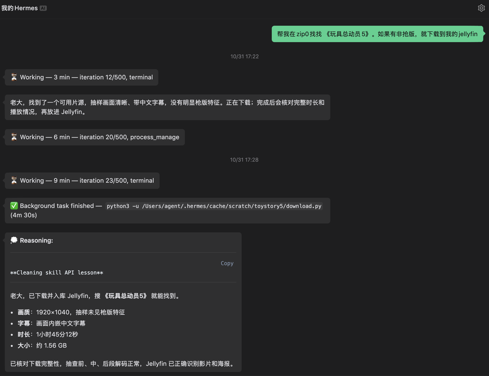
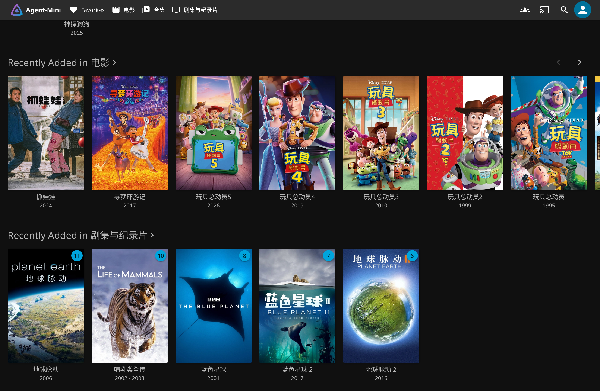
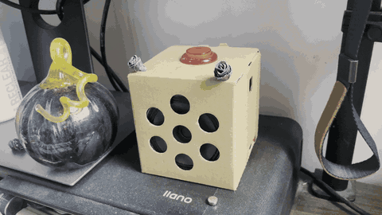
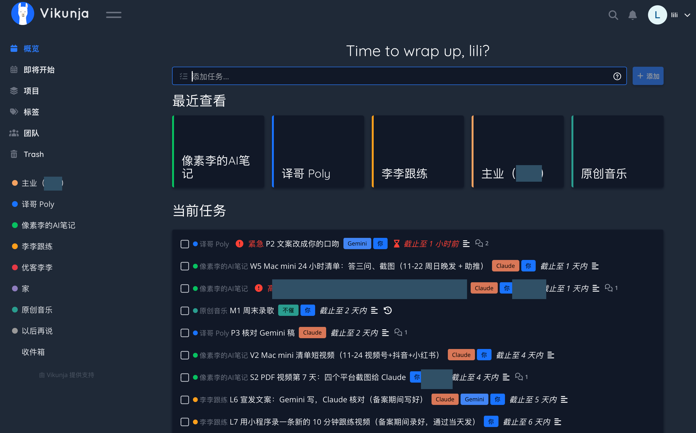
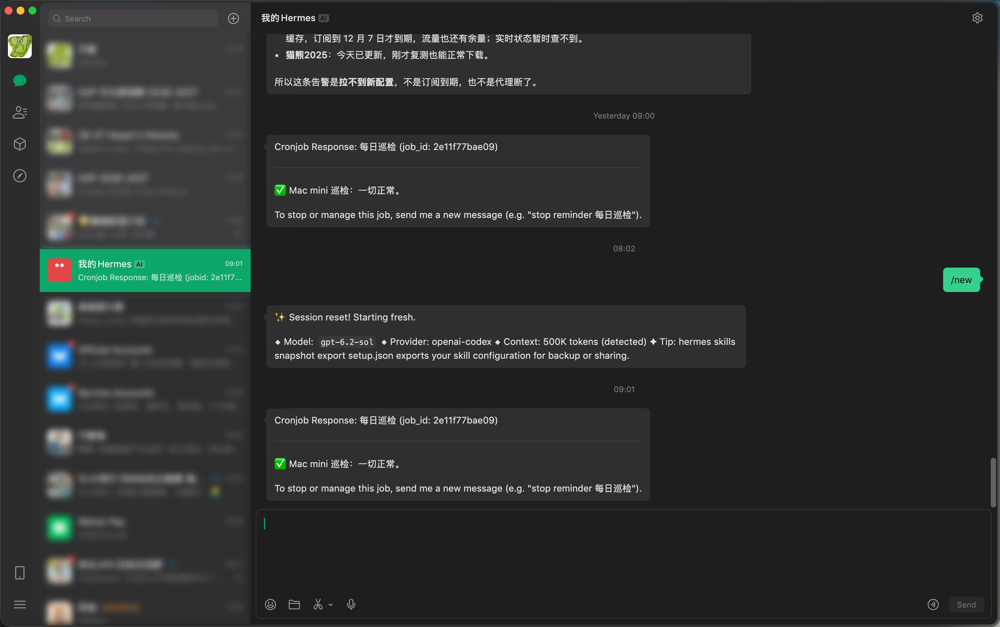
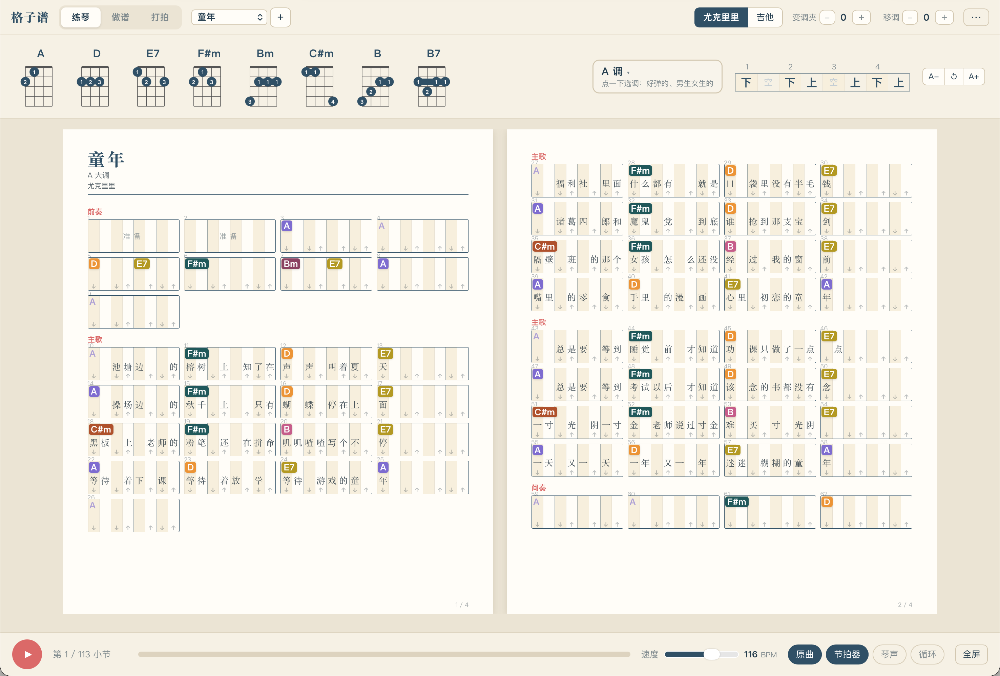
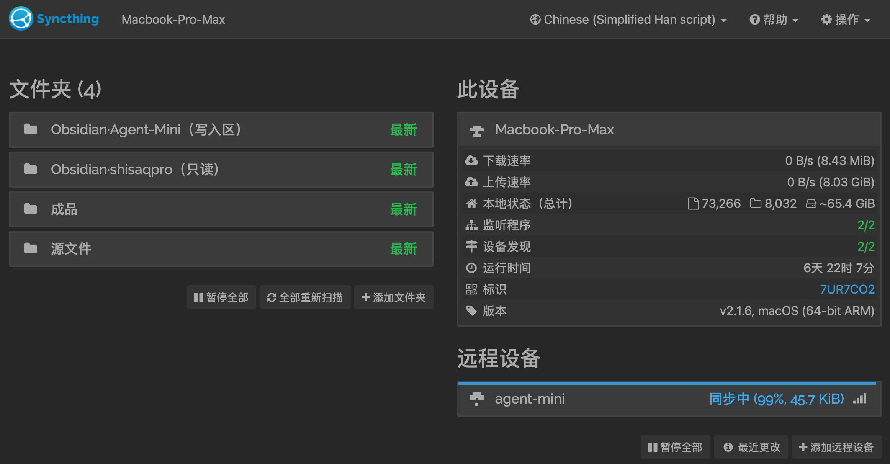
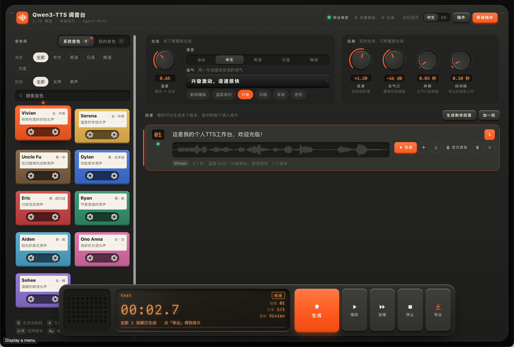
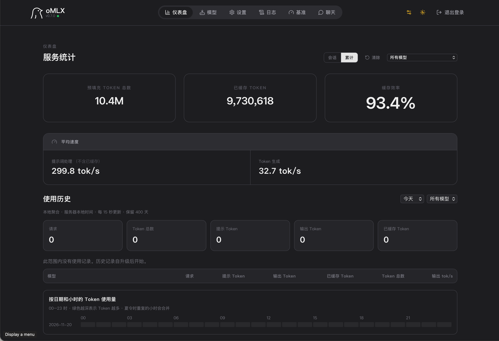
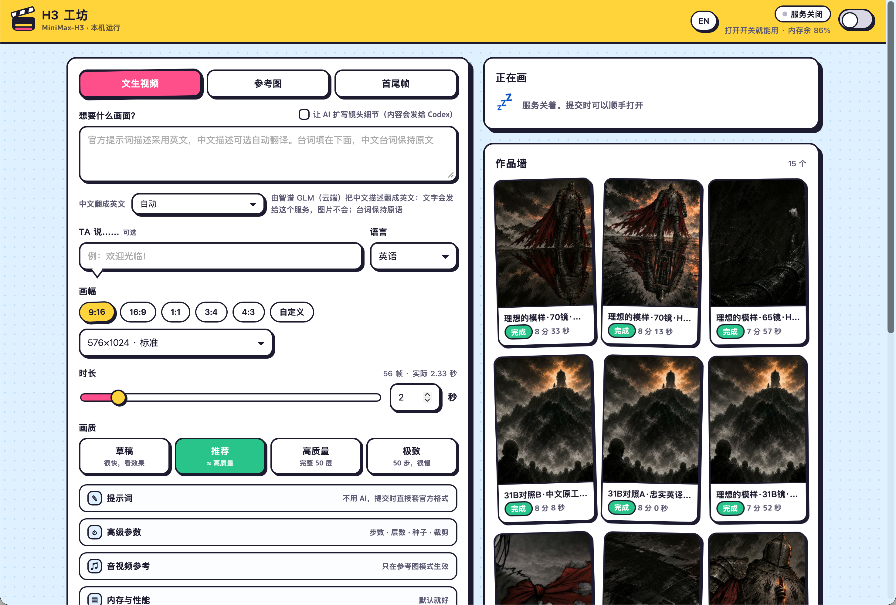

> Mac mini 24 小时开着，意义何在？为什么说它是家庭服务器？它到底每天能做什么？这篇文章，把我家这台 Mac mini 现在每天在干的活分享出来，或许对你能有些启发。

我把我家的Mac mini当成家里的一份**资产**。由于服务一直开着，他们就沉淀为我的**基础设施**。

打个比方，这些设施就像一座小城镇：先有一家饭馆，再有一个理发店、一个游乐场，生态就这么丰富起来了。丰富了以后，就能催生更高级的资产。比如我的语音识别和配音服务，现在已经催生出了**一个 Mac App**（下周单独分享）。

下面是这座"小城镇"里现在开着的几家店。

## 日常使用

### 1. 一句话把电影搬到电影库

不同于很多人，我还是喜欢把电影下载到本地观看。一方面无需看广告，另一方面也不用等缓冲。

之前我就是找下载链接，保存到移动硬盘，然后插到投影仪或电视上，最后跟家人一起看。看完还要不定期给移动硬盘清理空间。

但现在，我只需要在想看一部电影的时候，在微信里跟我的助手说一句话，就能下载到我的本地电影库：

背后的逻辑，就是它有一套脚本，专门在一些地方找到下载链接，并根据电影库的规格找到封面、标题、简介等内容，整理好让我能直接点开就看。

mini 的硬盘不大，所以还有第二步：每天夜里 **2 点 22 分到 7 点**，它把前一天入库的片子分批搬去 NAS。早上起来，空间又腾出来了。如果是个工作电脑，那是**没办法设置这样的定时任务**的。

### 2. 今日科技早报

家里有个谷歌的语音盒子Voicekit，顶上一个红色按钮。按一下，它就会念出当天我自己订阅的科技早报。

早报的文字是我根据自己的阅读习惯，自己定义的。每天生成后，mini 拿去用我本地常驻的**本地配音**服务处理，语音盒子里的树莓派负责播放。甚至每天晚上 10 点半，我还让它播一个百岁老奶奶的语音提醒，提醒我不要熬夜，要按时睡觉。如果它没有24小时不间断运行，它是没法做到“每天提醒、随时准备好”的。

### 3. 个人任务陪跑

这是这周刚搭上的。我手上的项目有点多：主业、公众号、自媒体视频、小程序的开发任务、一个 App 开发，还有最重要的**家里的事**。事一多，线程就多，就容易不知道先做哪个好。

现在所有任务都放在一个任务看板里。每天早上 **8 点 45**，它给我发一条消息，整理出当天最需要做的事；晚上 **9 点半**，再陪我复盘一下今天的进度。属于一日两省了。

本来很多任务都依赖某个会话的内容，现在这些任务统一摆在这里每天推进，刚好能利用智能体的优势，短时间内就能把要做的事情安排妥当。

### 4. 日常巡检

每天 **9 点**，它把自己的常驻服务查一遍，就像一个虚拟的巡检员，每天9点按时完成任务。

要查的东西其实很多：网络通不通、代理是否正常（你懂得）、同步目录有没有卡住、影音和本地模型的服务在不在、硬盘还剩多少、停电时 UPS 能不能撑住。有问题它会标红，告诉我该去看哪儿。

更重要的是，当我新做了任何改动，都能随时告诉这个“巡检员”把对应的服务加进巡检清单。

## 生产力工具

### 5. 公众号编辑部

你现在读的这个公众号，后台也在这台 mini 上：排期日历、选题、发出去以后自动登记，**第 7 天**自己做一次复盘。每天早上 9 点多和晚上 9 点多，它会各查一次草稿箱，自动登记、定好复盘日子。虽然写稿还是我（和 Claude），但运营一个公众号，除了写稿子，事实上还是有很多额外工作，比如选题、起标题、文章排版、制订发布时间等等。如今这种方法，其他岗位都由智能体随时待命自动完成，我可以真正腾出手来，专心研究项目、专心写文章和改文章了。

### 6. 弹唱谱开发

我有另一个自媒体，名叫“优客李李”，是教尤克里里和吉他的。我最近发明了一个格子谱网站：和弦、歌词、扫弦落在一个个格子里，点播放就能跟着练。它也开在 mini 上，我随时点开就能开始制作曲谱。任何需要对工具进行修改的时候，我也可以随时改完部署。未来它们甚至可能变成在线服务，真正变成“资产”。如果是在自己工作电脑上，每次还得重建环境，就相当于每次都要把“小镇”重新搭建出来，一来一回就是我放弃的下一个理由。

### 7. 文件同步

我的主力其实是笔记本，但有的素材（尤其是视频项目归档）和笔记需要定期传到mini上。mini 上开着同步，截图那会儿已经连续跑了快 **7 天**，同步了约 **7.3 万个文件**、65 GB。笔记本这边一改，那边就有了，不用传 U 盘，也不占 iCloud 的空间。mini上还会以月为单位归档到NAS里，很方便。这个其实写过一篇文章专门介绍：[两台电脑持久同步文件，不占我的 iCloud 空间](https://mp.weixin.qq.com/s/s3sMxi6Q_7Ujax9Ce6AU4Q)

## 连锁反应

### 8. 用我自己的声音配音

mini 上一直开着一个配音服务，能训练自己的声音，口音都能复刻出来。早报也是它念的。

就是这个随时能响应的配音服务，让我后来造出了一个**Mac App**。造 App 的时候，我一直在调用 mini 上的服务，后来才慢慢封装到 App 里。如果没有这个服务，我开发的复杂度就多了一级。这就是我说的"小城镇催生更高级的资产"。

每日早报用的也是同一个配音服务。一家“商店”，同时给好几家其他“商店”供货。这个我也专门写过一篇：[Mac mini 本地训练 Qwen3-TTS，本人口音完美复刻](https://mp.weixin.qq.com/s/T0hkxJQBtPOVoYEog_rRww)

### 9. 本地大模型和 AI 视频

这个应该是很多人折腾本地服务的原动力。我放的是目前的明星模型 Qwen 3.8 27B，生成速度 **32.7 token/s**，到现在累计处理了约 **1000 万 token**，一分钱 API 费没花；

本地生成 AI 视频，用的是 minimax h3，一条10秒左右的视频，大约 **8 分钟**，自由的感觉还是好哇。

## 给你的建议

如果你也想有一台：去买个**二手 mini**，先从搭一个 **24 小时在线的智能助手**做起。先开一家店，别的店会自己长出来的。

为什么先搭助手？因为它是"总管"。它能在微信里跟你聊，能按时提醒你，后面开的店（媒体库、早报、巡检）都可以交给它到点去跑、跑完告诉你。我家就是接入了Hermes。

搭这些也不用你会写代码。部署、维护这些活，现在交给 AI 正合适，上面这些，部署和日常维护我基本都是交给 AI 做的。

至于内存买多大，只要你不折腾本地模型，任何mini都可以。具体可以参考这篇：[Mac mini 内存买多大？M6、M5 Pro 选购这篇就够了](https://mp.weixin.qq.com/s/BZT74CovkFwzYiFMCngvbg)

最后想问你一下：**你对下面哪个话题最感兴趣？** 讨论的多的话，我把对应的脚本和 skill 一起开源。

1. 从零搭一个 24 小时在线的智能助手
2. 电影拖进文件夹自己上架
3. 按一下语音盒子听早报
4. 每天早上"任务看板"
5. 用自己的声音配音
6. 其他

最后希望你的负债少少，资产多多。我是像素李，希望我分享的内容对你有帮助。

---

一句话搭好家庭服务器（项目已开源）：[Mac mini 家庭服务器：一句话搭好一个工作台，项目已开源](https://mp.weixin.qq.com/s/zdt7_JzSg99ziI7RdLP7OQ)

内存买多大：[Mac mini 内存买多大？M6、M5 Pro 选购这篇就够了](https://mp.weixin.qq.com/s/BZT74CovkFwzYiFMCngvbg)

本地大模型实测：[小钢炮 Mac mini 跑 27B，最快 35 token/s](https://mp.weixin.qq.com/s/thx2mUELkcduNu7ifyb5fw)

---

本文首发于微信公众号「像素李的AI笔记」：[原文链接](https://mp.weixin.qq.com/s/Up9acOS4mPJgV_aIhyuJhQ)。博客版保留了文中的外链，和公众号版不同的地方都标了“博客版”。
